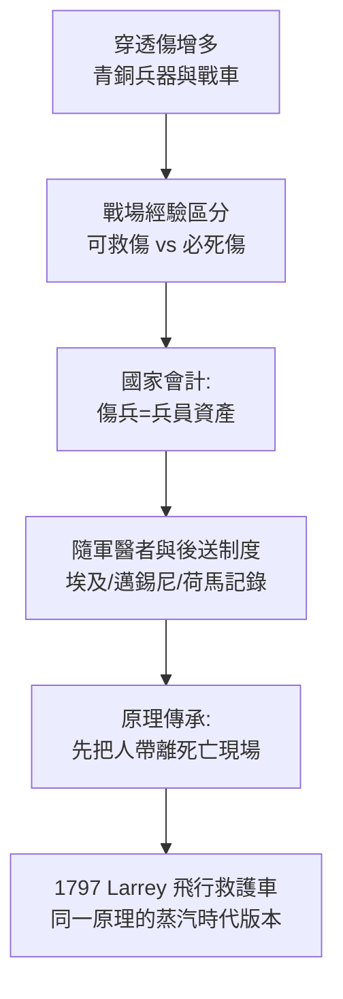

## -1275 - 卡疊石與伊利亞德戰地救護（最早的有組織傷兵後送，出現在青銅時代的戰車旁）

## 案件摘要

**本案偵破的是：在沒有醫學專科、沒有解剖學、甚至沒有止血觀念的年代，「把傷兵快速移離戰場」這件事為什麼會先於其他一切醫療發明出現？**

約前 1275 年的卡疊石戰役（埃及拉美西斯二世 vs 西台帝國）浮雕與文獻顯示，埃及軍隊有隨軍人員照料傷兵並後送；同時代邁錫尼世界的戰車被用於搭載傷患。約前 8 世紀成書的《伊利亞德》則保留了一套完整的戰地醫療「口述檔案」：馬卡翁與波達勒里奧斯兩位隨軍醫者、戰場上拔箭敷藥的標準流程、以及「先後送、再治療」的敘事順序。

## 前因 -- 為什麼會有這個案子

- **青銅時代戰爭的殺傷結構改變了**。戰車、複合弓、青銅矛頭使穿透傷比例上升——可救的傷（四肢穿透傷）與不可救的傷（軀幹深部傷）首次被戰場經驗區分開來。
- **軍隊是國家組織**。傷兵若棄置，部隊士氣與兵員損耗直接可量化——統治者出於會計而非仁慈，最先投資「回收士兵」。
- **神廟醫療與軍事醫療分流**。平民的病歸神廟與薩滿，軍人的傷歸隨軍人員——急診醫學的「事故外傷優先」傳統，源頭就是這條分流線。
- **《伊利亞德》的醫療細節驚人地具體**。拔箭頭、用溫酒與草藥敷料、檢查箭頭是否倒鉤入肉——這些是口述傳統中真實操作經驗的沉澱，而非詩人想像。

## 線索與推理 -- 數學式、程式、理論

為什麼「快」是第一個被發明的醫療原則？因為穿透傷死亡率的時間結構呈兩段式：立即死亡組（軀幹大血管、心臟）任何時代都救不了；可救組的死亡風險隨時間遞增。救護的價值集中在第二組：

$$ P_{\text{死亡}}(t) = P_{\text{立即}} + P_{\text{可救}} \times (1 - e^{-\lambda t}) $$

$$ \lambda = \text{出血與感染的危險率}，\quad \text{移動時間 } t \downarrow \Rightarrow P_{\text{可救死亡}} \downarrow $$

```python
import math
# 青銅時代戰場的簡化模型
def death_prob(t_move, lam=0.05):
    P_immediate, P_salvageable = 0.35, 0.25
    return P_immediate + P_salvageable * (1 - math.exp(-lam * t_move))

for label, hours in [("當場抬離(1h)", 1), ("戰鬥結束後(6h)", 6), ("棄置過夜(18h)", 18)]:
    print(f"{label}: 可救組死亡率 ≈ {death_prob(hours)*100:.0f}%")
# 當場抬離(1h): 可救組死亡率 ≈ 36%
# 戰鬥結束後(6h): 可救組死亡率 ≈ 44%
# 棄置過夜(18h): 可救組死亡率 ≈ 58%
```



《伊利亞德》第 11 卷的順序本身就是一份檢傷記錄：馬卡翁先被接走（因為醫者是不可替代資源）、受傷的國王由戰車後送、歐里皮洛斯則原地敷藥。**先救系統、再救個體**——這個現代災難醫學的原則，在史詩裡已經運作。

## 結案 -- 後果與影響

- **羅馬的軍醫體系（見 `-0102-羅馬軍團軍醫與傷兵醫院.md`）直接繼承這條線**：隨軍 medicus、傷兵後送車、valetudinarium 軍醫院。
- **「先後送、後治療」成為兩千五百年的不變原理**：Larrey 的飛行救護車（`1797-Larrey飛行救護車.md`）、Letterman 系統、直昇機後送，全是同一句話的時代方言。
- **戰地救護與神廟醫療的分道**：急診醫學的「身體先於儀式」傳統（止血優於禱告）確立於戰場，而非神殿。
- **文獻價值的警惕**：《伊利亞德》是口述詩歌，成書晚於所描寫時代數百年，只能當「青銅時代晚期至早期鐵器時代戰地醫療實踐的複合檔案」，不能當年表史實。
- **一句話結案**：人類學會的第一個急診原則不是任何治療，而是「距離殺人」——把傷者與死亡現場之間的時間壓縮，就是急診醫學的原點。

## 關鍵人物與文獻

- 拉美西斯二世（約前 1303–前 1213）——卡疊石戰役的埃及法老，其紀念浮雕保存了隨軍醫療的圖像證據。
- 荷馬（約前 8 世紀）——《伊利亞德》保留戰地醫療敘事，隨軍醫者馬卡翁（Machaon）與波達勒里奧斯（Podalirius）成為西方醫學守護神話之一。
- 馬卡翁——史詩中的戰地外科原型：拔箭、敷藥、後送優先於解釋病理。
- 現代考證：Majno《The Healing Hand》（1975）對古代戰傷醫療的經典重建。
