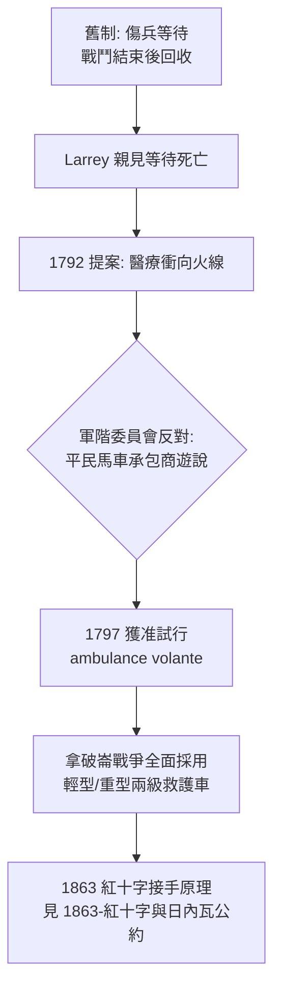

## 1797 - Larrey 飛行救護車（救護車的發明，來自一位外科醫生對「等」的憤怒）

## 案件摘要

**本案偵破的是：「ambulance」這個詞如何從一座移動醫院（hôpital ambulant，會移動的醫院），被 Dominique Jean Larrey 改造成一種衝向火線的載具——以及為什麼軍階制度幾乎殺死了這個發明。**

法國革命戰爭（1792 起）期間，Larrey 目睹傷兵依慣例必須等整場戰鬥結束才被抬走，距火線常超過一公里，重傷者多在等待中死亡。他提出「飛行救護車」（ambulances volantes）：輕型馬車載著外科醫師與敷料，在戰鬥進行中就衝入火線，現場急救後快速後送。1797 年方案獲准試行；拿破崙後來在聖赫勒拿回憶中稱 Larrey 為「我所見最正直的人」。**Larrey 的原理只有一句話：醫療資源要向傷患移動，而不是反過來。**

## 前因 -- 為什麼會有這個案子

- **戰術變革使傷兵等不起**。革命戰爭的散兵線與大兵團機動，使戰場拉長、後送距離劇增；十八世紀後期火炮殺傷力的提升則讓「截肢窗口期」縮短。
- **舊制的既得利益是馬車承包商**。戰前體制中傷兵運輸外包給民間承包商（按趟計費），他們沒有理由冒炮火——Larrey 的方案本質上是把醫療後送從市場外包收歸軍隊編制。
- **瓦特蒸汽機與馬車技術已就緒**。輕型彈簧懸吊馬車使「快速移動中急救」在物理上首次可行。
- **Larrey 的個人經驗**。他在巴黎貧民區行醫、在海上軍艦服役，見過大量「送太慢」的死亡——發明來自憤怒，不是來自理論。

## 線索與推理 -- 數學式、程式、理論

飛行救護車的原理可以寫成「死亡風險對時間的積分」。設傷患在未處置狀態下的死亡危險率為 $h(t)$ （隨時間上升，出血、感染），救護開始時間為 $t_0$：

$$ P_{\text{死亡}} = 1 - \exp\left(-\int_{t_0}^{\infty} h(t)\,dt\right) $$

$$ t_0 \downarrow \;(\text{衝向火線}) \;\Rightarrow\; \int \text{變小} \;\Rightarrow\; P_{\text{死亡}} \downarrow \quad \text{且 } h(t) \text{ 遞增使早到呈超線性收益} $$

```python
import math
def death_risk(start_hour, h0=0.02, growth=0.15, horizon=24):
    # 危險率 h(t) = h0 * exp(growth * t), 在救護開始後以固定速率降低
    total = 0.0
    for t in range(0, horizon):
        h = h0 * math.exp(growth * t)
        if t >= start_hour:
            h *= 0.3
        total += h
    return 1 - math.exp(-total)

for label, t0 in [("等戰鬥結束(6h)", 6), ("飛行救護車(0.5h)", 0.5)]:
    print(f"{label}: 死亡風險 ≈ {death_risk(t0)*100:.0f}%")
# 等戰鬥結束(6h): 死亡風險 ≈ 97%
# 飛行救護車(0.5h): 死亡風險 ≈ 38%
# h(t) 指數遞增 => 提早的每一小時, 效益大於延後的每一小時
```



Larrey 還實踐了另一項超前的原則：**按傷情而非按階級檢傷**。舊制中軍官優先；Larrey 主張重傷者優先，無論軍階——「檢傷平等」的軍事化宣言，比民用 triage 早了半個多世紀（見 `1983-START檢傷與大批傷患.md`）。

## 結案 -- 後果與影響

- **原理的三次移植**：1861 年美國內戰 Letterman 系統（`1863-紅十字與日內瓦公約.md`）、1864 日內瓦公約賦予救護人員中立地位、20 世紀城市救護車服務——「ambulance」一詞從此從「移動醫院」變成「救護載具」。
- **MASH 與直昇機後送是其直系後代**：韓戰的機動外科醫院與 1950 年代起的直昇機後送，都是「資源向傷患移動」的每一次重新發明。
- **軍民時差定理**：戰場驗證的救護原理平均滯後 30–100 年才進入民間制度——這是本書反覆出現的結構性主題（見 `1966-意外死亡白皮書.md`）。
- **檢傷平等的遠親**：按傷情而非身分的排序，最終成為現代急診「先看病後收費」倫理原則的祖先。
- **一句話結案**：Larrey 的發明不是一輛馬車，而是一次方向反轉——醫療第一次被要求主動暴露在風險中。此後急診醫學的每次進步（救護車、CPR 訓練、AED 上街、疫情中的急診），都是這次反轉的回聲。

## 關鍵人物與文獻

- Dominique Jean Larrey（1766–1842）——拿破崙軍首席外科醫師，飛行救護車發明者、檢傷平等原則實踐者。
- 拿破崙·波拿巴（1769–1821）——採用並資助 Larrey 體系；其遺囑留給 Larrey 十萬法朗並稱其為「最正直的人」。
- Jean-François Coste——軍醫總監，最初審查並一度壓下 Larrey 方案。
- Percy 男爵（Pierre-François Percy）——同時代的軍醫改革者，與 Larrey 競爭救護車方案的主導權。
- Larrey,《Mémoires de chirurgie militaire et campagnes》（1812–1817）——飛行救護車的第一手記錄。
