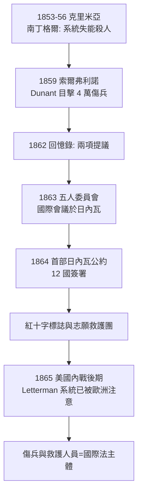

## 1863 - 紅十字與日內瓦公約（戰場救護拿到第一張國際法身分證）

## 案件摘要

**本案偵破的是：一場小小的義大利戰役（1859 索爾弗利諾），如何透過一位瑞士商人的憤怒與一份自費出版的小冊子，讓「照顧傷兵」從各國內政變成國際法義務——並把 Larrey 的軍事發明升級為跨國制度。**

1859 年 6 月，瑞士商人 Henry Dunant 路過索爾弗利諾戰場，目睹約 4 萬傷兵在缺乏組織的照顧下掙扎。他自費出版《索爾弗利諾回憶錄》（1862），提出兩項建議：各國成立志願救護團體、以條約保護戰地傷兵與救護人員。1863 年，「五人委員會」（紅十字前身）召集國際會議；1864 年 8 月，12 國簽署首部《日內瓦公約》，確立傷兵中立救護與紅十字標誌。**戰場救護從此有了不可攻擊的法律身分。**

## 前因 -- 為什麼會有這個案子

- **克里米亞戰爭（1853–1856）先鋪了路**。南丁格爾用死亡率統計（她發明的極區圖）證明多數士兵死於可預防的環境因素而非彈傷——「管理失能殺人」第一次被量化。但克里米亞的教訓仍限於國內。
- **民族國家戰爭的規模爆炸**。鐵路使兵力集結速度倍增，克里米亞與 1866、1870 年戰爭的傷亡量級超出任何一國的醫療容量。
- **Dunant 的關鍵身分是「中立國商人」**。他不是軍醫、不是外交官——正因無所屬，他能同時向交戰各方說話，把救護定義為「超國家的公共財」。
- **國際法工具已成熟**。1856 年《巴黎宣言》等海戰條約證明「用條約限制戰爭行為」在政治上可行——日內瓦公約是把這套工具第一次用在醫療上。

## 線索與推理 -- 數學式、程式、理論

南丁格爾的統計是本案的方法論偵探。她證明：戰爭的「醫療死亡」主要不是敵人造成，而是系統延誤造成。用現代語言重寫她的數據：

$$ \text{總死亡} = \text{陣亡} + \text{傷死（可避免部分）} + \text{病死（可避免部分）} $$

克里米亞戰爭英軍：陣亡約佔總死亡的一成以下；傷病死亡佔絕大多數。南丁格爾在 Scutari 醫院把死亡率從約 42% 壓到約 2%——用的不是藥，是洗手、通風、給養與後送流程。

```python
# 南丁格爾式比較: 系統干預前後的月死亡率
before = {"呼吸疾病": 0.27, "傷口感染": 0.09, "腹瀉": 0.06, "其他": 0.05}
after  = {"呼吸疾病": 0.03, "傷口感染": 0.01, "腹瀉": 0.02, "其他": 0.01}
tb = sum(before.values()); ta = sum(after.values())
print(f"干預前月死亡率 {tb*100:.0f}% -> 干預後 {ta*100:.0f}%")
# 干預前月死亡率 47% -> 干預後 7%
# 殺人兇手不是子彈, 是沒有洗手與沒有後送的系統
```



**Letterman 系統是同時期最重要的平行發明**。1862 年安提坦戰役後，聯邦軍醫總監 Jonathan Letterman 建立三級檢傷後送：火線急救站 → 師野戰醫院 → 後方總醫院，並配備專屬救護馬車隊。葛底斯堡戰役（1863）中，逾 2 萬傷兵在數日內被系統化處理——這是 Larrey 原理加上工業化管理的完整版，也成為日內瓦公約體系在實務上的樣板。

## 結案 -- 後果與影響

- **醫療中立的法理誕生**。救護人員、醫院、救護車成為不可攻擊目標——這是急診醫學「不問立場只問傷情」倫理的國際法基礎。
- **紅十字成為全球第一個跨國緊急醫療網**。此後每次戰爭與災難，紅十字都是檢傷與救護的預設組織架構（見 `2001-九一一與災難醫學體系.md`）。
- **公約的擴充成為常態**：1906 修訂、1929 戰俘公約、1949 四公約——「戰爭中的醫療」逐步被編成法典。
- **軍民時差的縮短開始**。紅十字的志願救護模式被城市借用：各國的民間救護車服務（如聖約翰救傷隊，見 `1867-聖約翰救傷隊與急救手冊.md`）直接在紅十字運動的蔭蔽下成長。
- **一句話結案**：日內瓦公約真正的發明不是條約，而是一個概念——「照顧傷者」可以凌駕於敵我之分。這個概念後來被搬進每一間急診室的分診台。

## 關鍵人物與文獻

- Henry Dunant（1828–1910）——《索爾弗利諾回憶錄》作者、紅十字創始人，1901 年首屆諾貝爾和平獎得主。
- Gustave Moynier（1826–1910）——五人委員會實際組織者，國際委員會掌舵四十年。
- Florence Nightingale（1820–1910）——克里米亞的統計革命，證明「系統殺人」可被數字揭露。
- Jonathan Letterman（1824–1872）——聯邦軍醫總監，「現代戰場醫療後送之父」。
- Dunant,《Un Souvenir de Solferino》（1862）；1864 年 8 月 22 日《改善戰地陸軍傷兵境遇之日內瓦公約》原文。
