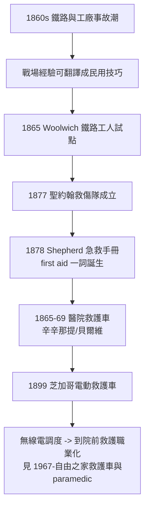

## 1867 - 聖約翰救傷隊與急救手冊（「急救」被發明成一門平民可以背誦的技藝）

## 案件摘要

**本案偵破的是：「first aid／急救」這個詞是誰發明的？為什麼戰場救護成熟之後，還要再等十年，才出現一個教平民救人的組織？**

1865 年，倫敦鐵路事故頻傳，聖約翰救護機構開始在倫敦郊區（如 Woolwich 鐵路工區）訓練工人急救；1877 年聖約翰救傷隊（St John Ambulance Association）正式成立，開設平民急救課程。1878 年，蘇格蘭外科醫師 John Furley（化名 Peter Shepherd）出版《First Aid to the Injured》——**「急救」一詞自此誕生**。同時期，1865 年辛辛那提商業醫院啟用附醫師的醫院救護車，1869 年紐約貝爾維醫院跟進——戰場救護原理正式移植進城市。

## 前因 -- 為什麼會有這個案子

- **工業化城市製造了新的傷亡**。鐵路（軋傷、碰撞）、工廠（機器擠壓）、碼頭（墜落）——事故傷害第一次成為城市常態，而醫院都在半小時車程之外。
- **戰場救護已證明「外行也能救命」**。美國內戰中擔架兵的簡單處置明顯降低死亡；這個經驗尚未被翻譯成民用語言。
- **聖約翰機構的十字架動機**。中世紀聖約翰騎士團的濟傷傳統，在維多利亞時代被重新點燃——宗教慈善提供了組織骨架與志工動員力。
- **鐵路公司的自保經濟學**。鐵路公司資助急救訓練，因為工傷賠償與服務中斷都是成本——企業風險管理成為急救普及的第一個出資人。

## 線索與推理 -- 數學式、程式、理論

急救的發明本質上是一次「醫學知識的壓縮編碼」：把數年的外科訓練壓縮成平民可在數小時內記住的最小行動集。用資訊量語言描述：

$$ \text{急救知識集} = \operatorname*{arg\,min}_{S \subset \text{醫學}} \left\{ |S| : \text{期望救命效益}(S) \geq \text{門檻} \right\} $$

Shepherd 手冊的取捨極其明確：**包含**止血（直接壓迫）、固定（夾板）、復甦體位、搬運；**排除**一切診斷與用藥。因為平民的錯誤操作風險在「做太多」而非「做太少」：

```python
def expected_value(actions, benefit, harm_rate):
    return sum(benefit[a] - harm_rate[a] for a in actions)

benefit  = {"壓迫止血": 3.0, "夾板固定": 1.5, "復甦體位": 1.0, "給藥": 0.8}
harm     = {"壓迫止血": 0.1, "夾板固定": 0.2, "復甦體位": 0.1, "給藥": 2.0}
core  = ["壓迫止血", "夾板固定", "復甦體位"]
core_plus_drug = core + ["給藥"]
print(f"核心三招淨值: {expected_value(core, benefit, harm):.1f}")
print(f"加上給藥淨值: {expected_value(core_plus_drug, benefit, harm):.1f}")
# 核心三招淨值: 5.1
# 加上給藥淨值: 3.9  <- 外行給藥是淨傷害, 所以被手冊排除
```



醫院救護車的同步出現同樣關鍵：辛辛那提（1865）與貝爾維（1869）的救護車上配醫師、酒精、止血帶，把「急診」的概念提前到院前——病人還沒到醫院，醫院已經開始診療。這條線在無線電（1900s）與汽車化之後，最終長成 EMS 系統（見 `1966-意外死亡白皮書.md`）。

## 結案 -- 後果與影響

- **急救成為公民技能**。1890s 起各國童軍、學校、工廠納入急救課程；今天的心肺復甦普及教育（見 `1960-現代CPR誕生.md`）是同一運動的百年續章。
- **醫院救護車模式擴散**。貝爾維模式被全球城市抄襲——但也埋下隱患：許多城市的救護車長期停留在「運輸工具」層級，直到 1966 白皮書（`1966-意外死亡白皮書.md`）才被批為「屠宰場」。
- **志願救傷隊成為災難動員的預備隊**。兩次大戰中聖約翰志工的表現，驗證了「平民急救能力是國家韌性的一部分」（見 `2001-九一一與災難醫學體系.md`）。
- **一句話結案**：急救的發明是一場簡化的勝利——醫學界第一次承認，把少數幾招教給非專業者，救的人比壟斷知識更多。

## 關鍵人物與文獻

- Peter Shepherd（John Furley，1837–1919）——《First Aid to the Injured》（1878）作者，聖約翰救傷隊醫學核心。
- Rowland Hill 爵士——郵政總監與聖約翰救護機構推手，促成鐵路工人試點訓練。
- Francis Laking——聖約翰救傷隊首席外科，整理課綱與手冊再版。
- 貝爾維醫院（紐約，1869）——美國醫院救護車服務的標竿，Edward Dalton 建立附醫師救護車制度。
- Shepherd,《First Aid to the Injured》（1878）；聖約翰救傷隊早期課程紀錄（1867–1882）。
