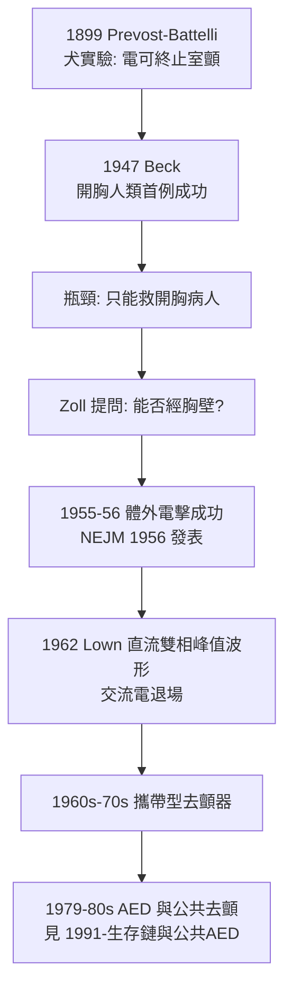

## 1955 - Zoll 體外電擊去顫器（用電重新啟動心臟：從開胸電極到病床邊的電擊板）

## 案件摘要

**本案偵破的是：「電可以救心」這個如今人人皆知的常識，為什麼花了半個世紀才從實驗室走到病床邊——以及為什麼關鍵突破發生在哈佛一位心臟科醫師的堅持上。**

1947 年，Claude Beck 在凱斯西儲大學對一位開胸手術中的 14 歲病人進行史上第一次人類心室顫動電擊去顫成功——但那需要開胸、直接把電極貼在心臟上。1955–1956 年，哈佛的 Paul Zoll 以體外（經胸壁）電擊成功終止多位病人的心室顫動與心搏停止，並發表於《新英格蘭醫學雜誌》（1956）。**去顫器從手術室走進病房，再到救護車與街頭，成為生存鏈中最關鍵的一環。**

## 前因 -- 為什麼會有這個案子

- **電的生理學早已就緒**。1899 年 Prevost 與 Battelli 已在犬身上證明交流電可終止室顫——「去顫」的原理比臨床應用早了半世紀。
- **開胸路線的瓶頸**。Beck 的成功只適用於已開胸的病人；冠狀動脈疾病病人猝死於病房與街頭，開胸去顫鞭長莫及。
- **Zoll 的臨床觀察**。他在冠心症病房反覆目睹猝死，並注意到少數病人在胸部捶擊或電流意外後恢復心律——「跨過皮膚需要多大能量？」成為他的核心問題。
- **高壓電技術可借自工業**。心導管實驗室的電容器放電與工業高壓技術的結合，使「足夠能量穿透胸壁、又不灼傷」成為工程問題而非生理問題。

## 線索與推理 -- 數學式、程式、理論

經胸壁去顫的電學問題可以用阻抗模型描述。胸壁—肺—心臟構成串聯阻抗，體表電極需提供足夠的心臟電流密度 $J_{\text{心}}$ ：

$$ I_{\text{心}} = \frac{V}{Z_{\text{胸壁}} + Z_{\text{肺}} + Z_{\text{心}}}, \quad Z_{\text{總}} \approx 50\text{–}100\,\Omega $$

$$ J_{\text{心}} \geq J_{\text{去顫閾值}} \approx 20\text{–}50\,\text{mA/cm}^2 \quad \Rightarrow \quad V \approx \text{數百至數千伏特} $$

```python
def cardiac_current(v, z_chest=45, z_lung=30, z_heart=15):
    return v / (z_chest + z_lung + z_heart)

for v in [100, 500, 1500]:
    print(f"電壓 {v}V -> 心臟電流 ≈ {cardiac_current(v)*1000:.0f} mA")
# 電壓 100V -> 心臟電流 ≈ 1111 mA (以上為模型示意, 實際去顫需要特定波形)
# 關鍵不是電壓大小, 而是心臟局部電流密度是否超過去顫閾值
```



Zoll 的臨床試驗紀錄本身就是證物：1955 年起，他對心搏停止與室顫病人施以體外電擊，數例長期存活——包括一位後來出院返家、存活多年的病人。這證明了**去顫不是權宜急救，而是可痊癒事件的確定性治療**。

## 結案 -- 後果與影響

- **「猝死是可逆的」成為公共衛生前提**。若猝死只是死亡，就不需要救護車上有去顫器；Zoll 之後，猝死被重新定義為「時間敏感的可治療事件」（見 `1991-生存鏈與公共AED.md`）。
- **波形演進**：交流電 → Lown 直流單相（1962）→ 雙相波形（1990s，能量減半、成功率更高）——工程持續降低電擊的代價。
- **去顫器上救護車**。1960s 末起，攜帶型去顫器與 paramedic 結合（`1967-自由之家救護車與paramedic.md`）；1980s 的 AED 使非醫療人員也能電擊（`1991-生存鏈與公共AED.md`）。
- **冠心病照護鏈的起點**。去顫＋CCU（冠心病加護病房，1962 起）＋溶栓（`1986-GISSI與心梗溶栓革命.md`）構成「time is muscle」照護鏈的三根支柱。
- **一句話結案**：Zoll 的突破本質是把去顫從「外科的特權」變成「電學的例行公事」——醫學史反覆證明，當一項救命技術被工程化、可攜帶化，它的受益人口才會爆炸。

## 關鍵人物與文獻

- Paul Zoll（1911–1999）——哈佛與貝斯以色列醫院心臟科醫師，體外去顫與體外心律調節（1952）的先驅。
- Claude Beck（1894–1971）——1947 年人類首次開胸去顫成功的外科醫師；他還推行醫院 CPR 訓練。
- Bernard Lown（1921–2021）——直流單相去顫波形設計者，亦為反核醫師運動創始人（1985 諾貝爾和平獎）。
- Zoll et al., "Termination of Ventricular Fibrillation in Man by Externally Applied Electric Countershock," *NEJM* 1956.
