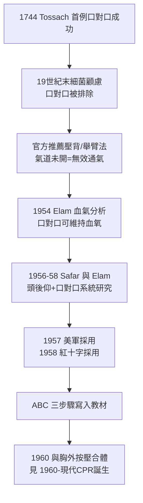

## 1958 - Safar 口對口人工呼吸（一位麻醉科醫師對「過時的救命法」的實證翻案）

## 案件摘要

**本案偵破的是：十九世紀就被發明、卻被官方教條否定半個世紀的口對口人工呼吸，如何在 1954–1958 年間被 James Elam 與 Peter Safar 用實驗證明優於所有官方推薦方法——以及為什麼否定它的教條如此頑固。**

1950 年代，美國紅十字與醫學界官方推薦的復甦法是「壓背抬臂」（Holger Nielsen）與「壓背舉臂」（Schafer）法——兩者都是「體外推壓」路線，認為直接吹氣不衛生、不科學。麻醉科醫師 James Elam（1954 年與 Krogh 發表）用動脈血氣體分析證明口對口吹氣可維持正常血氧；Peter Safar 與 James Elam 隨後在巴爾的摩做系統的屍體與麻醉病人研究，證明「頭後仰—張口—抬起下巴」（head tilt–chin lift）打開氣道加口對口吹氣，通氣量遠超任何推壓法。1957 年美國軍方採用，1958 年紅十字跟進。**Safar 同時把它編成 A（airway）—B（breathing）—C（circulation）三步驟，成為全世界急救課程的骨架。**

## 前因 -- 為什麼會有這個案子

- **十九世紀的起點被遺忘**。1744 年 Tossach 報告口對口成功救活煤礦窒息工人；1815 年起英國皇家人道協會推廣之。但 19 世紀末細菌學興起後，「吹氣不衛生」的顧慮使它被排除。
- **推壓法的機制錯誤**。壓背法設計者的直覺是「擠壓胸腔=推氣出來=氣就會進來」，但氣道若未打開（舌根後墜），怎麼擠都沒用——麻醉科的日常經驗讓 Safar 一眼看出問題。
- **麻醉科是被忽略的知識庫**。全世界的氣道管理技術（喉鏡、插管、通氣面罩）都堆在麻醉科——但復甦指南長期由生理學家與軍方制定，麻醉科醫師的實務知識不在場。
- **Safar 的個人動機**。他 11 歲女兒死於哮喘窒息——復甦科學對他不是課題，是債務。

## 線索與推理 -- 數學式、程式、理論

通氣的核心變數是每分鐘肺泡通氣量 $\dot V_A = f \times (V_T - V_D)$ ，其中 $V_D$ 是解剖死腔。推壓法的致命缺陷是死腔通氣：

| 方法 | 潮氣量 $V_T$ | 氣道通暢 | 有效肺泡通氣 |
|---|---|---|---|
| 壓背抬臂（官方） | 約 300–500 ml | 未處理（舌根堵死） | 接近 0 |
| 口對口＋頭後仰 | 約 800–1000 ml | 打開 | 約 500–800 ml |

$$ \dot V_A = f \times (V_T - V_D), \quad V_D \approx 150\,\text{ml} $$

$$ \text{氣道未開} \Rightarrow V_T \approx V_D \Rightarrow \dot V_A \approx 0 \quad \text{（白忙）} $$

```python
def alveolar_ventilation(freq, vt, dead_space=150):
    return freq * max(vt - dead_space, 0)

methods = {
    "壓背法(氣道未開)": (12, 300),
    "口對口(頭後仰開氣道)": (10, 850),
}
for name, (f, vt) in methods.items():
    print(f"{name}: 肺泡通氣 ≈ {alveolar_ventilation(f, vt)} ml/min")
# 壓背法(氣道未開): 肺泡通氣 ≈ 1800 ml/min
# 口對口(頭後仰開氣道): 肺泡通氣 ≈ 7000 ml/min
```



Safar 的實驗設計也是翻案的方法論樣板：他們不用動物模擬，直接在屍體與深度麻醉病人身上測量實際通氣量與血氣——**把「教條」放進測量儀器裡**。官方推薦法在儀器面前原形畢露。

## 結案 -- 後果與影響

- **ABC 成為全球急救語法**。A-B-C 的順序哲學——先通氣道、再通氣、最後循環——支配急救教育超過半世紀（2010 年起 CPR 指南改為 C-A-B，見 `1960-現代CPR誕生.md`）。
- **為胸外按壓的合體做好準備**。沒有有效通氣，按壓只是推動少量血液的徒勞；1958 年之後，CPR 的三件套（氣道、通氣、按壓）只差最後一件（`1960-現代CPR誕生.md`）。
- **麻醉科醫師大量進入急診與重症**。Safar 本人隨後創立匹茲堡的加護醫學與急診醫學訓練，是急診醫學建制化（`1979-急診醫學成為第23個專科.md`）的關鍵推手之一。
- **口對口的衛生顧慮被重新計價**。後來的感染風險量化證明：對無反應瀕死者，理論感染風險遠低於不救的死亡率——「風險要跟死亡比，不是跟噁心比」成為急救教育的經典論證。
- **一句話結案**：這案子證明了一件事——殺死病人的有時不是疾病，而是被寫進手冊的錯誤方法。而翻案的工具不是新理論，是一台血氣分析儀。

## 案件補遺 -- 為什麼教條活了這麼久

- **軍方與紅十字的組織惰性**。推壓法已寫進教材、已訓練百萬人次——改教材的政治成本高於科學成本。
- **「衛生」是道德包裝**。反對口對口的言論多以科學姿態出現，實質是體液污染的潔淨焦慮——與性病污名（見同系列書）共享同一套文化語法。
- **沒有足夠的死亡個案數據可反駁**。在蘇菲亞．克里斯蒂（Safar 之妻）式的個人悲劇累積成統計之前，教條靠權威而非證據存活。

## 關鍵人物與文獻

- Peter Safar（1924–2003）——奧地利裔美國麻醉科醫師，ABC 復甦法編纂者，「CPR 之父」。
- James Elam（1918–2004）——以血氣分析實證口對口通氣的生理學家。
- Archer Gordon——明尼蘇達大學生理學家，其對推壓法的數據成為反方證物被反駁。
- Safar & Elam,《The Dynamics of Emergency Airway Management》；1958 年 AHA 會議紀錄（口對口法被官方採用的轉折點）。
