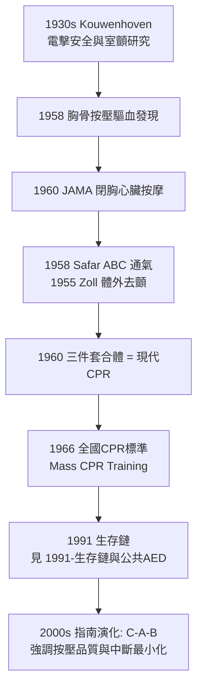

## 1960 - 現代 CPR 誕生（三項孤立的發明，在同一頁上被合體）

## 案件摘要

**本案偵破的是：胸外心臟按壓為什麼遲至 1958–1960 年才被發明？明明腹部按壓可驅血、心包按壓可維持血壓都是舊知識——答案是一系列幸運的工程事故，加上一個恰好把三塊拼圖放在一起的團隊。**

約翰霍普金斯大學的 William Kouwenhoven 是電氣工程師出身：他在 1930 年代研究電擊安全時，發現電流意外可引發室顫、也可能終止室顫。1958 年，他的團隊（外科醫師 James Jude、學生 G. Guy Knickerbocker）在犬實驗中發現：**以重物按壓胸骨，動脈壓可觸及搏動**——原來胸廓是一台泵，按壓胸骨可驅動全身循環。1960 年，Kouwenhoven、Jude、Knickerbocker 發表《閉胸心臟按摩》（JAMA）；同年，Safar 的口對口通氣（`1958-Safar口對口人工呼吸.md`）與 Zoll 的體外去顫（`1955-Zoll體外電擊去顫器.md`）同時就位——**現代 CPR（胸外按壓＋人工通氣＋去顫）三件套合體**。1966 年國家科學院會議制定第一份全國 CPR 標準。

## 前因 -- 為什麼會有這個案子

- **十九世紀的教條：按壓肋骨=弄斷肋骨**。閉胸按壓的概念被外科界視為野蠻——開胸心臟按摩（Boehm 1878、Iglesias 等）才是「正統」。
- **電氣工業的安全研究意外成為搖籃**。愛迪生與電力公司資助「電擊與猝死」研究，Kouwenhoven 的實驗室由此獲得設備與犬隻——復甦科學的資金來源是電力公司怕被告。
- **腹部按壓驅血曾被發現卻沒人接上**。1900 年前後已有按壓腹部維持血壓的報告，但沒人問「那胸骨呢？」
- **三個職業剛好同框**：工程師（懂電與測量）、外科醫師（懂心臟）、麻醉知識（懂通氣）——CPR 是跨領域巧合的產物，不是單一天才的直覺。

## 線索與推理 -- 數學式、程式、理論

胸外按壓的生理學是「胸廓泵」模型：按壓胸骨使胸腔內壓與心臟直接受壓共同驅血。血流取決於按壓頻率、深度與中斷次數：

$$ \text{冠狀動脈灌流壓} = \text{主動脈舒張壓} - \text{右心房壓} \quad (\text{目標} > 15\,\text{mmHg}) $$

$$ \text{存活率} \propto (\text{按壓頻率} \geq 100/\text{分}) \times (\text{深度} \geq 5\,\text{cm}) \times (1 - \text{中斷比例}) $$

```python
def survival_proxy(rate, depth_cm, interruption_frac):
    quality = min(rate/100, 1.2) * min(depth_cm/5, 1.2) * (1 - interruption_frac)
    return quality

print(f"標準按壓:   {survival_proxy(110, 5.2, 0.10):.2f}")
print(f"頻率不足:   {survival_proxy(70, 5.2, 0.10):.2f}")
print(f"頻繁中斷:   {survival_proxy(110, 5.2, 0.45):.2f}")
# 標準按壓:   1.04
# 頻率不足:   0.66
# 頻繁中斷:   0.63  <- 中斷是按壓品質最大的殺手
```



1966 年國家科學院—國家研究委員會的 CPR 標準會議是制度化的轉折：第一份全國課綱、訓練人偶（Resusci-Anne 早在 1960 由 Laerdal 量產）與醫護/消防/大眾的分級訓練。**CPR 從醫學技術變成公民技能**，全球數億人接受訓練。

## 結案 -- 後果與影響

- **猝死的公共衛生定義被改寫**。心跳停止從「事件結束」變成「3–5 分鐘的搶救窗口」——這是生存鏈（`1991-生存鏈與公共AED.md`）與 AED 普及的前提。
- **訓練人偶成為全球標準教具**。Resusci-Anne 的臉（相傳取自塞納河溺亡少女的面模）成為史上被親吻次數最多的臉。
- **按壓品質成為新戰場**。2010 年指南把 A-B-C 改為 C-A-B、強調「用力快壓、減少中斷」——知識的迭代靠按壓深度與中斷時間的量化（通話器、智慧手錶、自動回饋裝置）。
- **急診與救護系統的黏合劑**。CPR 訓練使旁觀者成為生存鏈第一環，使 EMS 的到達有意義——到院前救護的價值（`1967-自由之家救護車與paramedic.md`）一半建立在旁觀者 CPR 上。
- **一句話結案**：CPR 的發明證明了一個殘酷的原理——知識不會自動變成救命能力，必須經過「標準化＋大規模訓練」的工業化過程。

## 關鍵人物與文獻

- William Kouwenhoven（1886–1975）——約翰霍普金斯電氣工程師，「閉胸心臟按摩之父」，研究由愛迪生電力研究所資助。
- James Jude（1928–2015）——外科醫師，按壓驅血的第一作者與臨床推動者。
- G. Guy Knickerbocker——博士生，按壓實驗的直接操作者，後進入去顫器產業。
- Peter Safar（見 `1958-Safar口對口人工呼吸.md`）——通氣環節的編纂者，1966 標準會議共同主席。
- Kouwenhoven, Jude, Knickerbocker, "Closed-Chest Cardiac Massage," *JAMA* 1960.
