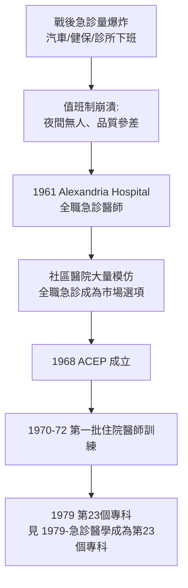

## 1961 - 亞歷山卓醫院與全職急診醫師（當「值班雜務」第一次變成一門職業）

## 案件摘要

**本案偵破的是：急診科（Emergency Department）作為一個有專責醫師的部門，為什麼誕生在一間小規模的維吉尼亞社區醫院，而不是任何一座大學醫學中心？**

1961 年，維吉尼亞州亞歷山卓醫院（Alexandria Hospital）聘請兩位年輕醫師——James Mills 醫師倡議、由 Stan de Lozier 與 John Chovanes 等人出任——擔任**全職、輪班、只看急診**的醫師，把原本由各科醫師輪流「值班」的急診室改造成專門科室。方案立刻解決了該院急診室的混亂，並被全美中小型社區醫院大量模仿。**急診醫學的組織胚胎，由民間需求（夜間沒人看急診）在市場中孵化，而非由學院設計。**

## 前因 -- 為什麼會有這個案子

- **戰後急診量爆炸**。汽車普及（公路系統擴張）、私人執業診所下班、健保給付使住院費用可報——急診人次在 1950s 美國以每年兩位數成長。
- **值班制度的崩潰**。急診室由院內各科醫師輪值：品質參差、無人對結果負責、夜間常叫不到人。家庭醫師還會在值班夜被自己的病房工作拉走。
- **年輕醫師的就業需求**。越戰世代醫學畢業生（部分為避免徵召的預備役安排）需要工作——全職急診職缺應運而生。
- **醫院管理者的務實算術**。聘兩位全職醫師的薪資，低於處理急診混亂的訴訟與流失病源成本——制度變革的動力是損益表，不是理想主義。

## 線索與推理 -- 數學式、程式、理論

為什麼「專職」勝過「輪值」？答案在於責任的歸屬與經驗的累積。急診的品質函數中，**熟練度與專注度**是主導變數：

$$ \text{急診品質} \sim \underbrace{f(\text{急診病例曝露量})}_{\text{專職者的學習曲線}} \times \underbrace{g(\text{單一責任歸屬})}_{\text{輪值者缺乏}} $$

```python
# 輪值 vs 專職: 急診病例曝露量對照
n_eds_per_year = 20000            # 年急診人次
rotating_docs = 60                # 輪值的各科醫師人數
fulltime_docs = 3
exposure_rotating = n_eds_per_year / rotating_docs   # 每人年急診病例數
exposure_fulltime = n_eds_per_year / fulltime_docs
print(f"輪值: 每位醫師年急診病例 ≈ {exposure_rotating:.0f}")
print(f"專職: 每位醫師年急診病例 ≈ {exposure_fulltime:.0f}")
# 輪值: 每位醫師年急診病例 ≈ 333
# 專職: 每位醫師年急診病例 ≈ 6667
# 20倍的曝露差 => 學習曲線差一個數量級, 這是專科化的經濟學根據
```



亞歷山卓模式的可複製性是關鍵：它不是大學醫學中心的精密設計，而是**社區醫院可以照抄的商業模板**（僱三個年輕醫師、讓他們輪班）。這種「自下而上」的擴散路徑，使急診醫學在獲得學術承認（`1979-急診醫學成為第23個專科.md`）之前，就已經在數百家醫院運作——**市場走在學院之前**。

## 結案 -- 後果與影響

- **急診室的空間與人員被重新組織**。分診台、觀察區、創傷室、專責護理——今日急診科的空間語法在 1960s 社區醫院成形。
- **暴露了「無訓練」的缺口**。全職急診醫師沒有專科訓練、沒有專科考試——這個缺口直接催生 ACEP（1968）與住院醫師訓練（1970s），最終推向 1979 專科化。
- **全美急診量持續膨脹**。1960s 美國年急診人次約 1800 萬，2000s 超過 1.3 億——急診科成為美國醫療體系的事實上安全網（safety net）。
- **國際傳播**。英、加、澳在 1970s–80s 相繼建立急診專科（澳洲 1983、英國 1993 成為正式專科），皆以美國社區醫院模式為參照。
- **一句話結案**：急診科的誕生證明了制度變革的一條鐵律——當一項工作量大到無人願意兼職做，它就會自己長成一門職業。

## 關鍵人物與文獻

- James D. Mills, Jr.——亞歷山卓醫院急診室主任，1961 年全職急診醫師方案的主要倡議者，後為 ACEP 創會重要成員。
- Stan de Lozier、John Chovanes——首批全職急診醫師。
- 「Alexandria Plan」——後世對該方案的通稱，急診專科化史上的標準起點敘事。
- Mills,"Emergency Department: Organization and Management," 以及 ACEP 早期年鑑的建制化記錄。
