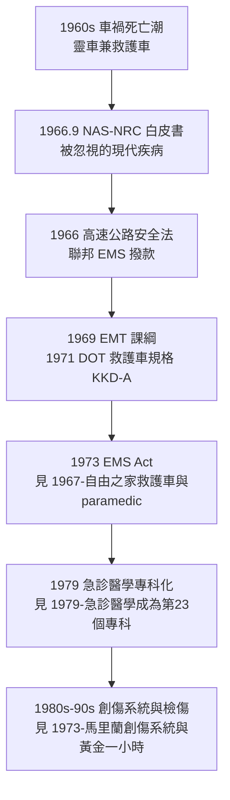

## 1966 - 意外死亡白皮書（一份報告如何罵出一整個救護產業）

## 案件摘要

**本案偵破的是：到院前救護系統（EMS）的誕生，為什麼不是來自醫學界的自我反省，而是來自一份把現狀罵成「屠宰場」的國家報告——以及為什麼這份報告的有效期只有短短十餘年。**

1966 年 9 月，美國國家科學院—國家研究委員會（NAS-NRC）出版《意外死亡與殘廢：被忽視的現代疾病》（Accidental Death and Disability: The Neglected Disease of Modern Modern Society）。報告以駭人的證據指出：意外傷害是 37 歲以下人口的第一死因，而全國的救護車、救護員與急診處理能力「遠低於最低標準」——許多救護車是殯儀館的靈車，救護員只受過把人裝進車的訓練。報告直接催生 1966 年《高速公路安全法》到院前救護條款、EMT 訓練課綱（1969）、聯邦 EMS 計畫。**這是急診醫學史上最重要的一份文件。**

## 前因 -- 為什麼會有這個案子

- **事故傷害的流行病學轉型**。戰後汽車保有量爆炸，車禍死亡在 1960s 年超過 5 萬人——但醫學界把注意力放在感染與慢性病，傷害被視為「意外」而非疾病。
- **救護車的荒謬現狀**。多數救護車由殯儀館經營（靈車兼救護車），救護員是司機兼抬擔架工；設備標準各州不一，許多州完全沒有。
- **戰場經驗的對比羞辱**。韓戰與越戰中，直昇機後送與戰地復甦使重傷死亡率大降——同樣的傷在美國公路上卻等不到有效救護。
- **NHTSA 與公衛官僚的推動**。交通部與公衛服務署需要一個引爆點來撥預算——白皮書正是那個引爆點。

## 線索與推理 -- 數學式、程式、理論

白皮書的核心論證是「可預防死亡的流行病學」：把傷害當疾病，統計其「可預防死亡」的結構：

$$ \text{外傷死亡三峰分佈}： \begin{cases} \text{第一峰}：\text{即時死亡（中樞/大血管）} \approx 50\% \\ \text{第二峰}：\text{黃金一小時內（可救）} \approx 30\% \\ \text{第三峰}：\text{數天至數週（感染/器官衰竭）} \approx 20\% \end{cases} $$

**第二峰正是 EMS 能干預的區間**——白皮書的全部論證都建立在壓縮第二峰上：

```python
# 外傷死亡三峰: EMS 可干預的比例
peaks = {"即時死亡": 0.50, "數小時內": 0.30, "數天至數週": 0.20}
ems_addressable = peaks["數小時內"] * 0.7   # EMS 可影響其中 7 成
print(f"EMS 可干預的死亡比例 ≈ {ems_addressable*100:.0f}%")
# EMS 可干預的死亡比例 ≈ 21%
# 以年 5 萬車禍死亡計, 系統化救護每年理論上可救回上萬人
```



報告的修辭策略同樣值得解剖：它刻意用「屠宰場」「隨機」「意外」等衝擊性字眼，並附上怵目車禍現場照片——**這是一份用流行病學寫成的行動綱領，而不是學術論文**。修辭的強度與證據的強度同樣重要，這是政策科學的經典案例。

## 結案 -- 後果與影響

- **到院前救護被國家化**。聯邦撥款建立區域 EMS、EMT 課綱與救護車規格——救護車從靈車變成移動醫療單元（`1967-自由之家救護車與paramedic.md`）。
- **「傷害是疾病」的典範轉移**。此後傷害流行病學、預防醫學（安全帶、酒駕法）與急診創傷照護成為一體。
- **為急診專科化提供正當性**。白皮書把「急診能力不足」定義為國家級問題，使急診醫學的專科化訴求（`1979-急診醫學成為第23個專科.md`）獲得政治槓桿。
- **1926 年莫斯科、1930 年代歐陸的救護系統經驗終於被美國消化**——美國的 EMS 制度化，比歐洲晚了數十年，這是本書「軍民時差」主題的又一例。
- **一句話結案**：制度的改變有時不靠說服，靠羞辱——白皮書用「屠宰場」三個字，完成了十年學術呼籲做不到的事。

## 案件補遺 -- 為什麼白皮書的效力會衰退

- **聯邦撥款隨政治更迭消失**。1973 EMS Act 的經費在 1981 年被雷根政府大幅刪減並下放州政府——系統建設失去聯邦推力。
- **正因如此，後來的進步多靠「再出版的報告」驅動**：1985 年《Injured Children》（兒童創傷）、1988 年 NHTSA 創傷系統指南、2016 年《A National Trauma Care System》——每隔十餘年就需要一次新的羞辱。

## 關鍵人物與文獻

- Sam F. Seeley 等——NAS-NRC 委員會召集人與報告統籌者。
- 美國國家科學院,《Accidental Death and Disability: The Neglected Disease of Modern Society》（1966）——通稱「白皮書」。
- 《高速公路安全法》（Highway Safety Act, 1966）——到院前救護的聯邦法源。
- 《緊急醫療服務法》（EMS Act, 1973, Public Law 93-154）——白皮書的制度果實。
