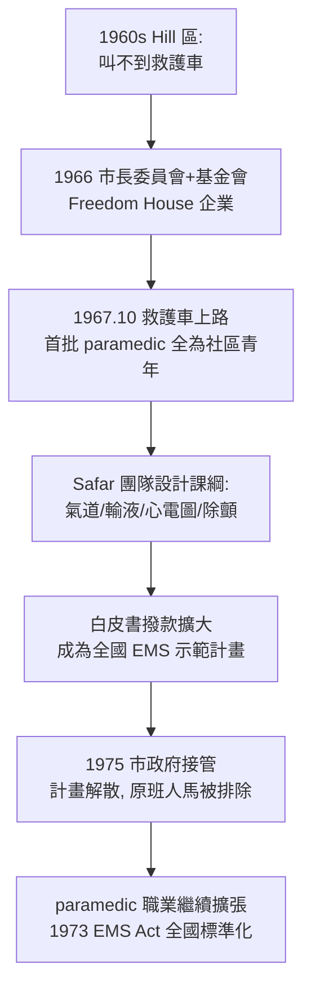

## 1967 - 自由之家救護車與 paramedic（第一批救護技術員，來自匹茲堡最窮的街區）

## 案件摘要

**本案偵破的是：「paramedic」這個職業為什麼誕生在匹茲堡 Hill 區——一個被歧視、失業、醫療沙漠化的黑人社區——以及為什麼第一批 paramedic 的訓練水準遠超官方標準。**

1966 年，匹茲堡市長委員會與 Philip Hallen（Maurice Falk 基金會）發起 Freedom House 企業（Freedom House Enterprises）：僱用 Hill 區的弱勢失業者（以非裔為主），訓練成第一批受過高級救護技術的救護員，於 1967 年 10 月開始以救護車服務 Hill 區。訓練由 Peter Safar（見 `1958-Safar口對口人工呼吸.md`）主導的團隊設計，課程包含氣道管理、靜脈輸液、藥物使用——**在官方 EMT 課綱（1969）尚未存在時，他們已被訓練成超越十年後標準的救護者**。1975 年市政府接管後計畫解散，多數原班人馬被排除——職業誕生了，發明它的那群人卻被趕走了。

## 前因 -- 為什麼會有這個案子

- **社區的救護真空**。Hill 區居民叫不到救護車：私立救護公司拒載或收取高額費用，官方救護車數量不足——急救不平等的實體化。
- **白皮書（1966）的撥款窗戶**。聯邦高速公路安全法使試驗型 EMS 計畫可以拿到錢——Freedom House 是最早抓住這扇窗的計畫之一。
- **就業政策的動機**。1960s 城市騷亂後，市政府與基金會需要「對 Hill 區的就業補償」——救護員訓練同時滿足就業政策與醫療需求。
- **Safar 的急診醫學野心**。Safar 一直在等一個可以把「麻醉科復甦技術搬上街頭」的試驗場——Freedom House 正是他要的實驗室。

## 線索與推理 -- 數學式、程式、理論

Freedom House 的訓練邏輯是「把急診醫學的核心技能下沉到院前」。傳統 EMT 只做搬運與基本急救；Freedom House 的 paramedic 課綱包含醫師授權的介入：

$$ \text{paramedic 技能集} = \text{EMT 基礎} + \{\text{氣道, 靜脈輸液, 抗心律失常藥, 心電圖判讀, 除顫}\} $$

```python
# 反應時間對心跳停止存活率的敏感性（示意）
def survival_from_arrest(response_min):
    # 旁觀者 CPR 假設已開始; 存活率隨除顫時間指數衰減
    return max(0, 0.50 * (0.92 ** max(response_min - 1, 0)))

for label, t in [("Freedom House 街區駐點", 4), ("市中心救護車", 8), ("無救護服務社區", 15)]:
    print(f"{label}: 到達 {t} 分, 存活率 ≈ {survival_from_arrest(t)*100:.0f}%")
# Freedom House 街區駐點: 到達 4 分, 存活率 ≈ 42%
# 市中心救護車: 到達 8 分, 存活率 ≈ 31%
# 無救護服務社區: 到達 15 分, 存活率 ≈ 18%
```



「醫師授權的院前介入」（offline medical direction）是本案最重要的制度發明：paramedic 在現場做的每項進階操作，背後是醫師預先授權的協議——**急診醫學的「協議化決策」由此誕生**，後來的檢傷協議、敗血症 bundle（`2001-敗血症EGDT與bundle.md`）都是它的後代。

## 結案 -- 後果與影響

- **paramedic 成為正式職業**。1970 年代起各州立法承認、1973 EMS Act 全國標準化——今日全球的救護技術員體系都可追溯到這條線。
- **急診醫學的知識被搬上街頭**。到院前氣道、除顫、輸液成為標準；「救護車是移動急診室」的觀念確立。
- **不平等的反諷**。發明 paramedic 的那批黑人救護員，在 1975 年市政府接管後幾乎全部被排除——計畫的商業知識被收割，計畫的人被拋棄。2010 年代起，匹茲堡市與基金會陸續公開致歉與紀念。
- **EMS 與急診科互相成就**。paramedic 的存在使急診科能接收「已在院前完成部分處置」的病人——急診專科化（`1979-急診醫學成為第23個專科.md`）的後勤基礎因此穩固。
- **一句話結案**：職業的誕生常常不靠專業界的慷慨，靠社區被逼到牆角後的自救——而職業化完成後，發明它的人是否被善待，才是文明程度的真正測量。

## 關鍵人物與文獻

- Philip Hallen——Maurice Falk 醫療基金會會長，Freedom House 計畫的幕後推手。
- Peter Safar（1924–2003）——訓練課綱設計者，見 `1958-Safar口對口人工呼吸.md`。
- Nancy Caroline（1944–2002）——Freedom House 醫療主任，撰寫《Emergency Care in the Streets》（1979）——paramedic 教科書的經典。
- John Moon、Victor Payton 等——首批 Freedom House paramedic，計畫解散後轉入匹茲堡 EMS 體系並持續倡議。
- 紀錄片《Freedom House Ambulance Service》（2022）與匹茲堡大學口述史檔案。
