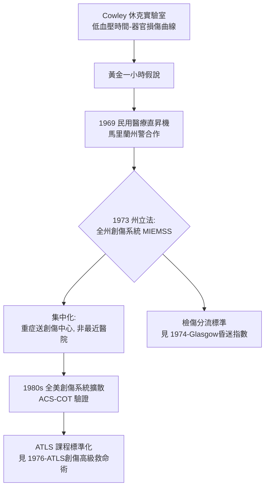

## 1973 - 馬里蘭創傷系統與黃金一小時（「黃金一小時」是一個科學概念，還是一個行銷口號？）

## 案件摘要

**本案偵破的是：「黃金一小時」（golden hour）這句急診醫學最著名的口號，從何而來？它是有嚴格數據基礎的生理學定理，還是一位鬥士的修辭發明？答案兩者皆是——而這個曖昧正是它成功的原因。**

R Adams Cowley 是巴爾的摩的外科醫師，1950s 起研究休克與創傷。他根據動物實驗與臨床觀察提出：重傷病患若能在**一小時內**被送到有能力的手術室，存活率顯著提升——「黃金一小時」由此誕生。1973 年，他說服馬里蘭州立法建立全州創傷系統（MIEMSS，馬里蘭急診醫療服務研究所）：單一創傷中心（後為 R Adams Cowley 創傷中心）、全州直昇機後送網（1969 起，全球最早的民用醫療直昇機系統之一）、統一檢傷與分流標準。**黃金一小時從一句口號變成了一整套政府工程。**

## 前因 -- 為什麼會有這個案子

- **出血性休克的生理學已就緒**。Cowley 在軍方資助的休克實驗室中，量化了低血壓與器官衰竭的時間關係。
- **白皮書（1966）的政治窗口**。見 `1966-意外死亡白皮書.md`——傷害被定義為國家級疾病，州政府有動機投資。
- **直昇機技術的軍民移轉**。韓戰與越戰的戰地直昇機後送證明「把時間壓縮」的價值；Cowley 是第一批把它搬進民用系統的人。
- **反對者的理由同樣強大**。傳統外科界反對「把病人送到專門中心」——主張救護車應送到最近的醫院。創傷系統的革命本質是**集中化**：寧可多花二十分鐘，也要到對的地方。

## 線索與推理 -- 數學式、程式、理論

黃金一小時的科學核心是**出血的時間敏感度**。未控制的出血以近似恆定速率消耗血容量，而休克進展呈非線性加速（凝血功能惡化、酸中毒、低體溫的「死亡三聯徵」互相強化）：

$$ V_{\text{剩餘}}(t) = V_0 - r \cdot t, \quad r \approx 100\text{–}150\,\text{ml/min（重度出血）} $$

$$ \text{凝血功能} \downarrow \;\text{與}\; \text{酸中毒} \uparrow \;\text{隨時間互相放大（triad of death）} $$

```python
# 死亡三聯徵的正回饋: 時間越久, 出血控制後的結局越差
def triad_score(t_min):
    acidosis  = min(t_min/60, 1.0)
    hypothermia = min(t_min/90, 1.0)
    coagulopathy = (acidosis + hypothermia) / 2
    return {"酸中毒": acidosis, "低體溫": hypothermia, "凝血病變": coagulopathy}

for t in [30, 60, 120]:
    s = triad_score(t)
    print(f"{t} 分鐘: 三聯徵總分 ≈ {sum(s.values()):.2f}")
# 30 分鐘: 三聯徵總分 ≈ 0.83
# 60 分鐘: 三聯徵總分 ≈ 1.67
# 120 分鐘: 三聯徵總分 ≈ 3.33  <- 非線性惡化, 這是黃金一小時的生理基礎
```



Cowley 的名言揭示了黃金一小時的雙重身分：「我在實驗室找到的是一小時，但我叫它黃金，因為醫學界只聽得懂黃金。」**作為生理學，黃金一小時的邊界從未嚴格成立**（後續研究顯示：城市內院前時間通常不足一小時，多數重傷死亡發生在更早；而某些鄉村系統的受益遠超一小時窗）。但作為制度設計原則，它無懈可擊：**把「快」變成可以立法、撥款、考核的目標**。

## 結案 -- 後果與影響

- **創傷系統成為標準**。美國外科醫師學會創傷委員會（ACS-COT）1980s 起制定創傷中心分級與驗證；全球各國創傷系統均以馬里蘭模式為參照。
- **直昇機後送民用化**。HEMS（直升機緊急醫療服務）產業誕生；後續研究對其成本效益持保留態度——口號的效果常超出證據的邊界。
- **「時間窗」家族的開端**。黃金一小時 → time is muscle（`1986-GISSI與心梗溶栓革命.md`）→ time is brain（`1995-NINDS與time is brain.md`）→ 敗血症 bundle（`2001-敗血症EGDT與bundle.md`）——急診醫學被組織成一系列時間窗，全都是馬里蘭模式的修辭後代。
- **白皮書的落實樣板**。馬里蘭州證明 1966 白皮書的訴求可以被完整執行——系統、培訓、後送、專責醫師一應俱全。
- **一句話結案**：黃金一小時是科學與修辭的合資企業——科學提供方向，修辭提供動員力；急診醫學的每一次大躍進，幾乎都是這種合資的產物。

## 關鍵人物與文獻

- R Adams Cowley（1917–1991）——「創傷系統之父」「黃金一小時之父」，馬里蘭創傷中心以其命名。
- 軍方休克研究單位（美國陸軍外科研究）——Cowley 早期實驗的資助與知識來源。
- 馬里蘭州議會（1973）——創建 MIEMSS 的立法者。
- Cowley,"A Total Emergency Medical System for the State of Maryland," *Maryland State Medical Journal*, 1975.
- ACS-COT:《Resources for Optimal Care of the Injured Patient》系列——創傷系統的標準手冊。
