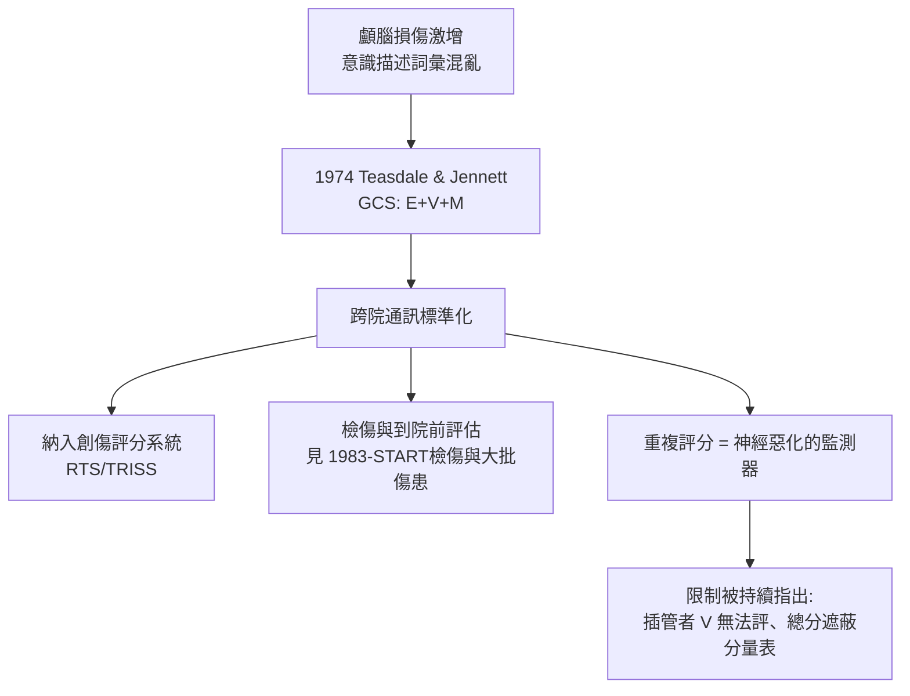

## 1974 - Glasgow 昏迷指數（把「他好像沒有意識」變成一個可以傳真的數字）

## 案件摘要

**本案偵破的是：神經外科醫師們為什麼要花力氣把意識狀態壓縮成一個 3–15 分的數字？以及為什麼這個粗糙的量表，成為全球急診與檢傷系統最常被引用的單一指標。**

1974 年，格拉斯哥的 Graham Teasdale 與 Bryan Jennett 在《柳葉刀》發表 "Assessment of coma and impaired consciousness"——以**睜眼（E）、語言（V）、動作（M）**三個分量表量化意識：GCS = E + V + M，滿分 15、最低 3。設計動機不是診斷，而是**通訊**：不同醫院、不同觀察者描述意識的詞彙混亂（「半昏迷」「木僵」「反應遲鈍」），導致治療決策與研究無法比較。**GCS 的發明是一場詞彙的標準化運動。**

## 前因 -- 為什麼會有這個案子

- **頭部外傷成為主要公衛問題**。汽車化使顱腦損傷激增；神經外科需要追蹤病人意識的「時間軌跡」以決定手術。
- **舊術語無法比較**。英國文獻中的 coma、stupor、drowsiness 各家定義不一——跨院研究根本無法合併。
- **觀察者間的信度危機**。同一病人，夜班護士寫「嗜睡」、晨班醫師寫「昏迷」——治療連續性被語言模糊性破壞。
- **格拉斯哥團隊的系統性**。Jennett 與 Teasdale 同時在建立外傷資料庫（後來的 Glasgow Outcome Scale、CT 分類），GCS 是整個「可量化外傷語言」計畫的一環。

## 線索與推理 -- 數學式、程式、理論

GCS 的設計哲學是**序列行為的階梯式評分**：每個分量表的分級代表神經功能的「下層先失效」順序。以動作分量表為例：

$$ \text{GCS} = E + V + M, \quad M: 6\text{（遵囑）}\to5\text{（定位）}\to4\text{（退縮）}\to3\text{（屈曲）}\to2\text{（伸展）}\to1\text{（無反應）} $$

```python
# GCS 的檢傷應用: 快速分流
def gcs_triage(e, v, m):
    g = e + v + m
    if g <= 8:  return "重度: 考慮氣道保護/插管"
    if g <= 12: return "中度: 影像與神經外科會診"
    return "輕度: 觀察與 CT 決策準則"

print(gcs_triage(2, 3, 3))   # 重度: 考慮氣道保護/插管
print(gcs_triage(3, 4, 6))   # 中度: 影像與神經外科會診
print(gcs_triage(4, 5, 6))   # 輕度: 觀察與 CT 決策準則
```



GCS 的深層價值是**差分**而非絕對值：單次 GCS 13 的意義遠低於「兩小時內由 15 降到 13」——後者代表顱內病變進展，是急診最危險的訊號。這使 GCS 從分類工具變成**時間序列監測器**。

## 結案 -- 後果與影響

- **成為創傷評分系統的支柱**。修訂創傷評分（RTS）、TRISS 存活預測、APACHE II 均內含 GCS——重傷研究與品質比較的公共語言。
- **到院前與急診的標配**。EMT 課綱、ATLS（`1976-ATLS創傷高級救命術.md`）、各國檢傷系統都嵌入 GCS 或其簡化版（如 AVPU）。
- **循證的陰影面**：研究顯示 GCS 總分的信息量主要來自 M（動作）分量表；插管或眼瞼腫脹病人無法完整評分；觀察者間信度中等。新一代量表（如 FOUR score，2005）試圖取代，但網絡效應使 GCS 至今不倒。
- **「可通訊的醫學」的典範**。GCS 證明了：把臨床判斷壓縮成小整數，可以大幅提升跨人員、跨機構、跨時間的醫療協調——這個模式後來被複製到疼痛評分、早期預警分數（NEWS）、檢傷分級。
- **一句話結案**：GCS 的發明人自己說得最清楚——它不是測量意識的儀器，是讓兩個不同醫院的人「講同一種話」的字典。

## 關鍵人物與文獻

- Graham Teasdale（1940–）——神經外科醫師，GCS 第一作者，持續修訂與推廣至 2014 年的官方指南。
- Bryan Jennett（1926–2008）——神經外科教授，Glasgow 資料庫與 Glasgow Outcome Scale 的建立者。
- Teasdale & Jennett,"Assessment of coma and impaired consciousness: a practical scale," *Lancet* 1974;2(7872):81–84.
- Wijdicks et al.,"Validation of a new coma scale: The FOUR score," *Annals of Neurology*, 2005——GCS 的主要挑戰者。
