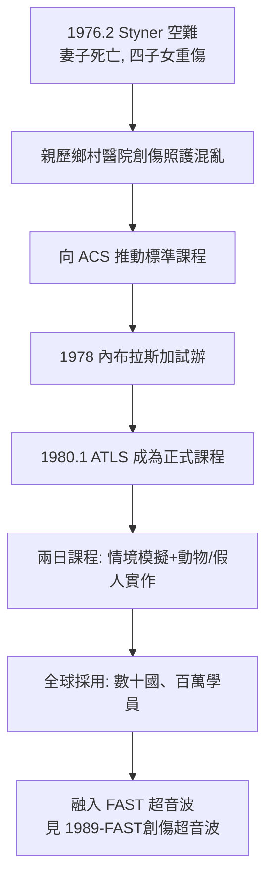

## 1976 - ATLS 創傷高級救命術（一次空難，一位骨科醫師，一份全球手術室規則）

## 案件摘要

**本案偵破的是：全球創傷照護的標準流程（ATLS）為什麼誕生於一位醫師的家庭悲劇，而不是任何一項研究計畫？以及為什麼一個「教外科醫師基本的東西」的課程，能成為被翻譯成數十種語言的全球標準？**

1976 年 2 月，內布拉斯加州骨科醫師 James K. Styner 駕駛的小型飛機在內布拉斯加農田墜毀，妻子當場死亡，四名子女重傷。Styner 自己重傷（面部骨折等），被送到最近的鄉村醫院——醫院關閉中；再送一家，只有一位經驗不足的醫師，處置混亂（甚至給他拍 X 光前未固定頸椎、未優先處理氣道）。Styner 事後寫下著名指控："I determined that the care I received was inadequate and inappropriate." 他向美國外科醫師學會（ACS）與內布拉斯加大學推動系統性的創傷照護訓練——**1978 年試辦、1980 年 1 月 ATLS 正式成為 ACS 課程**。

## 前因 -- 為什麼會有這個案子

- **鄉村創傷照護的品質斷崖**。多數美國創傷死亡發生在沒有創傷中心的地區；地方醫師一年遇到的重傷病人屈指可數——技能荒廢是結構性問題。
- **外科訓練的知識斷層**。外科技能隨專科化而碎片化：神經外科不懂胸腔、整形外科不懂休克——沒有人「統一規則」。
- **「黃金一小時」需要操作手冊**。Cowley 的時間窗理論（`1973-馬里蘭創傷系統與黃金一小時.md`）需要一套可標準化傳授的處置順序——ATLS 正是那份手冊。
- **Styner 的受害者身分具有不可辯駁性**。他是醫師、是受害者、是家屬——三重身分使他的倡議無法被官僚程序輕易消化。

## 線索與推理 -- 數學式、程式、理論

ATLS 的核心是**優先序算法**：先殺死病人的東西先處理。其哲學可以寫成一條搜尋問題：在黃金一小時內，按「立即致命性」排序檢查與處置：

$$ \text{處置順序} = \operatorname*{arg\,sort}_{i} \left[ P_{\text{立即死亡由 } i \text{ 造成}} \times \text{可逆性}_i \right] $$

$$ \text{ABC 優先序}： A(\text{氣道}) \to B(\text{呼吸}) \to C(\text{循環}) \to D(\text{神經}) \to E(\text{暴露/環境}) $$

```python
# ATLS 優先序: 立即致命問題的排序
problems = {
    "張力性氣胸":  {"立即死亡風險": 0.95, "可逆性": 0.95},
    "心包填塞":    {"立即死亡風險": 0.90, "可逆性": 0.80},
    "長骨骨折":    {"立即死亡風險": 0.15, "可逆性": 0.95},
    "面部骨折":    {"立即死亡風險": 0.05, "可逆性": 0.98},
}
for name, s in sorted(problems.items(), key=lambda kv: -(kv[1]["立即死亡風險"]*kv[1]["可逆性"])):
    score = s["立即死亡風險"] * s["可逆性"]
    print(f"{name}: 優先分數 {score:.2f}")
# 張力性氣胸: 優先分數 0.90  <- 第一針減壓在骨盆 X 光之前
# 心包填塞: 優先分數 0.72
# 長骨骨折: 優先分數 0.14
# 面部骨折: 優先分數 0.05  <- Styner 本人的傷被排在最後, 這正是課程的教訓
```



ATLS 的教學法是本案的另一半發明：**標準化情境＋模擬實作＋統一評核**。它把「看過的病例數」與「學到什麼」脫鉤——即使一年只遇兩個重傷病人，醫師也能靠課程肌肉記憶執行正確順序。這是「低頻高風險技能」訓練的原型，後來的 ACLS、PALS、模擬醫學教育全是它的複製品。

## 結案 -- 後果與影響

- **全球創傷照護的最低共同標準**。數十國採用、逾百萬醫師受訓；「ATLS 通過」成為急診與外科的入場券。
- **急診醫學專科化的配套**。ATLS 給了急診醫學（`1979-急診醫學成為第23個專科.md`）一個現成的技能標準，補足其「什麼都會一點」的專科身分。
- **持續修正的活文件**。每四年改版：胸腔穿刺減壓位置、骨盆帶、限制性復甦（permissive hypotension）、止血帶復位——證明標準化與持續修正可以並存。
- **爭議與局限**。ATLS 的部分教條（如大量輸液策略）後來被 RCT 修正（PROPPR 試驗等）；它也常被批評為「把美國資源假設強加於資源不足地區」。
- **一句話結案**：ATLS 證明了一個殘酷的公式——**一個偉大課程＝一場悲劇＋一位有能力的受害者＋一個願意接案的學會**。急診醫學史上，太多課程缺少了第二項或第三項。

## 關鍵人物與文獻

- James K. Styner（1927–）——內布拉斯加骨科醫師，1976 年空難倖存者與 ATLS 發起人；其 13 歲女兒 Karen 在救援中表現出的鎮靜成為課程的傳奇注腳。
- 美國外科醫師學會（ACS）創傷委員會（ACS-COT）——1980 年起管理 ATLS 課程。
- R Adams Cowley（見 `1973-馬里蘭創傷系統與黃金一小時.md`）——黃金一小時理論供應了 ATLS 的時間哲學。
- Styner,"Advance Trauma Life Support: The story of its development"（口述與自述文獻）。
