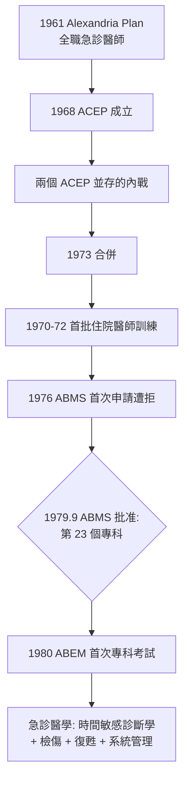

## 1979 - 急診醫學成為第 23 個專科（一次專業身分的政治鬥爭，歷時十八年）

## 案件摘要

**本案偵破的是：急診醫學從 1961 年的社區醫院實驗（`1961-亞歷山卓醫院與全職急診醫師.md`）到 1979 年成為美國醫學專科委員會（ABMS）認可的第 23 個專科，這十八年間最大的障礙是什麼？答案是：其他專科的反對，加上一場內戰——兩個急診醫學會的合併。**

1968 年，急診醫師在密西根州蘭辛成立美國急診醫師學會（ACEP）。同時期，一群家庭醫學背景的急診醫師組成急診醫師學院（American College of Emergency Physicians 的競爭者：University Association for Emergency Medical Services（UA/EMS）主學術、American College of Emergency Physicians（另一個 ACEP）主實務）。1973 年，兩個同名學會合併；1976 年，ACEP 與 ABMS 申請專科認證遭拒（理由：缺乏足夠的住院醫師訓練與學術基礎）。1979 年，經由美國醫學會（AMA）與 ABMS 的再審議，**急診醫學被批准為第 23 個專科**；1980 年舉行首次專科執照考試（ABEM）。

## 前因 -- 為什麼會有這個案子

- **急診是「殘餘科」**。傳統專科把它視為各科診療的入口雜務：內科說急診該歸內科、外科說外傷該歸外科——沒有人願意讓出領土。
- **沒有訓練就沒有專科**。1976 年 ABMS 拒絕的理由正中要害：一個專科必須有自己的住院醫師訓練體系與知識本體。
- **急診知識本體的建構工程**。1970s 急診文獻爆發：急診教科書（Rosen's 前身）、期刊（*Annals of Emergency Medicine* 1982 起）、辛辛那提（1970）、南加州大學（1971）、丹佛（1972）等首批住院醫師訓練——知識本體是靠編輯與課程硬造出來的。
- **政治聯盟的工程**。ACEP 需要家庭醫學、兒科的投票支持，並與 AMA 的專科委員會建立議程——專科化一半是學術案，一半是選舉案。

## 線索與推理 -- 數學式、程式、理論

專科化的成立條件可以寫成一套「身分證」核發準則：獨特的知識核心、訓練管道、考試與持續品質機制：

$$ \text{專科身分} = \underbrace{\text{獨特知識核心}}_{\text{急診: 時間敏感診斷學}} + \underbrace{\text{住院醫師訓練}}_{\text{1970s 建立}} + \underbrace{\text{專科考試}}_{\text{1980 ABEM}} $$

```python
# 專科化的三大支柱進度表
pillars = {
    "知識核心(文獻/教科書)":  {"1968": 0.2, "1973": 0.5, "1979": 0.9},
    "住院醫師訓練":           {"1968": 0.0, "1973": 0.4, "1979": 0.8},
    "考試與認證":             {"1968": 0.0, "1973": 0.1, "1979": 0.7},
}
for pillar, years in pillars.items():
    print(f"{pillar}: " + ", ".join(f"{y}: {v:.0%}" for y, v in years.items()))
# 知識核心(文獻/教科書): 1968: 20%, 1973: 50%, 1979: 90%
# 住院醫師訓練: 1968: 0%, 1973: 40%, 1979: 80%
# 考試與認證: 1968: 0%, 1973: 10%, 1979: 70%
```



急診醫學的知識核心最終被定義為**「時間敏感診斷與復甦的整合學」**——不是各科知識的總和，而是一種獨特的技能：在資訊不全、時間受限、資源可變的環境中排序與決策。這個自我定義，是十八年鬥爭中最終說服各專科的理由。

## 結案 -- 後果與影響

- **急診科獲得制度性位階**。醫學院開設急診學科、住院醫師訓練標準化、急診文獻成為獨立學術場域。
- **全球專科化浪潮**。加拿大 1980（CFPC-EM 後 1997 獨立）、英國 1993、澳洲 1983、台灣 1990s（急診專科 1994）、日本 2008（急診專醫制）——美國模式被各地改裝。
- **職業保護與負面效應並存**。專科身分保護了急診醫師的就業與薪資，但也帶來「住院醫師學費與勞力剝削」「專科考試成本」等結構問題。
- **急診成為醫療體系的安全網與壓力計**。急診量的升降成為健保可近性、疫情強度（見 `2020-COVID大流行與急診.md`）的社會指標。
- **一句話結案**：專科化是一場政治戰爭，武器是教科書、考試與投票權——知識本身從不會自動贏得身分，必須被組織成制度。

## 關鍵人物與文獻

- John Wiegenstein（1933–2006）——蘭辛急診醫師，ACEP 創會會長，專科化的政治總工程師。
- James Mills（見 `1961-亞歷山卓醫院與全職急診醫師.md`）——建制化路線的先行者。
- Eugene Calesnick——UA/EMS 學術線領袖，兩會合併的談判者之一。
- Peter Rosen（1935–2018）——《Rosen's Emergency Medicine》主編，急診知識本體的編纂者。
- ABMS 公告（1979.9）；ABEM 首次考試紀錄（1980）。
