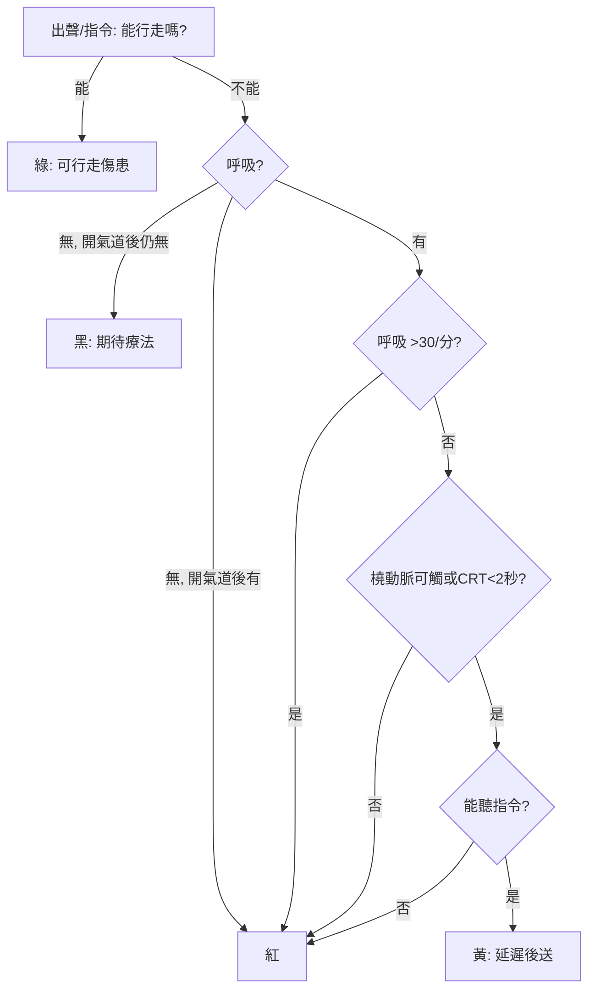

## 1983 - START 檢傷與大批傷患（當病人比資源多：triage 的數學與它的道德重量）

## 案件摘要

**本案偵破的是：當一次地震或恐攻製造出幾十個傷患、而現場只有兩位救護員時，「先救誰」的問題如何被壓縮成一套 30 秒完成的算法？以及為什麼這套算法的哲學基礎——極大化總存活數而非救每一個人——如此難以被公眾接受？**

1983 年，加州紐波特海灘消防局發表 START（Simple Triage And Rapid Treatment）檢傷法：以**行走能力、呼吸、灌流、意識**四個快速檢查，在 30 秒內把傷患分為紅（立即）、黃（延遲）、綠（可行走）、黑（死亡/期待療法）四級。START 及其變體（JumpSTART 兒童版、SALT）成為全球大批傷患（MCI）檢傷的主流。「triage」一詞來自法文 trier（分揀），原是咖啡分級用語，經拿破崙時代軍醫（Larrey，見 `1797-Larrey飛行救護車.md`）與一戰戰場制度化後，在 1980s 被民間急救系統收編成標準算法。

## 前因 -- 為什麼會有這個案子

- **MCI 的資源方程式**。日常救護的預設是「資源≥需求」；MCI 打破這個預設——常規的「每個病人都全力救」反而使總死亡最大化。
- **戰場檢傷的民間移植滯後**。軍隊有成熟的檢傷傳統，但消防/救護系統長期以日常模式回應 MCI——1980s 初的多起空難與火災暴露了這個缺口。
- **消防部門的主導權**。美國多數救護服務掛在消防局下——檢傷法必須簡單到「消防員在濃煙旁、聽力受損、戴著手套」也能執行，這就是 START 極簡設計的原因。
- **法律風險**。檢傷的「放棄治療」決定可能引發訴訟——算法化、文件化成為法律防線。

## 線索與推理 -- 數學式、程式、理論

檢傷的數學本質是**資源約束下的存活極大化**。日常模式與 MCI 模式的目標函數完全不同：

$$ \text{日常}： \max \sum_i s_i \;(\text{每位病人的存活機會各自極大化}) $$

$$ \text{MCI}： \max \sum_i s_i \quad \text{s.t.} \; \sum_i c_i \leq C \;(\text{資源約束}） \;\Rightarrow\; \text{優先紅標（邊際效益最大者）} $$

```python
# START 檢傷算法
def start_triage(walking, rr_ok, perfusion_ok, mental_ok):
    if walking:              return "綠(可行走)"
    if not rr_ok:            return "黑(呼吸無法恢復)"
    if not perfusion_ok:     return "紅(立即)"
    if not mental_ok:        return "紅(立即)"
    return "黃(延遲)"

# RR 判準: >30次/分 為紅; 灌流判準: 橈動脈摸不到或微血管填充>2秒
print(start_triage(walking=True,  rr_ok=True,  perfusion_ok=True,  mental_ok=True))   # 綠
print(start_triage(walking=False, rr_ok=False, perfusion_ok=True,  mental_ok=True))   # 黑
print(start_triage(walking=False, rr_ok=True,  perfusion_ok=False, mental_ok=True))   # 紅
print(start_triage(walking=False, rr_ok=True,  perfusion_ok=True,  mental_ok=False))  # 紅
print(start_triage(walking=False, rr_ok=True,  perfusion_ok=True,  mental_ok=True))   # 黃
```



**道德重量在黑標**。START 的黑標（呼吸經開放氣道後仍無）意味著「不治療」——這在哲學上是效用主義的（救總數最多的人），在倫理上是極端沉重的（每位黑標者被個別地放棄）。這也是為什麼檢傷教育必須同時教算法與倫理：算法讓執行者不必在當場重新發明放棄的標準，但也要求社會事先為這個標準背書。

## 結案 -- 後果與影響

- **MCI 應變標準化**。ICS 指揮體系＋START 檢傷＋區域後送計畫成為各國災難應變的教科書組合（`2001-九一一與災難醫學體系.md`）。
- **檢傷科學化**。SALT（2010 起的美國國家指引）、二級檢傷（secondary triage）、Sieve and Sort（英國）——檢傷從規則變成可被模擬、量化、改良的系統。
- **日常檢傷的普及**。ESI（美國急診五級檢傷，1999 起推廣）把 MCI 的算法哲學搬進日常急診：分診台本質上就是一套資源約束下的排序系統。
- **COVID 的檢傷回歸**。2020 年疫情高峰，義大利與紐約的加護病房分配協議把「triage」從災難現場帶回醫院內部——社會第一次被迫在大眾面前討論黑標（`2020-COVID大流行與急診.md`）。
- **一句話結案**：檢傷是醫學史上少數「不救人也是治療」的處置——它的正當性不來自個案結果，來自總數結果；而讓社會接受這一點，比發明算法更難。

## 關鍵人物與文獻

- Newport Beach Fire Department（1983）——START 檢傷法的發表者；主要設計者為該局醫療顧問群（與 Hoag 醫院急診合作）。
- Lou Romig——兒科檢傷專家，JumpSTART 兒童檢傷法（1995）作者。
- Napoleon Larrey（見 `1797-Larrey飛行救護車.md`）——檢傷平等原則的軍事先行者。
- Newport Beach FD,"START: Simple Triage And Rapid Treatment"（1983）手冊。
- SALT Triage Guidelines（2010，美國國家 MCI 檢傷共識）。
