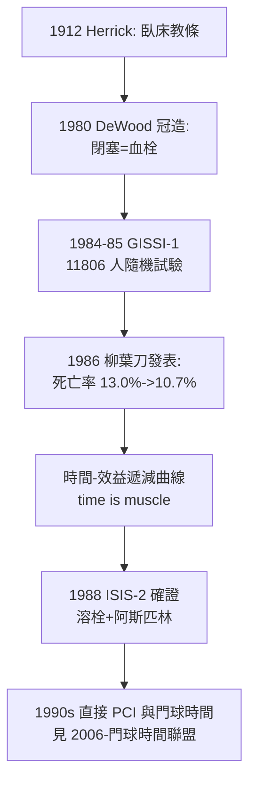

## 1986 - GISSI 與心梗溶栓革命（「time is muscle」：一場義大利大規模試驗如何把心肌變成會溶化的時鐘）

## 案件摘要

**本案偵破的是：急性心肌梗塞的治療為什麼從「臥床休息」躍進到「靜脈溶栓」？以及為什麼「越早越有效」這個今天顯而易見的結論，需要動員上萬病人才能證明？**

1980 年代初，冠狀動脈血栓被確認為急性心肌梗塞（AMI）的成因——堵塞的冠狀動脈使心肌以每小時數百萬細胞的速度壞死。義大利 GISSI-1（Gruppo Italiano per lo Studio della Streptochinasi nell'Infarto Miocardico，1984–1985 收案、1986 發表於《柳葉刀》）以隨機對照方式納入 **11,806 位病人**，證明發病後靜脈注射鏈激酶使 21 天死亡率從 13.0% 降至 10.7%（相對風險下降約 18%）——且**效益隨發病至給藥的時間遞減**：1 小時內給藥者死亡率相對下降近半，6 小時後效益趨近於零。**「time is muscle」從此有實證數字。**

## 前因 -- 為什麼會有這個案子

- **「臥床休息」教條的長期統治**。1912 年 Herrick 描述心梗後，標準治療是絕對臥床六週——心臟被當成「需要靜養的傷口」，而血栓學說長期居於次要。
- **血栓學說的復活**。1959 年 Fletcher 的早期溶栓報告被忽視；1970s 冠狀動脈造影證實 AMI 病人堵塞率極高；1980 DeWood 的冠造研究（發病 4 小時內 87% 完全堵塞）給血栓學說蓋章。
- **溶栓藥物已上市但沒有證據**。鏈激酶（1958 起）與後來的 tPA 被零星使用——缺少的是「夠大、夠隨機」的試驗。
- **義大利網絡的組織優勢**。GISSI 由 176 家冠心症加護病房（CCU）聯網完成，收案速度遠超英美——大規模試驗需要的不只是想法，是網絡。

## 線索與推理 -- 數學式、程式、理論

心梗的時間生物學：冠狀動脈閉塞後，心肌壞死從心內膜向外擴展，數小時內完成「透壁壞死」。溶栓的效益與「尚未壞死的心肌量」成正比：

$$ \text{壞死心肌}(t) \approx \text{總風險心肌} \times (1 - e^{-k t}), \quad k \approx 0.3\text{–}0.5\,/\text{小時} $$

$$ \text{溶栓效益} \propto \text{風險心肌} \times (1 - e^{-k t_{\text{給藥}}}) \; \Rightarrow \; t_{\text{給藥}} \downarrow \; \text{效益呈指數遞減} $$

```python
import math
def salvage_frac(hours_to_treatment, k=0.4):
    # 可被挽救的心肌比例 = 尚未壞死比例
    return math.exp(-k * hours_to_treatment)

for h in [1, 3, 6, 12]:
    print(f"發病後 {h:2d} 小時給藥: 可挽救心肌 ≈ {salvage_frac(h)*100:.0f}%")
# 發病後  1 小時給藥: 可挽救心肌 ≈ 67%
# 發病後  3 小時給藥: 可挽救心肌 ≈ 30%
# 發病後  6 小時給藥: 可挽救心肌 ≈  9%
# 發病後 12 小時給藥: 可挽救心肌 ≈  1%
```



**大規模簡單試驗（large simple trial）的方法論革命**同樣重要。GISSI 的設計刻意極簡：一個隨機分組、一個主要終點、極少排除條件——換取收案速度與外推性。這個設計哲學（與 ISIS-2 共享）成為此後心血管大型試驗的範本。

## 結案 -- 後果與影響

- **急診流程被重組**。「胸痛病人＝時間敏感病人」；急診建立胸痛分診、快速心電圖（目標 10 分鐘內）——急診的「時間窗」治理模式成為常態。
- **ISIS-2（1988）確證並簡化**：鏈激酶＋阿斯匹林的組合使死亡率相對下降約 40%，且阿斯匹林便宜無比——溶栓成為全球可及的治療。
- **直接 PCI 的崛起**。1990s 末起，直接經皮冠狀動脈介入（PCI）在多項試驗中超越溶栓，催生「門球時間」治理（`2006-門球時間聯盟.md`）與區域心梗網絡。
- **院前心電圖**。paramedic 現場做 12 導程心電圖並傳輸給心導管室——EMS（`1967-自由之家救護車與paramedic.md`）成為再灌流鏈的第一環。
- **一句話結案**：GISSI 證明的不是鏈激酶有效，而是「心肌的死亡有時鐘」——一旦時間被證明是藥物，急診醫學的整個治理邏輯就改寫了。

## 關鍵人物與文獻

- GISSI 研究群（意大利 176 家 CCU 網絡）——大規模簡單試驗的執行者。
- Aldo P. Maggioni、Franco Rovelli 等——GISSI 統籌與分析核心。
- Peter Sleight、Richard Peto——ISIS-2 的方法論推手，大型簡單試驗的代言人。
- GISSI,"Effectiveness of intravenous thrombolytic treatment in acute myocardial infarction," *Lancet* 1986;1:397–402.
- ISIS-2 Collaborative Group, *Lancet* 1988;2:349–360.
