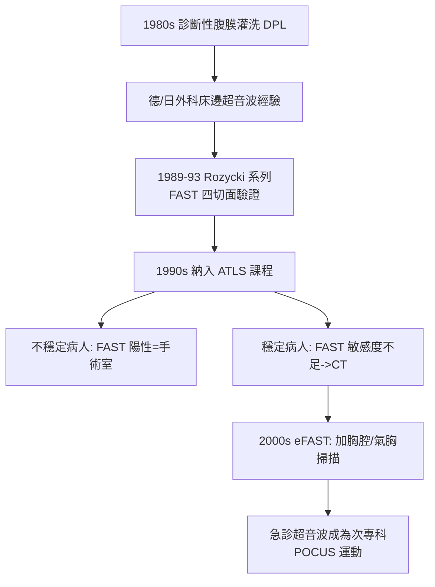

## 1989 - FAST 創傷超音波（用聲波取代手術刀：把「開腹探查」變成「床邊四個切面」）

## 案件摘要

**本案偵破的是：腹部鈍傷病人的診斷，為什麼從「灌液洗腹＋開腹探查」的侵入式路線，被「四個切面的床邊超音波」改寫？以及為什麼急診醫師堅持自己學超音波，而不是叫放射科來做？**

1980s 末，美國創傷外科界（ATLS 體系，見 `1976-ATLS創傷高級救命術.md`）的標準是診斷性腹膜灌洗（DPL）：往腹腔灌生理食鹽水再抽出來驗血——侵入、耗時、無法重複。德國與亞洲的外科醫師（1980s，如 Sonoda、Hoffmann 等）與美國的 Grace Rozycki（1989 年起系列研究）發展並驗證了 FAST（Focused Assessment with Sonography in Trauma）：在劍突下、右季肋、左季肋、恥骨上四個切面快速尋找游離液體。**FAST 在數分鐘內、床邊、可重複完成**，1990s 被納入 ATLS 課程，並成為急診醫師自學超音波運動的旗艦。

## 前因 -- 為什麼會有這個案子

- **DPL 的成本與缺點**。侵入性操作、破壞後續 CT 影像、無法定位出血源、且對不穩定病人仍需十數分鐘。
- **CT 尚未普及**。1980s 末，急診 CT 排程以小時計——創傷病人需要的是「現在」的答案。
- **德國與日本的外科傳統**。德國外科（如 Sauerland 學派）與日本創傷外科自 1980s 起在創傷復甦室直接使用超音波——美國是後來者。
- **急診醫師的職業戰場**。影像檢查由放射科掌控的秩序，成為急診專科化（`1979-急診醫學成為第23個專科.md`）必須突破的邊界——「自己的病人自己掃」是專業自主權之爭。

## 線索與推理 -- 數學式、程式、理論

FAST 的診斷邏輯是**概率更新**：在創傷復甦的前驅概率（驗前概率）下，四切面結果快速更新是否需要手術的判斷：

$$ \text{驗後機率} = \frac{\text{靈敏度} \times \text{驗前機率}}{\text{靈敏度} \times \text{驗前機率} + \text{偽陽性率} \times (1-\text{驗前機率})} $$

$$ \text{FAST 靈敏度} \approx 70\text{–}90\%（腹部游離液）， \text{特異度} \approx 95\%+ $$

```python
# FAST 的貝葉斯更新（示意）
def post(pred_test_positive, sensitivity=0.85, specificity=0.98):
    ppv = sensitivity * pred_test_positive / (sensitivity * pred_test_positive
          + (1 - specificity) * (1 - pred_test_positive))
    return ppv

print(f"低驗前機率(穩定輕傷, 5%): FAST陽性 PPV ≈ {post(0.05)*100:.0f}%")
print(f"高驗前機率(不穩定鈍傷, 60%): FAST陽性 PPV ≈ {post(0.60)*100:.0f}%")
# 低驗前機率(穩定輕傷, 5%): FAST陽性 PPV ≈ 69%
# 高驗前機率(不穩定鈍傷, 60%): FAST陽性 PPV ≈ 99%
# FAST 陽性在不穩定病人=直送手術室; 在穩定病人=需要 CT 確認
```



FAST 的真正革命是**檢查的地點與時間被移進復甦現場**：診斷從「把病人送去影像科」變成「把儀器帶到病人身邊」——這是 Larrey 原理（資源向病人移動，`1797-Larrey飛行救護車.md`）在診斷學上的重演。

## 結案 -- 後果與影響

- **ATLS 標準化 FAST**。全球創傷課程同步更新，FAST 成為復甦室標配——診斷的標準流程以分鐘計。
- **POCUS 運動誕生**。急診超音波（point-of-care ultrasound）從 FAST 擴張到心臟、肺、血管、婦產、眼部——2008 年 ACEP 制定急診超音波指引；2010s「POCUS」成為全球次專科。
- **DPL 幾乎絕跡**。侵入式診斷被非侵入式影像取代——急診診斷學的無創化趨勢確立。
- **限制被誠實面對**。FAST 對後腹膜損傷、少量出血、肥胖病人敏感度不足；兒童的應用有專門爭議——FAST 的教條也經歷了被限縮的過程（「FAST 陰性不等於沒事」）。
- **一句話結案**：FAST 證明了急診診斷的最高原則不是「最準確的檢查」，而是「在最短時間內、病人所在之處、足以改變決策的檢查」。

## 關鍵人物與文獻

- Grace S. Rozycki——印第安納大學創傷外科醫師，FAST 的美國驗證系列研究（1989–1996）與 ATLS 納入的推手。
- 日本創傷外科團隊（1980s）——床邊超音波在創傷的早期大量應用。
- 德國外科超音波學派——FAST 技術的歐洲源頭。
- ACEP Emergency Ultrasound Guidelines（2001、2008、2023）——急診超音波的專科標準。
- Rozycki et al., "Prospective evaluation of surgeon-performed ultrasound as the primary adjuvant...", *Ann Surg* 1995.
