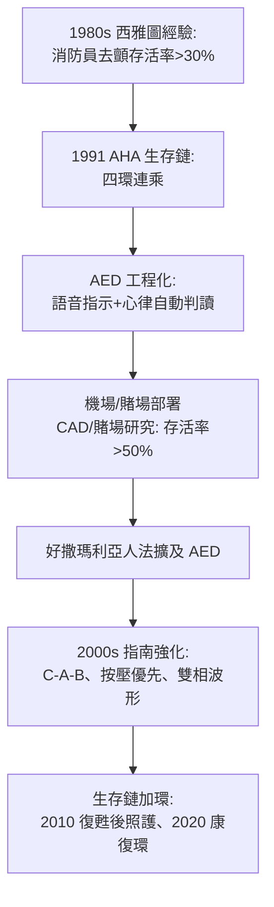

## 1991 - 生存鏈與公共 AED（把急救寫成一條有時限的鏈條，再把它搬到街角）

## 案件摘要

**本案偵破的是：心跳停止的救命知識已經齊備（CPR、去顫、高級照護），為什麼院外存活率仍然不到 5%？答案是：每一環之間的延遲都在殺人——而「生存鏈」是第一個把這件事畫成鏈條、並推動把去顫器搬上街頭的框架。**

1991 年，美國心臟學會（AHA）的緊急心血管照護委員會在專刊中提出「Chain of Survival」：**早期求救 → 早期 CPR → 早期去顫 → 早期高級照護**（成人院外心跳停止）。這個框架的直接政策後果是**公共電擊器（AED）運動**：自動體外去顫器被設計得讓外行人可用（語音指示、自動判讀心律），1990s 起部署於機場、賭場、健身房；2000 年代起各國立法保護善意使用者（好撒瑪利亞人法擴及 AED）。

## 前因 -- 為什麼會有這個案子

- **存活率證據堆積**。1980s 的西雅圖經驗（Leonard Cobb 的消防員去顫計畫）證明：旁觀者 CPR＋快速去顫可使院外心跳停止存活率超過 30%——問題不在技術，在**部署**。
- **院外死亡的主因是室顫**。院外成人心跳停止的初始心律多為心室顫動——它唯一確定的治療是電擊，而電擊每延遲 1 分鐘，存活率下降約 7–10%。
- **AED 的工程條件成熟**。微處理器使心律自動判讀演算法（靈敏度/特異度要求極高：絕不能電擊正常心律）可以放進輕便裝置。
- **法律風險的解鎖**。AED 部署的最大阻力是「用錯被告」——好撒瑪利亞人法的修訂使企業願意裝機。

## 線索與推理 -- 數學式、程式、理論

生存鏈的數學結構是**連乘**：總存活率是各環節成功率的乘積，因此任一環節的薄弱都會壓垮全局：

$$ S_{\text{總}} = p_{\text{求救}} \times p_{\text{CPR}} \times p_{\text{去顫}} \times p_{\text{高級照護}} $$

```python
def chain_survival(p_call, p_cpr, p_shock, p_ac):
    return p_call * p_cpr * p_shock * p_ac

print(f"無 AED、無旁觀 CPR: {chain_survival(0.90, 0.20, 0.30, 0.70)*100:.1f}%")
print(f"旁觀 CPR:           {chain_survival(0.90, 0.60, 0.35, 0.70)*100:.1f}%")
print(f"CPR+3分內AED:       {chain_survival(0.90, 0.60, 0.75, 0.70)*100:.1f}%")
# 無 AED、無旁觀 CPR: 3.8%
# 旁觀 CPR:           13.2%
# CPR+3分內AED:       28.4%
# 連乘結構 => 加強最弱的一環(去顫延遲)對總存活率的邊際效益最大
```



生存鏈是「時間窗治理」（`1973-馬里蘭創傷系統與黃金一小時.md`）的完美示範：它把一連串複雜的系統工程壓縮成四個人人可懂的名詞，使立法者、企業主與市民都能對準同一目標——**修辭與連乘數學在此完全一致**。

## 結案 -- 後果與影響

- **公共 AED 成為城市基礎設施**。機場、地鐵、學校、飛機上的 AED；芝加哥機場與賭場的系列研究證明 3 分鐘內電擊可讓存活率超過 50%。
- **指南的動態演化**。2000、2005、2010、2015、2020 年每五年改版：C-A-B、按壓深度 5–6 cm、頻率 100–120、最小化中斷——生存鏈的每一環都在被量化重修。
- **生存鏈的加環史**：2010 年加入「復甦後照護」（整合心導管與低溫治療，見 `2006-門球時間聯盟.md` 的區域網絡邏輯）；2020 年加入第六環「康復」（recovery）——鏈條的延伸反映照護範圍的擴大。
- **急診的角色改變**。急診從「接受心跳停止病人」變成生存鏈的第四環與復甦後照護起點——與心導管室、加護病房的介面被制度化。
- **一句話結案**：生存鏈的發明證明了急救的成敗不在任何單一技術，而在**環與環之間的縫隙**——而工程師做對的一件事，是把最貴的縫隙（去顫延遲）用一枚可被外行人使用的盒子填上了。

## 關鍵人物與文獻

- Leonard Cobb（1929–2020）——西雅圖 Medic One 計畫創立者，證明消防員去顫模式的生存率。
- Richard Cummins——華盛頓大學流行病學家，生存鏈概念的學術奠基者。
- Mary Newman——生存鏈的早期倡議者，Sudden Cardiac Arrest Foundation 創辦人。
- AHA,"Chain of Survival"（1991, *Currents in Emergency Cardiac Care*）；AHA/ECC 指南（2000–2020）系列。
- Page et al.,"Use of automated external defibrillators by a U.S. airline," *NEJM* 2000；Valenzuela et al.（賭場研究）*NEJM* 2000.
