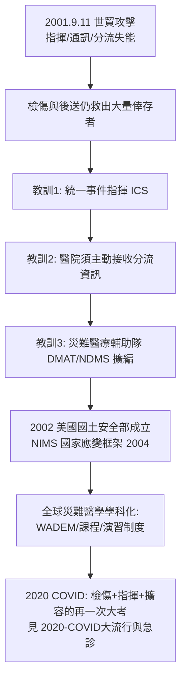

## 2001 - 九一一與災難醫學體系（當檢傷與指揮同時上場：一場災難的重寫清單）

## 案件摘要

**本案偵破的是：九一一攻擊當天，紐約的救護系統在沒有完整傷亡清單、現場指揮疊床架屋、醫院瞬間湧入數千人的情況下，做對了什麼、做錯了什麼？以及為什麼這一天成為現代災難醫學（Disaster Medicine）與國家應變體系的分水嶺？**

2001 年 9 月 11 日上午，兩架客機撞入世貿雙塔。紐約市消防局、警察局、緊急醫療服務（EMS）的通訊與指揮互不相通；現場湧入數百救護單位與上萬志工；五間一級創傷中心在數小時內接收逾千名傷患——但因疏散相對順利，**多數醫院發現「準備好的傷患潮」沒有來**（多數倖存者自行離開或就近就醫）。當日死亡近 3,000 人，幾乎全部是即時死亡（塌陷與墜落）——「可救而未救」的比例驚人地低，暴露的問題不在急救品質，而在**指揮、通訊與規劃的假設錯誤**。

## 前因 -- 為什麼會有這個案子

- **MCI 理論已就緒（`1983-START檢傷與大批傷患.md`），但部署與指揮未整合**。紐約的檢傷與後送由不同單位各自為政，無線電頻道不相容。
- **「傷患潮假設」的盲點**。災難規劃預設「醫院將被湧入」；九一一顯示：高致命性建築倒塌的倖存者多為輕傷且自行就醫——真正的問題是「資源過剩地點的資訊真空」。
- **1990s 恐攻預案的積累**。1993 年世貿炸彈攻擊、1995 年奧克拉荷馬市與東京地鐵沙林事件提供預案素材，但都停留在地方層級。
- **災難醫學的學術化起點**。1980s 起美國有 NDMS（國家災難醫療系統，1984），但規模與演練遠不及需求——九一一成為它的壓力測試與擴編理由。

## 線索與推理 -- 數學式、程式、理論

災難醫學的核心數學是**資源-需求曲線的錯位**：日常醫療的需求緩慢變化，災難則使需求函數在分鐘內跳升、隨後劇烈變形（九一一的需求高峰在第一小時，之後是長尾的心理創傷）：

$$ \text{災難響應} = \min\left( C_{\text{現場指揮}},\ C_{\text{檢傷}},\ C_{\text{後送}},\ C_{\text{醫院容量}} \right) $$

```python
# 九一一當天的資訊-資源錯位（示意）
def effective_capacity(hospitals, pre_alert_minutes, self_referrals):
    # 預警時間越短、自行就醫越多, 有效容量越低
    alert_factor = min(pre_alert_minutes / 30, 1)
    return hospitals * (0.4 + 0.6 * alert_factor) * (1 - self_referrals * 0.3)

print(f"預警 5 分、自行就醫多: 有效容量 ≈ {effective_capacity(5, 5, 0.6):.1f} 間當量")
print(f"預警 30 分、分流通報:  有效容量 ≈ {effective_capacity(5, 30, 0.2):.1f} 間當量")
# 預警 5 分、自行就醫多: 有效容量 ≈ 2.6 間當量
# 預警 30 分、分流通報:  有效容量 ≈ 4.6 間當量
# 殺傷力最大的不是容量不足, 是容量「未被告知如何使用」
```



**檢傷在九一一的實際運作**值得特別記錄：現場的 START 檢傷（`1983-START檢傷與大批傷患.md`）因建築物持續崩落而無法標準執行，救護單位採取「即到即送」的簡化模式——這暴露了檢傷法的隱藏假設：**現場必須相對安全**。當現場本身是危險源，檢傷哲學必須讓位給搶救與撤離的優先序。

## 結案 -- 後果與影響

- **指揮體系國家化**。美國建立 NIMS（國家事故管理系統，2004）與 ICS 的全國標準——「統一指揮、互通頻道」成為法制要求。
- **災難醫學學科化**。災難醫學成為急診醫學的正式次專科（美國 2003 年起認證軌道）；大學開設災難醫學課程；全災害（all-hazards）規劃取代單一情境預案。
- **醫院的「接收側」改造**。醫院突發事件指揮系統（HICS）、擴容演習、緊急備用電源與隔離病房——九一一與其後的 SARS、Katrina、COVID 連續重塑醫院的災難設計。
- **心理創傷的長尾**。救難人員與倖存者的 PTSD、癌症長期隊列（WTC Health Program 至今運作）——災難醫學的時間尺度被證明是「數十年」而非「數小時」。
- **一句話結案**：九一一教會災難醫學最反直覺的一課——**殺傷力的上限不在敵人，而在體系自己的假設**；規劃錯誤的傷患潮，比真實的傷患潮更致命。

## 關鍵人物與文獻

- 紐約市消防局（FDNY）、紐約市警察局、紐約市 EMS——當日應變的三大系統；其內部事後報告（McKinsey Report）成為指揮整合改革的依據。
- The 9/11 Commission Report（2004）——包含應變體系缺失的官方重建。
- NDMS / DMAT 隊伍——被動員的聯邦災難醫療力量。
- 9/11 Commission,"The 9/11 Commission Report," 2004；McKinsey & Company,"FDNY Incident Management System," 2002.
