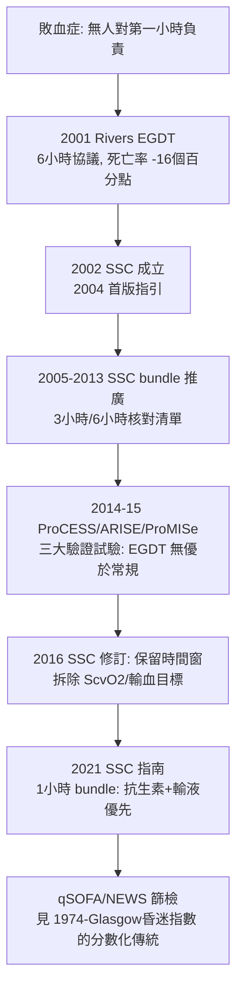

## 2001 - 敗血症 EGDT 與 bundle（一個 6 小時的協議，一場持續二十年的驗證戰爭）

## 案件摘要

**本案偵破的是：敗血症——這個每年殺死全球上千萬人的症候群——為什麼在 2001 年之前幾乎沒有「時間窗」概念？以及為什麼一項後來被證明「效應過度樂觀」的試驗，反而催生了整個敗血症照護體系？**

2001 年 11 月，《新英格蘭醫學雜誌》發表 Emanuel Rivers 的早期目標導向治療（Early Goal-Directed Therapy, EGDT）：對重度敗血症與敗血性休克病人，在**到院後 6 小時內**以中心靜脈血氧、輸液、輸血與強心藥達成血流動力學目標——死亡率從 46.5% 降至 30.5%（相對下降約 34%）。2002 年，Surviving Sepsis Campaign（SSC）成立，2004 年發布首版指引；其核心工具「bundle」（組合處置：如 3 小時內完成乳酸測量、抗生素、輸液）把時間窗變成核對清單。

## 前因 -- 為什麼會有這個案子

- **敗血症的死亡結構**。敗血症是美國醫院外死亡與加護病房死亡的主因之一，但治療分散在急診、病房、ICU——沒有人對「第一小時」負責。
- **抗生素延遲的觀察性證據**。多項研究顯示：感染性休克病人抗生素每延遲 1 小時，死亡風險遞增——「time is life」在敗血症有流行病學影子，缺的是試驗。
- **Rivers 的假說**。全身感染早期存在「隱性組織缺氧」——血壓正常不代表氧輸送足夠；用中心靜脈血氧（ScvO₂ ≥ 70%）為目標可及早矯正。
- **品管運動的工具箱就緒**。核對清單（checklist）、bundle、時間戳——工業品管方法進入醫療（參照 `2006-門球時間聯盟.md` 的同構運動）。

## 線索與推理 -- 數學式、程式、理論

EGDT 的生理學邏輯：氧輸送 $\dot{DO_2} = CO \times CaO_2$ （心輸出量×動脈含氧量），早期休克時組織氧債累積，目標是把 $\dot{DO_2}$ 拉回臨界值以上：

$$ \text{氧債}(t) = \int_0^{t} \left( \dot{DO}_{2,\text{需求}} - \dot{DO}_{2,\text{實際}} \right) dt \quad \Rightarrow \quad \text{越早還債, 器官衰竭越少} $$

```python
def sepsis_bundle_score(hours_lactate, hours_abx, iv_fluid_given):
    score = 0
    if hours_lactate <= 3: score += 1
    if hours_abx <= 3:     score += 1
    if iv_fluid_given:     score += 1
    return score

# bundle 的本質: 把「何時做」變成可稽核的布林值
print("病人A:", sepsis_bundle_score(1.5, 2.0, True))    # 3
print("病人B:", sepsis_bundle_score(1.5, 8.0, True))    # 2  <- 抗生素延遲是最大殺手
# 觀察性研究的核心發現: bundle 達成率每提升 10%, 院內死亡相對下降數個百分點
```



**驗證戰爭是本案最深刻的一課**。2014–2015 年，ProCESS、ARISE、ProMISe 三大隨機試驗一致證明：EGDT 的詳細協議（ScvO₂ 監測、輸血目標）**並不優於良好的常規照護**。Rivers 試驗的效應主要來自「早評估、早抗生素、早輸液」的整體關注（甚至來自對照組的進步）——但 bundle 的時間窗框架被完整保留。**一項「被推翻的試驗」成為一套存活體系的開端**：這是醫學史中「假說死亡、制度誕生」的罕見案例。

## 結案 -- 後果與影響

- **敗血症成為時間敏感急症**。「3 小時／1 小時 bundle」被寫入全球指引與醫院評鑑；急診的敗血症篩檢（qSOFA、SIRS、NEWS）成為常規。
- **bundle 文化普及**。核對清單從敗血症擴散到心肌梗塞（`2006-門球時間聯盟.md`）、中風（`1995-NINDS與time is brain.md`）、手術安全——品管方法成為急診治理的母語。
- **加護醫學與急診的介面**。EGDT 使「急診 6 小時」與「ICU 後續」的交接被制度化——分界點被明確定義。
- **方法的教訓**。EGDT 案例成為「單中心突破性試驗需要多中心驗證」的教科書案例——急診醫學的證據階層因此被重新校準。
- **一句話結案**：敗血症 bundle 的真正發明不是任何一項操作，而是**「把第一小時變成有負責人、有清單、有時間戳的領土」**——即使最初的地圖（ScvO₂ 目標）畫錯了，領土本身被保住了。

## 關鍵人物與文獻

- Emanuel Rivers（1950–）——底特律亨利福特醫院急診醫師，EGDT 試驗主設計者。
- Surviving Sepsis Campaign（2002 成立；歐洲重症醫學會 ESICM 與 SCCM 共同發起）——全球敗血症指引體系。
- Mitchell Levy、Craig Coopersmith 等——SSC 指引與 bundle 的多版主編。
- Rivers et al., "Early goal-directed therapy in the treatment of severe sepsis and septic shock," *NEJM* 2001;345:1368–1377.
- ProCESS Investigators, *NEJM* 2014; ARISE Investigators, *NEJM* 2014; ProMISe, *NEJM* 2015——EGDT 的三大驗證試驗。
- Seymour et al.,"Time to Treatment and Mortality during Mandated Emergency Care for Sepsis," *NEJM* 2017——bundle 時間窗的現代實證。
