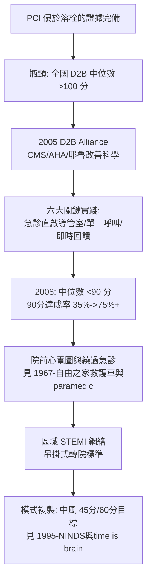

## 2006 - 門球時間聯盟（用品管運動榨出每一分鐘：把急診變成計時器）

## 案件摘要

**本案偵破的是：當「直接 PCI 優於溶栓」已被證明，為什麼全美急性心梗病人的「門球時間」（door-to-balloon, D2B）中位數仍高達兩小時？以及為什麼一場由品管專家主導的全國運動，能把這個數字壓進 90 分鐘？**

2000s 初，多項隨機試驗確立直接經皮冠狀動脈介入（PCI）優於靜脈溶栓——但前提是及時：指南建議 door-to-balloon ≤ 90 分鐘。實際全美中位數超過 100–120 分鐘。2005 年，美國心臟學會（AHA）啟動 **D2B Alliance**（由 Elizabeth Bradley、Harlan Krumholz 等主導的 CMS/AHA/耶魯團隊），以「改善科學」（improvement science）推動六大關鍵實踐：單一呼叫啟動心導管室、急診醫師而非心臟科醫師啟動、資料即時回饋、高層承諾等。至 2008 年，全美逾千家醫院參與，門球時間中位數降至約 90 分鐘以內，90 分鐘達成率從約 35% 升至 75% 以上。**這是醫療品管史上最大規模的成功之一。**

## 前因 -- 為什麼會有這個案子

- **時間-效益的證據已完備**。溶栓（`1986-GISSI與心梗溶栓革命.md`）與 PCI 的時間敏感性均被量化：PCI 延遲每 30 分鐘，一年死亡率相對上升約 7.5%（De Luca 合併分析）。
- **瓶頸不是技術是流程**。延遲的結構被研究清楚：急診等心臟科會診、導管室團隊到齊、轉院—每一段都有可測量的等待。
- **品管科學的成熟**。PDCA、瀑布圖、時間戳資料庫（CDC 的 NRMI 登錄）——醫療首次擁有「全國性可測量的延遲地圖」。
- **支付方的壓力**。CMS 把急性心梗照護指標掛入公開報告與給付——時間窗從醫學建議變成經濟訊號。

## 線索與推理 -- 數學式、程式、理論

門球時間治理的核心是**延遲的分解與再組合**：把 D2B 拆成可歸責的段，對每段設定目標：

$$ T_{\text{D2B}} = t_{\text{到院至心電圖}} + t_{\text{心電圖至啟動}} + t_{\text{啟動至穿刺}} + t_{\text{穿刺至球囊}} $$

$$ \text{目標：} \quad T_{\text{D2B}} \leq 90 \text{ 分鐘} \; \Longleftrightarrow \; \text{每段壓縮} \; (\text{目標值: 10 + 5 + 30 + 45}) $$

```python
# D2B 延遲分解: 品管運動前後
segments_before = {"到院->心電圖": 15, "心電圖->啟動導管室": 45, "啟動->穿刺": 55, "穿刺->球囊": 25}
segments_after  = {"到院->心電圖": 8,  "心電圖->啟動導管室": 10, "啟動->穿刺": 40, "穿刺->球囊": 22}
tb, ta = sum(segments_before.values()), sum(segments_after.values())
print(f"D2B 中位數: {tb} 分 -> {ta} 分")
# D2B 中位數: 140 分 -> 80 分
# 最大的壓縮段是「心電圖->啟動」: 讓急診醫師(而非等會診)直接啟動導管室
```



**方法論的深意**：D2B Alliance 不是新藥、新手術，而是「改善科學」的勝利——它證明同樣的技術、同樣的醫師，只因流程重組就能救更多人。這與敗血症 bundle（`2001-敗血症EGDT與bundle.md`）共享同一個結論：**時間的敵人通常是組織，不是疾病**。

## 結案 -- 後果與影響

- **90 分鐘成為全球標準**。各國指南採納 door-to-balloon / FMC-to-device（首次醫療接觸至器械）指標；歐洲以 ESC 指引強化至 60 分鐘目標。
- **院前分流的制度化**。EMS 現場 12 導程心電圖＋直送 PCI 中心（bypass 急診）——急診的角色從「入口」變成「例外路徑」，這是急診治理的深刻轉變。
- **品管方法成為急診母語**。時間戳登錄、公開報告、聯盟式改善——被複製到中風（door-to-needle 60→45 分鐘目標）、創傷、敗血症。
- **代價與反思**。指標壓力可能扭曲行為（為衝數字把病人直接送導管室、不當活化）；品管研究者（如 Braithwaite）警告「改善的複製性有限」——D2B 的成功無法機械化移植到所有指標。
- **一句話結案**：門球時間聯盟證明了急診醫學的終極資源不是設備或藥物，而是**流程設計**——每一分鐘都在組織圖上有一個名字。

## 關鍵人物與文獻

- Elizabeth H. Bradley——耶魯公共衛生學者，D2B Alliance 的方法論主設計者。
- Harlan Krumholz——耶魯心臟科與 outcomes research 領袖，D2B 運動的醫學旗手。
- CMS 與 AHA——資助與組織者；CDC 的 NRMI（國家心梗登錄）提供全國時間資料。
- Bradley et al.,"A national effort to reduce door-to-balloon times: the D2B Alliance," *Journal of the American College of Cardiology* 2008.
- De Luca et al.,"Time delay to treatment and mortality in primary angioplasty for acute myocardial infarction," *Circulation* 2004.
