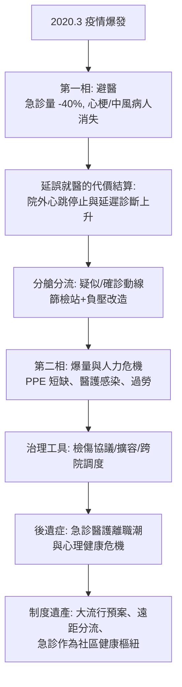

## 2020 - COVID 大流行與急診（急診體系的極限壓力測試：先空、後爆、再重組）

## 案件摘要

**本案偵破的是：當一場呼吸道大流行襲來，急診——這個被設計成「任何時間任何病人都收」的系統——為什麼在疫情初期出現史上首次「急診量崩落」，隨後又被反覆爆量、隔離、人力與物資短缺輪番考驗？COVID 是急診醫學百年來最全面的一次壓力測試。**

2020 年 3 月起，COVID-19 大流行使全球急診量在數週內下降 20–60%（美國 2020 年 4 月急診量較前年同期減少約 42%）——恐慌性避醫使心梗、中風、闌尾炎病人「消失」，延誤就醫的代價在其後數月以更高死亡率結算。隨後各波疫情使急診在「分艙分流（疑似/確診動線分離）、遠距接觸、PPE 短缺、人力病倒」之間反覆重組。**急診第一次同時扮演「篩檢站、負壓病房、檢傷前線、社會安全網」四個角色。**

## 前因 -- 為什麼會有這個案子

- **急診的容量哲學「及時運轉」**。全球醫院的床位利用率長期在 85–95%——沒有餘裕吸收疫情尖峰；急診候診走廊本身就是常態性的超載。
- **檢傷的兩層任務**。COVID 使分診台必須同時判斷「醫療緊急度」與「感染風險」——兩套邏輯首次疊加（`1983-START檢傷與大批傷患.md` 的檢傷傳統面對全新維度）。
- **SARS 與 MERS 的預演**。2003 年 SARS 使亞洲急診建立了發燒篩檢站、負壓動線與醫護保護規範——2020 年的許多「發明」其實是 2003 年的復刻。
- **資訊環境的劇變**。疫情同時是資訊災難：指南每日改寫、社群媒體恐慌、遠距醫療爆發——急診成為「錯誤資訊」的接收端。

## 線索與推理 -- 數學式、程式、理論

COVID 對急診的衝擊可用**兩相模型**描述：第一相（避醫）需求斷崖，第二相（爆量＋延誤代價）需求反彈並轉重症化：

$$ E_{\text{量}}(t) = E_0 \cdot \left[ (1-\phi_{\text{避醫}}(t)) + \phi_{\text{COVID病人}}(t) \right] $$

```python
# 急診量的兩相衝擊（以基期 100 表示）
phases = {
    "基期(2019)":        {"一般急診": 100, "COVID 急診": 0},
    "2020.4 首波":       {"一般急診": 58,  "COVID 急診": 22},
    "2020.7 反彈":       {"一般急診": 85,  "COVID 急診": 30},
    "2020-21 冬季尖峰":  {"一般急診": 78,  "COVID 急診": 65},
}
for k, v in phases.items():
    print(f"{k}: 總量 ≈ {sum(v.values())}（基期 100）")
# 基期(2019): 總量 ≈ 100（基期 100）
# 2020.4 首波: 總量 ≈ 80（基期 100）
# 2020.7 反彈: 總量 ≈ 115（基期 100）
# 2020-21 冬季尖峰: 總量 ≈ 143（基期 100） <- 一般急診被壓縮、COVID 佔走容量
```



**檢傷的倫理回歸**。疫情高峰的加護病房與氧氣分配（義大利、紐約、印度）把「黑標」的倫理問題（`1983-START檢傷與大批傷患.md`）從災難現場帶進醫院內部——各國醫學會首次公開發布「分配協議」（allocation protocols），社會被迫在戰時以外討論醫療配給。

## 結案 -- 後果與影響

- **急診量結構的永久改變**。部分輕症流向遠距醫療與急診替代；急診被重新定位為「複雜、高風險病人的樞紐」——同時財務上因病人量結構變化而受創。
- **醫護人力危機**。離職潮、倦怠、創傷後壓力——急診人力成為全球醫療體系最脆弱的環節之一；「急診過載（ED crowding）」從品管議題升級為公共衛生議題。
- **預案的制度化**。大流行條約談判、國家戰略儲備改革、PPE 供應鏈重組——COVID 是 2001 年九一一（`2001-九一一與災難醫學體系.md`）之後對應變體系最大的一次重寫。
- **急診醫學的科學貢獻**。急診醫師參與臨床試驗（RECOVERY、抗病毒藥物）、即時資訊網絡（急診醫師的社群與預印本文化）——急診第一次在「治療知識生產」上居於全球前線。
- **一句話結案**：COVID 證明急診醫學的最終形態不是「科的急診」，而是**社會的故障保險絲**——當社會的任何一個系統失靈，最後都會變成急診的問題。

## 關鍵人物與文獻

- WHO 與各國衛生部門——疫情應變的國際協調者。
- RECOVERY Trial 團隊（牛津）——地塞米松等治療證據的快速生產者，急診與重症醫師為主要執行者。
- 美國 CDC/MMWR、歐洲 ECDC——急診量與超額死亡的即時監測。
- Hartnett et al.,"Impact of the COVID-19 Pandemic on Emergency Department Visits," *MMWR* 2020——避醫現象的標誌性量化。
- WHO,"COVID-19 Strategic Preparedness and Response Plan"系列；各國分配協議（如紐約州 Ventilator Allocation Guidelines, 2015/2020 修訂）。
