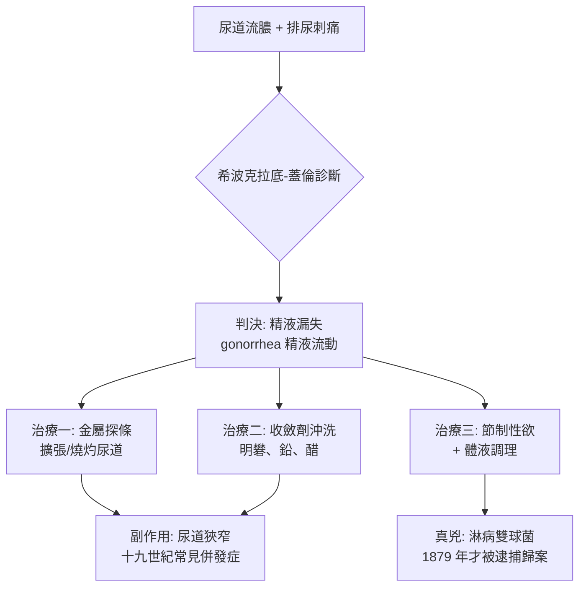

## -0400 - 希波克拉底精滴症（一個解剖學錯誤，統治了兩千年的診間）

## 案件摘要

**本案偵破的是一樁長達兩千年的「身份誤認」：把膿當成了精液。**

約西元前 400 年，希波克拉底學派的醫者們在科斯島上觀察到一種疾病：男性尿道持續流出液體，排尿刺痛。他們判斷——流出的就是精液，是身體「留不住種子」的衰弱症。約 150 年，蓋倫用希臘語將它定名 **gonorrhea**：gonos（精液）+ rhoia（流動）＝「精液流動」。**名字本身就是錯誤判決書**，而這份判決書的效力一直延續到 1879 年奈瑟發現淋病雙球菌為止（那已經是另一章的故事了）。

## 前因 -- 為什麼會有這個案子

- **體液學說是本案的思想現場**。希波克拉底學派《論人的本性》主張人體由血液、黏液、黃膽汁、黑膽汁四種體液構成，疾病即體液失衡；治療＝恢復平衡（放血、催吐、飲食調整）。
- **淋病在體液框架裡「完美自洽」**。尿道流出溫熱、微白的液體——與精液外觀相符，且患者常在性交後發病。於是結論水到渠成：這是精液失控外流。
- **「精滴症」的病理想像**。學派著作（如《論生殖》《論疾病》）認為脊柱與關節的「骨髓」會持續漏失，導致腰痠、膝軟、甚至牙齒鬆動——這解釋了為何慢性淋病患者「渾身虛弱」。
- **治療順理成章地走向「封堵與清創」**。既然是管子漏了，就收緊管子、清洗管子。
- **蓋倫的權威把錯誤鑄成金身**。蓋倫（129–約 200 年）是羅馬醫學的絕對權威，他的命名與解釋被此後一千五百年拜占庭、阿拉伯、歐洲醫學照單全收。

## 線索與推理 -- 數學式、程式、理論

體液學說如何「解釋」性病？可以用其病因模型寫成一個平衡式：

$$ \text{健康} = \frac{\text{血液} \times \text{黏液}}{\text{黃膽汁} \times \text{黑膽汁}} \quad \text{失衡} \Rightarrow \text{排泄異常} $$

而精滴症的「蓋倫模型」可表示為：

$$ \text{性欲過度} \rightarrow \text{骨髓虧損} \rightarrow \text{精液自尿道漏出} \rightarrow \text{虛弱症候群} $$

古代療法工具箱（見於蓋倫與其後的醫學文獻）：

| 療法 | 材料 | 意圖 | 實際後果 |
|---|---|---|---|
| 尿道灌注 | 明礬水、醋、鉛溶液 | 收斂「漏出的精液」 | 化學性灼傷，加劇狹窄 |
| 金屬探條（sound） | 銅、銀製細桿 | 擴張尿道、清除「堵塞」 | 假道、出血、感染加重 |
| 燒灼 | 熱鐵、腐蝕藥 | 封閉「滲漏處」 | 疤痕狹窄，慢性疼痛 |
| 飲食與禁欲 | 冷性食物、節制 | 減少精液生成 | 無效但無害 |

推論：這不是庸醫故事，而是**觀察正確、框架錯誤**的典型案例。症狀記錄（流膿、刺痛、慢性化）完全忠實；錯的是把膿細胞讀成了精子。

## 疑點複核 -- 為什麼兩千年沒有人翻案？

這是本案最值得深思的部分。症狀觀察者成千上萬，膿裡的線索每天都被沖洗掉，卻無人起疑。原因可以列為三條：

- **權威的閉環**。蓋倫之後，拜占庭、阿拉伯（如阿維森納《醫典》）與中世紀歐洲醫學都是「註釋式醫學」——任務是解讀權威，而非檢驗權威。疑點在註釋傳統裡會被「調和」掉，而不是被證偽。
- **觀察工具的缺席**。沒有顯微鏡，膿液只是「膿」；1676 年列文虎克已用自製顯微鏡看見「微生物小獸」，但要到 1879 年才有人想到在淋病膿液裡找雙球菌——工具與問題的相遇，晚了三百年。
- **理論的自我隔離**。在體液學說裡，「精液漏失」與「膿液分泌」屬於不同的解釋層（前者是體質虧損，後者是局部熱症），兩套解釋可以並存而不互斥——框架本身不會產生「這兩者是同一件事」的疑問。

還有一條歷史支線值得記錄：中醫的對照譯本。同時代的觀察在《諸病源候論》（`0061-諸病源候論疳瘡.md`）中被歸入「濕熱下注」，同樣正確記錄症狀、同樣錯置因果——兩大醫學傳統在同一個症狀上，各自蓋了一座兩千年不倒的錯誤紀念碑。

## 結案 -- 後果與影響

- **「精液漏失致虛弱」的迷思延續兩千年**。它孕育了中醫「腎虧」之外的西方版本——十九世紀「精液耗損症」恐慌、禁欲運動與各種壯陽補品產業，全部流著蓋倫的血液。
- **尿道探條成為千年刑具**。金屬探條療法一直流行到十九世紀末，造就了大量醫源性尿道狹窄——許多「老淋病」的痛苦其實一半來自治療本身。
- **命名鎖死了認知**。當病名叫「精液流動」，醫生就不會去找膿裡的微生物。直到 1879 年 Albert Neisser 在膿液中找到雙球菌，本案才真正翻案。
- **與本書的連結**。體液框架下，性病被視為「個體失衡」而非「外部入侵」，因此不會產生傳染防治的思路——這正是 `1530-弗拉卡斯托羅梅毒史詩.md` 中傳染小體理論的革命性所在。

## 案件補遺 -- 「虧損恐懼」的千年產業鏈

蓋倫的錯誤診斷還催生了一條橫跨兩千年的社會產業鏈，值得立案歸檔：

- **醫源性的疼痛**。金屬探條在十九世紀仍是泌尿科常備器械，配合「追逐式擴張」（chasing the stricture）的教條，患者往往終身每週就診擴張——醫學史家估計，維多利亞時代泌尿科門診的相當比例是這類醫源性尿道狹窄。
- **道德教條的科學外包**。「精液＝生命精華」的觀念讓禁欲宣傳獲得醫學背書：十九世紀的醫學通俗讀物把自慰與「精液耗損」導致的衰弱、瘋癲、失明連成因果鏈，其實全是蓋倫「骨髓漏失」模型的近代翻版。
- **補品經濟**。「補精」「壯陽」產品市場的理論根據，正是「漏失致病」——一個錯誤診斷養活了無數藥商，直到二十世紀才真正失去科學庇護。
- **比較視角**。同一時代的東方敘事把類似症狀歸為「腎虧」（見 `0061-諸病源候論疳瘡.md`），兩套文化各自發展出「耗損恐懼」——人類學上幾乎是同一個原型神話的兩種方言。

## 關鍵人物與文獻

- 希波克拉底（約前 460–前 370）與科斯學派——《希波克拉底文集》記載尿道炎、排尿困難與「精液漏失」症狀。
- 蓋倫（Galen，129–約 200）——命名 gonorrhea，將其歸入「精液耗損」病理，權威化此錯誤。
- Aretaeus 與 Celsus——羅馬時期醫家，留下更詳細的尿道炎與探條治療描述。
- Albert Neisser（1879）——發現淋病雙球菌，為本樁兩千年懸案畫下句點的翻案者。
