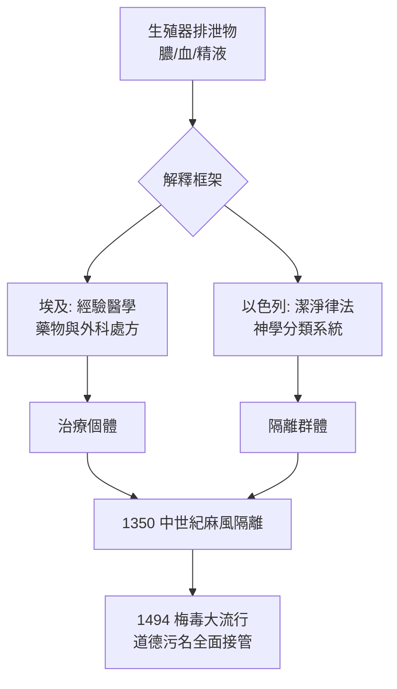

## -1550 - 埃伯斯紙草與利未記的不潔（人類最早的性病檔案，寫在紙草與律法之間）

## 案件摘要

**本案偵破的，不是一種病，而是一種制度的誕生。**

約西元前 1550 年，埃及底比斯某位醫者在紙草上抄錄處方；幾個世紀後，猶太祭司在律法書中寫下關於「下體流穢」的隔離條文。這兩份文獻共同構成了人類歷史上最早的性病檔案：一邊是**治療**，一邊是**潔淨**。而這對雙生子——醫學與道德——將在之後三千五百年裡，反覆共同出現在每一場性病疫情現場，直到 `1564-法洛皮奧亞麻套與早期避孕套.md` 與二十世紀的愛滋時代，仍然能聽見利未記的回聲。

## 前因 -- 為什麼會有這個案子

- **病原是兇手，但古人沒有顯微鏡**。淋病、軟下疳、可能的梅毒前身在青銅時代已存在，古人只能看見膿、潰瘍與疼痛，於是被迫發明解釋。
- **美索不達米亞泥板是第一位證人**。蘇美與巴比倫的醫學泥板（約前 2000–前 1000 年）記載陰莖流膿之症，並將病因歸於神明之怒與邪靈附身；治療兼用草藥與驅邪咒語。
- **埃及走的是經驗路線**。《埃伯斯紙草》（Ebers Papyrus，約前 1550 年）全長約 20 公尺、記載逾 700 種處方，其中針對「排尿疼痛」「生殖器潰瘍」的療法包括蘆薈、沒藥、蜂蜜敷料與尿道灌注。
- **利未記是第二位證人**。《舊約·利未記》第 15 章規定：遺精、經血、生殖器排泄物皆為「不潔」（tumah），患者須洗滌衣物、沐浴、隔離至傍晚，接觸其床榻者亦不潔。
- **祭司取代了醫生的一部分職能**。在聖殿制度下，「潔淨檢查」由祭司執行——這是史上最早的公共衛生行政體系之一。

## 線索與推理 -- 數學式、程式、理論

古人沒有細菌理論，但他們建構了一套自洽的「污染傳播模型」。若把利未記第 15 章的條文形式化，其實是一條傳染鏈規則：

$$ \text{不潔者} \xrightarrow{\text{接觸}} \text{接觸者} \xrightarrow{\text{洗滌/隔離}} \text{潔淨狀態} $$

```python
# 以現代術語重寫利未記 15 章的「污染傳播演算法」
def levitical_quarantine(source, contact, duration_to_evening=1):
    """
    source: 被判定為不潔的身體
    返回: 接觸者的潔淨時間表
    """
    contamination = {"source": "tameh(不潔)", "objects_touched": "需洗滌"}
    if contact:
        contamination["contact"] = "tameh(不潔)"
    # 隔離至「傍晚」——即設定了固定的隔離期
    return {"wash": "洗身+洗衣", "quarantine_hours": duration_to_evening}

print(levitical_quarantine("流穢者", True))
# 輸出: {'wash': '洗身+洗衣', 'quarantine_hours': 1}
```



關鍵推論：「不潔」是一個**分類制度**而非病因學說。它不問「為何得病」，只問「誰接觸了誰」。這使它成為有效的公共衛生工具，同時也是有效的社會控制工具——同一條律法，兩種用途。

三大文明對「同一批症狀」的不同處理方式，可以並排成一張對照表——這是本案最重要的偵查發現：

| 文明 | 文獻 | 對生殖器症的解釋 | 主要對策 |
|---|---|---|---|
| 美索不達米亞 | 醫學診斷泥板（約前 2000–前 1000） | 神怒、邪靈、巫術攻擊 | 草藥灌洗＋驅邪咒語並行 |
| 埃及 | 埃伯斯紙草（約前 1550） | 體內腐敗物、蟲（蠕蟲論） | 蘆薈、沒藥、蜂蜜、尿道灌注 |
| 古以色列 | 利未記第 15 章（前 6–前 5 世紀成書） | 「不潔」狀態（tumah），非「病」 | 洗滌、隔離至傍晚、計日潔淨儀式 |

注意第三行的關鍵差異：以色列體系**根本不治療**。利未記的第 15 章裡沒有任何藥方——它處理的不是病人，而是病人與社群之間的界線。「不潔」是一個傳播學範疇，不是病因學範疇；這正是它成為公共衛生原型的原因，也是它成為壓迫工具的原因。

另一條不可忽略的線索：埃及紙草的處方裡出現了**局部收斂與抗菌直覺**。蜂蜜的高滲透壓抑菌、礬類的收斂，在經驗層面確實能緩解潰瘍與尿道炎的症狀。也就是說，青銅時代的醫者並非全然無效——他們只是不知道自己為什麼有效。這種「經驗有效、理論錯誤」的組合，將是本書反覆出現的主題（比較 `-0400-希波克拉底精滴症.md` 的探條與 `1690-水銀療法與劇毒蒸氣.md` 的汞劑）。

## 結案 -- 後果與影響

- **隔離與洗滌成為遺產**。Lazaretto 檢疫島、麻風病院的強制隔離，乃至近代的檢疫法，其制度原型皆可追溯到利未記式的「不潔—隔離—洗淨」程序（見 `1350-麻風鈴鐺與罪惡身體.md` 同款機制）。
- **道德污名同步誕生**。生殖器症狀天然指向性行為，於是「病＝不潔＝罪」的三段論被焊接進西方與近東文化，之後在 `1494-那不勒斯梅毒大流行.md` 中以毀滅性的效率重新啟動。
- **醫學與神學的分道與重逢**。埃及的經驗療法進入了希波克拉底傳統（`-0400-希波克拉底精滴症.md`）；而神學的污名框架則進入了中世紀教會法。
- **一句話結案**：人類治理性病的第一件工具是制度，不是藥——而制度的雙面刃從第一天起就已出鞘。

## 案件補遺 -- 制度的雙面體

把利未記制度拆開來看，它的兩個面向必須同時承認，缺一即失真：

- **公共衛生的一面**。在沒有微生物概念的時代，「接觸後洗滌、狀態解除前隔離」是純經驗性的傳播阻斷設計。經血與膿液的接觸傳染（如產褥熱時代的醫生手）在二十世紀才被 Semmelweis 用數據證明，而律法以「不潔」概念提前實施了同樣的行為規範。
- **道德壓迫的一面**。「不潔」與道德罪責的界線在律法內部其實是模糊的——它雖然也涵蓋非自願的生理現象（遺精、月經、產後排泄），但到了後期拉比與教父詮釋手中，生殖器症狀越來越與性行為、與「淫」字掛鉤。分類制度一旦附著道德語言，就會自動生成污名。
- **污名的複利效應**。污名不會隨時間折舊，只會複利增長：每一次新疫情（麻風、梅毒、疱疹、愛滋）都向這個古老的帳戶借貸。

## 關鍵人物與文獻

- 佚名埃及醫者——《埃伯斯紙草》（Ebers Papyrus，約前 1550 年）的抄寫與編纂者，紙草現藏萊比錫大學。
- 佚名祭司集團——《利未記》第 15 章（P 典源，成書約前 6–前 5 世紀）的立法者。
- 美索不達米亞的 asû（醫者）與 āšipu（驅邪祭司）——治療與咒語的雙軌執行者。
- Georg Ebers——1873 年發現並購得該紙草的埃及學家，文獻因他而得名。
