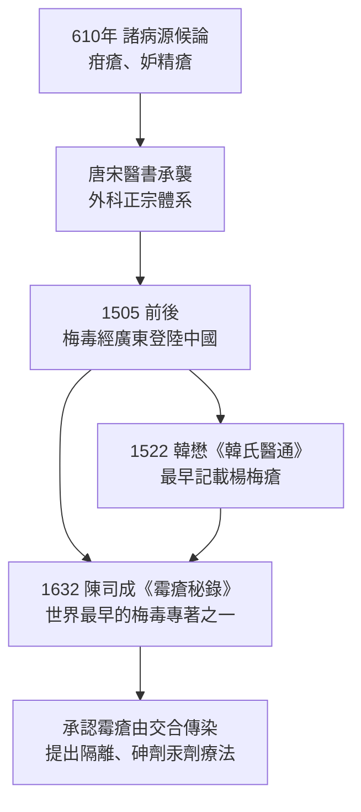

## 0061 - 諸病源候論疳瘡（隋代太醫的性病病理學，比梅毒登陸早了九百年）

## 案件摘要

**本案偵破的是：當歐洲還在體液學說裡打轉時，中國醫學已經為生殖器潰瘍建立了完整的分類學檔案。**

大業六年（610 年），隋代太醫博士巢元方奉敕主持編成《諸病源候論》五十卷、論候 1739 條——這是中國第一部系統性病因病理學專著，也是官修醫學「檔案室」。其中記載的「疳瘡」「妒精瘡」等病候，正是今天所謂下疳類病變（硬下疳、軟下疳）的中古觀察紀錄。距離哥倫布啟航還有八百八十二年，距離梅毒以 `1494-那不勒斯梅毒大流行.md` 的方式橫掃歐洲並隨後傳入中國，還有近九個世紀——但東方醫學早已備好了接收疫情的敘事框架：**濕熱、淫邪與氣血失調**。

## 前因 -- 為什麼會有這個案子

- **官方編纂是本案的制度背景**。隋煬帝敕令巢元方與吳景賢等校閱醫書、總結眾病源候，全書以「候」為單位，每候一論，只講病因與症狀、不附藥方——純病理學。
- **「疳」是一個家族性分類**。中醫的「疳」泛指慢性糜爛、潰瘍性病變（小兒疳積、下疳、陰部疳瘡），《諸病源候論》將發於前陰者描述為瘡瘍濕爛、久不收口。
- **「妒精瘡」是本案最精準的條目**。後世醫書（承此書體例）將性交後發生於龜頭、冠狀溝的潰瘍稱「妒精瘡」，明確與房事相連——這是行為流行病學的直覺觀察。
- **中醫的病因框架是氣與濕熱**。不是體液失衡（那是希臘的，見 `-0400-希波克拉底精滴症.md`），而是「濕熱下注」「淫邪入絡」「氣血失調」——同樣沒有微生物概念，但有環境—體質—行為的三因子模型。
- **道德框架同步安裝**。「妒」「淫」字入病名，即暗示病因在縱欲與不潔之交合——與利未記的「不潔」邏輯殊途同歸（`-1550-埃伯斯紙草與利未記的不潔.md`）。

## 線索與推理 -- 數學式、程式、理論

中醫的病因模型可寫成如下的乘法關係：

$$ \text{發病} = \text{正氣虛（氣血失調）} \times \text{濕熱下注} \times \text{淫邪/房事不慎} $$

這個模型的有趣之處在於它與現代流行病學的「三角模型」可以對位翻譯：

| 《諸病源候論》概念 | 現代流行病學對應 | 備註 |
|---|---|---|
| 正氣虛 | 宿主易感性 | 免疫力低下 |
| 濕熱（環境） | 環境危因子 | 潮濕、氣候、衛生 |
| 淫邪入體 | 病原暴露途徑 | 性行為傳播 |
| 疳瘡／妒精瘡 | 下疳（硬／軟） | 症狀學分類 |

《諸病源候論》卷四「虛勞陰瘡候」指出：腎氣虛弱、風邪濕氣乘虛而入，發為陰瘡——其推理結構是「**先有虛，後有邪**」。這與西方瘴氣論（壞空氣＋體質弱）驚人地平行，兩者都把「為什麼是他得病」歸於宿主，而把傳播鏈藏在背景裡。真正的轉折要等到梅毒疫情迫使中醫承認一種「無虛也會中招」的強傳染病——《霉瘡秘錄》明言「霉瘡」由「精竅」而入、傳染配偶子女，這是中國醫學史上第一次把一種病徹底歸給性接觸。

## 疑點複核 -- 隋代醫官看見了什麼？

回到 610 年的案發現場，《諸病源候論》裡與本案直接相關的條目結構值得仔細檢視：

- **「虛勞陰瘡候」（卷四）**。將陰部瘡瘍繫於「腎勞虛損、風濕乘虛」——把病灶放進「虛勞」總綱之下，這是全書的分類學特色：先立總病機，再分列候。
- **「疳瘡」諸候**。描述瘡面濕爛、久不收口、分泌物的外觀與氣味——症狀學描寫精細，是全書被後世外科奉為圭臬的原因。
- **病因的多因模型**。風、寒、濕、熱、蟲、飲食、房室勞損並列為病因來源，其中「房室」作為獨立病因類別，使性病在中文醫學敘事中天然帶有行為歸因。

一條重要的斷代線索：**《諸病源候論》成書時，梅毒尚未存在於舊大陸**。因此書中「疳瘡」「妒精瘡」所指的應是軟下疳、皰疹、外陰潰瘍等前梅毒時代疾病。這使得該書成為「梅毒登陸前的基準線」——1505 年之後的醫書突然出現前所未有的嚴重潰爛病例敘述時，正是這條基準線讓後世史家能夠判定疫情是新入的。換句話說，巢元方在不知情的情況下，為九百年後的流行病學史家留下了一張乾淨的案發前照片。

還須記錄本書的傳承地位：唐代孫思邈《千金要方》、王燾《外台秘要》大量徵引其病候；宋代校正醫書局（1057 年）將其列為官校醫書之一；金元明清的外科著作在談論陰部瘡瘍時，體例幾乎都是從「候」出發。這部書因此是東方性病敘事的「總檔案室」——後世所有關於下疳、楊梅瘡、妒精瘡的討論，都必須回到這裡尋找起點。

## 結案 -- 後果與影響

- **建立了接收梅毒的「語言基礎設施」**。1505 年前後梅毒傳入中國時，醫者直接沿用疳瘡、瘡瘍、淫毒的既有詞彙消化它——楊梅瘡、廣瘡、黴瘡，皆舊瓶新酒。
- **「淫邪」框架被強化並制度化**。性病在中醫敘事中長期與「縱欲傷腎」綁定，患者先被道德審判、再被治療——與 `1350-麻風鈴鐺與罪惡身體.md` 的身體污名機制平行運作。
- **陳司成《霉瘡秘錄》（1632）是本案的後傳**。明末浙江醫家陳司成總結祖傳與己驗，記載梅毒各期症狀、胎傳梅毒、夫婦同治與隔離觀念，並用含砷汞的「生生乳」治療——早於歐洲砷劑療法（Salvarsan，1910）近三百年。
- **一句話結案**：東方醫學用分類學迎來了瘟疫，但真正決定敘事的仍是那個古老的三段論——病發於陰，陰通於淫。

## 案件補遺 -- 東西兩條敘事線的合流

把本檔與西方章節並排放置，可以看到一場跨越九百年的「敘事接力」：

| 年代 | 東方線 | 西方線 |
|---|---|---|
| 前 1550–610 | 疳瘡、妒精瘡分類成型（本檔） | 體液學說與精滴症（`-0400-希波克拉底精滴症.md`） |
| 1494–1505 | 基準線尚乾淨 | 梅毒大流行爆發（`1494-那不勒斯梅毒大流行.md`） |
| 1522–1632 | 楊梅瘡→《霉瘡秘錄》，承認接觸傳染 | Fracastoro 傳染小體（`1530-弗拉卡斯托羅梅毒史詩.md`） |
| 共同點 | 淫邪框架 | 道德污名框架 |

值得記錄的細節是《霉瘡秘錄》的兩項突破：其一，陳司成明確記載「胎傳霉瘡」——嬰兒自患病母體染病，這使梅毒成為中醫文獻中最早被完整描述的垂直傳染病；其二，他主張患病者「不與壯者交合、不使家人共器」，把隔離寫進了病人行為準則。這兩點在西方要到十九世紀才被系統化。換言之，當「淫邪」的道德框架在敘事層面壓迫患者時，操作層面的中醫臨床反而跑得相當快——敘事與實務的落差，正是本書貫穿的母題。

## 關鍵人物與文獻

- 巢元方（隋，約 6–7 世紀之交）——《諸病源候論》（610 年）主編，太醫博士。
- 韓懋（明，1522 年《韓氏醫通》）——較早記載「楊梅瘡」於中國流行。
- 陳司成（明末）——《霉瘡秘錄》（1632 年），中國第一部梅毒專著，記載胎傳梅毒與砷劑療法。
- 《諸病源候論》——50 卷、1739 論候，唐代《外台秘要》與宋代校正醫書局均奉為病理學依據。
