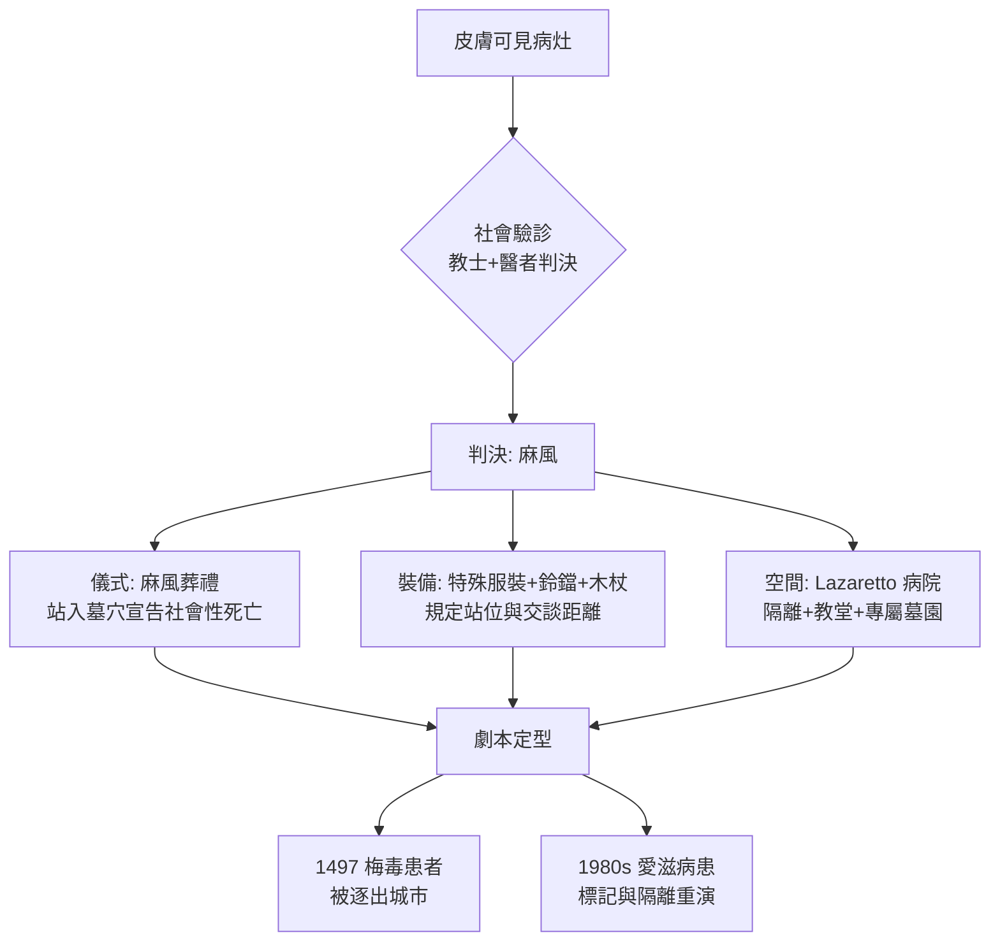

## 1350 - 麻風鈴鐺與罪惡身體（身體標記＝道德標記：一個被重演四次的社會劇本）

## 案件摘要

**本案偵破的不是麻風桿菌，而是歐洲的第一套「身體污名作業系統」。**

1340 年代，黑死病前夕的歐洲有數以萬計的麻風病人（lepers），他們被教會與世俗政權要求穿特殊服裝、掛木鈴或搖鈴、遠離人群、進入 Lazaretto（麻風病院）。當他們被宣告「與活人分離」時，教士會主持一場儀式——史家稱之為「麻風葬禮」：病人站進墓穴旁的坑中，象徵性地宣告「你已對世界死去了」。**疾病在這裡被升級為身份，身份被降級為死亡**。而這套劇本，將在 `1494-那不勒斯梅毒大流行.md`、以及二十世紀的愛滋疫情中被逐字重演。

## 前因 -- 為什麼會有這個案子

- **麻風（Hansen's disease）的病原在 1873 年才被發現**（Gerhard Armauer Hansen 的麻風分枝桿菌），中世紀的人只能依賴皮膚病灶的外觀做診斷——而這正是污名的入口：**看得見的病，才是最容易被審判的病**。
- **流行高峰約在 11–14 世紀**。十字軍東征、人口流動與都市化被認為助長傳播；英格蘭、法國、德意志的痲風病院（lazar houses）數量在 13 世紀達到高峰，僅法國就估有兩千餘所。
- **Lazaretto 是最早的常設隔離機構**。以聖拉撒路（St. Lazarus，福音書中乞討的麻風病人）命名，由教會與城市資助，內設教堂、病房、墓園——病人進得去，社會身份出不來。
- **神學詮釋是本案的核心引擎**。中世紀教士普遍將麻風解讀為神對罪的懲罰，尤其與性罪（淫亂）相連——雖然麻風與性行為毫無關聯。麻風病在《利未記》的「不潔」傳統（`-1550-埃伯斯紙草與利未記的不潔.md`）中早被列入，如今更被附會為「靈魂的麻風＝罪」的寓意病。
- **許多「麻風」可能是誤診**。牛皮癬、狼瘡、梅毒早期皮膚病灶、真菌感染都可能被送進病院——司法式驗診（由教士與醫者共同判決）的誤判率無從得知，但判決即終身。

## 線索與推理 -- 數學式、程式、理論

中世紀「身體污名」的運作機制，可以用一條符號學方程式概括：

$$ \text{可見病灶} \Rightarrow \text{內在罪性} \Rightarrow \text{社會性死亡} \Rightarrow \text{空間隔離} $$

同一套「污名劇本」在不同疾病上的重演，可以用表格直接比對：

| 劇本元素 | 中世紀麻風 | 1497 年後的梅毒 | 1980 年代的愛滋 |
|---|---|---|---|
| 身體標記 | 面部結節、殘缺 | 鼻塌、骨爛、下疳 | Kaposi 肉瘤、消瘦 |
| 歸因敘事 | 神罰、（被附會的）性罪 | 淫亂、外來病 | 性解放、特定社群 |
| 空間措施 | Lazaretto 病院 | 驅逐出城、妓院封禁 | 禁入境、強制檢測提案 |
| 儀式性驅逐 | 麻風葬禮 | 鎮門逐出 | 公開點名與社會排斥 |

麻風病院的歷史功過需要分開計算：它提供了史上最早的常設隔離基礎設施——病院（lazar house）→ 檢疫站（quarantine，1377 年威尼斯拉古薩首創 30 天隔離，後延為 40 天 quaranta giorni）→ 現代傳染病院，這條制度演化鏈是實實在在的公共衛生遺產。但它的運作邏輯不是流行病學，而是**神學**：隔離的目的與其說是阻斷傳播（麻風實際傳染力極低），不如說是維持社會純潔的界線。

## 疑點複核 -- 麻風為何被寫成「性病」？

本案最詭異的誤判是：麻風與性行為毫無關聯，卻被普遍附會為性罪的懲罰。動機鏈可以重建如下：

- **教義的需要**。中世紀神學需要可見的、現世的懲罰範例來支撐道德訓誡；麻風的毁容與慢性化使它成為最理想的「活的地獄預告」。
- **文本的誤植**。希伯來聖經的 tsara'at（被譯為 lepra）涵蓋多種皮膚病與黴斑、衣物黴變，本非今日的麻風；七十士譯本與武加大譯本以 lepra 移譯，再經拉丁教父（如衷心訓誡的講道文獻）的寓意化詮釋，把「皮膚病＝罪」焊死在歐洲文化裡。
- **傳染恐懼的錯置**。麻風分枝桿菌傳染力極低（須長期密切接觸），但外觀的駭人程度與傳染風險完全不成比例——社會隔離的力度實際上是「視覺恐懼」的函數，而非流行病學的函數。這條規律在之後的每一次疫情中都會重現（對照 `1981-CDC報告與愛滋降臨.md` 的社會反應）。

另有一條晚出的旁證：十五世紀末梅毒登陸時，歐洲一度把「大痘」（la grosse vérole）與麻風混為一談，部分醫者主張梅毒是麻風的變種——兩種病在污名系統裡互相借用了彼此的檔案。這場混亂直到 Fracastoro 分期描述梅毒（`1530-弗拉卡斯托羅梅毒史詩.md`）才逐漸釐清。

## 結案 -- 後果與影響

- **制度遺產：檢疫體系的史前史**。麻風病院、1377 年拉古薩檢疫、1423 年威尼斯在潟湖島上設立的 Lazzaretto Vecchio，構成了現代檢疫隔離制度的雛形——這條制度線在 `1494-那不勒斯梅毒大流行.md` 的梅毒疫情中被第一次大規模用於「性病」。
- **敘事遺產：三段式污名**。「可見病灶→道德罪→社會性死亡」的模板被梅毒與愛滋完整繼承，連細節都相似（梅毒病人被要求遠離水井與食物，如同麻風病人；愛滋最初被稱 GRID，並被污名化為特定群體之罪）。
- **麻風在歐洲的消退是個謎**。15–16 世紀麻風疫情衰退，一個有力假說是：新興的肺結核感染提供了對麻風分枝桿菌的部分交叉免疫（兩種分枝桿菌的 Th1 型免疫反應互相競爭）——歷史學與免疫學在此交會。
- **一句話結案**：中世紀歐洲沒有治好麻風，卻完成了「用身體審判靈魂」的技術——這項技術的推廣速度，遠快於任何醫學進步。

## 案件補遺 -- 一份「麻風葬禮」的儀式程序

現存中世紀文獻（各地主教敕令與城市法）記載的「與活人分離」儀式大致包含以下程序，值得全文歸檔，因為它的每一步都是社會機制的展示：

- **驗診判決**。由教士與醫者共同驗看皮膚病灶，宣告患病——判決在群眾面前做出，儀式本身就是公示。
- **警告文告**。部分地區的儀式中，教士向病人宣讀條款：你不得進入教堂、市場、磨坊、酒館；不得徒手觸碰任何物品；不得與任何人（家人除外）交談，除非對方先行允許；靠近水源時須後退；出門須穿特殊服裝、攜帶鈴鐺或響板，讓他人在看見之前先聽見。
- **象徵性死亡**。病人站入墓坑或持鏟向自己腳上撒土、領受「來世」的祝禱——法律上他仍活著，社會意義上他已除籍；部分地區允許麻風病人繼承處理如同死人。
- **分配斗篷與木杖**。新「身份」的裝備交付，儀式結束，病人在護送下前往 Lazaretto。

這份程序的可怕之處在於它的**精細**：每一條禁令都對應一個具體的接觸場景（食物、水、交談、觸碰），顯示設計者認真思考過傳播路徑——污名系統其實是對傳染理論的粗糙模擬。制度沒有科學，卻有科學的形狀。

## 關鍵人物與文獻

- 聖拉撒路崇拜——福音書中乞討麻風者的形象，成為病院與騎士修會（聖拉撒路騎士團，12 世紀成立）的名號來源。
- Assizes of Jerusalem（12 世紀）——十字軍王國的成文法，明文規定麻風病人的法律地位、財產與生活限制，是最著名的世俗麻風立法。
- 威尼斯共和國——1377 年拉古薩（今杜布羅夫尼克）首立檢疫法；1423 年設 Lazzaretto Vecchio，逐步擴充為近代檢疫體系。
- Gerhard Armauer Hansen（1873）——發現麻風分枝桿菌，將本病從「神罰」案卷中移交給微生物學。
