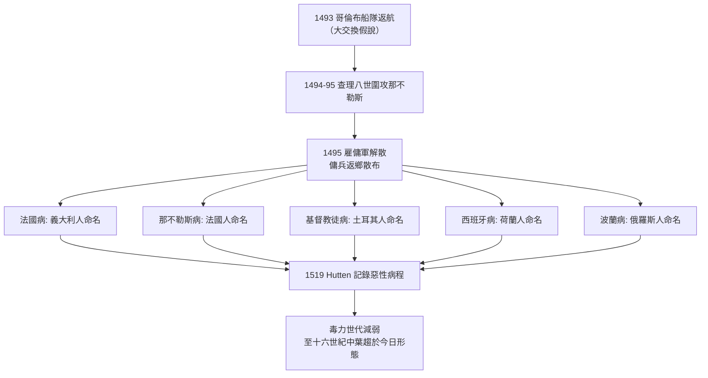

## 1494 - 那不勒斯梅毒大流行（一場圍城戰，讓全歐洲在同一種潰瘍上互相甩鍋）

## 案件摘要

**本案偵破的是：梅毒如何在 18 個月內從一場軍事行動的附帶損害，變成席捲全歐的大流行；以及「疾病命名」如何變成一場國際政治戰。**

1494 年秋，法王查理八世率約 2.5–3 萬大軍（其中雇傭兵為主力）越過阿爾卑斯山圍攻那不勒斯，1495 年 2 月入城。不久軍中爆發一種前所未有的疫病：生殖器潰瘍、全身膿皰、骨痛如焚。城破之後軍隊解散、雇傭兵各奔東西——他們成了史上最有效率的病原體傳播網。1495–1496 年，疫病以駭人速度出現在法國、德意志、瑞士、波蘭；1498 年抵達印度，1505 年前後登陸中國（見 `0061-諸病源候論疳瘡.md`），1522 年抵日本。**這是舊大陸第一次「性病全球化」**。

## 前因 -- 為什麼會有這個案子

- **「哥倫布大交換」假說是第一嫌疑人**。1493 年哥倫布船員自美洲返航，多位史家（自 Ruy Díaz de Isla 1510 年代的記載起）認為梅毒由船員自伊斯帕尼奧拉島帶回，經巴塞隆納輸入那不勒斯戰場。加勒比地區早期殖民文獻確記載當地有類似症狀的流行。
- **舊大陸起源說持續反擊**。歐洲多處中世紀骨骼（如 13–14 世紀英國赫爾的顱骨與脛骨病變）曾被主張為梅毒證據，但「梅毒前疾病」（treponemal disease，如雅司 bejel）與梅毒的骨骼鑑別極困難，爭議至今未決。分子演化學（梅毒螺旋體全基因組研究）較支持蒼白密螺旋體譜系近期跨洋傳播的圖像，但定年仍有分歧。
- **戰爭是超級傳播事件**。圍城部隊中士兵與隨營婦女的接觸密度極高；戰後雇傭軍（包括曾在法軍或那不勒斯陣營服役的加泰隆尼亞、德意志、瑞士、匈牙利傭兵）解散返鄉，把病原散布回各自的徵兵區。
- **毒力假說解釋了第一波的恐怖**。1495–1520 年代的梅毒以「惡性梅毒」形態現身：高熱、大面積潰爛、數月內致死，遠比今日兇猛。
- **沒有病原體概念，只有瘴氣與天譴**。當時醫學（體液學說，見 `-0400-希波克拉底精滴症.md`）無法理解接觸傳染，只能用星象（1494 年木星—土星合相的占星解釋一度流行）與神罰來歸因。

## 線索與推理 -- 數學式、程式、理論

病原體與宿主的共演化，可以用基礎再生數的框架說明。毒力株若殺宿主太快，會自斷傳播鏈：

$$ R_0 = \beta \times D \quad \text{其中} \; \beta = \text{傳染率}，\; D = \text{可傳染期長度} $$

$$ \text{高毒力株}: D \downarrow \Rightarrow R_0 \downarrow \quad \text{低毒力株存活}: \text{毒力隨世代減弱（也許）} $$

```python
# 模擬: 不同毒力下病原株系的命運
def r0(beta, infectious_months):
    return beta * infectious_months

strains = {
    "1495 惡性株": (0.30, 4),   # 快速致殘致死, 可傳染期短
    "現代株":     (0.25, 18),  # 病程溫和漫長, 可傳染期長
}
for name, (beta, D) in strains.items():
    print(f"{name}: R0 ≈ {r0(beta, D):.2f}")
# 惡性株宿主迅速病重臥床, 性接觸銳減 -> 有效 R0 反而更低
# 溫和株宿主帶病漫遊多年 -> 傳播鏈綿延不絕
```



1519 年，德意志人文主義者與騎士詩人 **Ulrich von Hutten** 以自身患病經驗寫下《論法國病》（De morbo gallico），記錄第一波的恐怖：膿皰潰破如橡實大、體無完膚、夜間骨痛如受酷刑、鼻塌齒落——他的記載是本案最重要的目擊者證詞，也記錄了水銀塗擦與汗蒸療法的痛苦（見 `1530-弗拉卡斯托羅梅毒史詩.md`）。

各國命名的甩鍋邏輯只有一條：**把疫病歸罪於敵人或「外來者」**。唯一以科學家命名的名字要等到 1530 年之後——Fracastoro 詩中的牧羊人 Syphilus（見 `1530-弗拉卡斯托羅梅毒史詩.md`）。

## 證物清單 -- 命名戰全記錄

各國對同一種病的命名，構成了本案最完整的「政治光譜」證物：

| 命名者 | 稱呼 | 甩鍋對象 |
|---|---|---|
| 義大利人 | 法國病（morbo gallico） | 法軍 |
| 法國人 | 那不勒斯病（mal de Naples） | 戰場城市 |
| 荷蘭人 | 西班牙病（Spaanse ziekte） | 西班牙勢力 |
| 土耳其人 | 基督教徒病（Frengi） | 歐洲基督徒 |
| 俄羅斯人 | 波蘭病 | 波蘭鄰邦 |
| 日本人 | 唐瘡／琉球瘡 | 傳入路徑 |
| 中國人 | 廣瘡、楊梅瘡 | 廣東口岸（見 `0061-諸病源候論疳瘡.md`） |

命名規律只有一條：**病名永遠指向「他者」**——敵國、外邦、異教徒。每個名字都是一張外交指控書。這場甩鍋大賽要到 1530 年 Fracastoro 以虛構牧羊人 Syphilus 命名（`1530-弗拉卡斯托羅梅毒史詩.md`），才出現第一個不指涉任何民族的科學名稱。

## 證物二 -- 目擊者證詞：1496 年的病程記錄

同時代編年史與醫案對第一波疫情的描述高度一致，摘其要者：

- **發病順序**。生殖器小潰瘍 → 數週後全身膿皰與皮疹 → 劇烈骨痛（患者夜間無法入睡，痛感被形容為「骨頭被從身體裡拉出來」）→ 部分病例鼻樑塌陷、口齒脫落、衰竭而死。
- **傳播速度**。從 1495 年初到 1496 年，疫情已見於法國、德意志諸邦、瑞士、波蘭、匈牙利；以當時的商旅與軍隊動線計算，傳播速度不遜於任何呼吸道疫病——因為它的「傳播網」就是軍隊本身的解散。
- **社會反應**。醫者一開始以為遇到新種天花；占星家把 1494 年 11 月的木星—土星合相指為禍源；教會佈道則直接把它列入神罰清單——三種解釋並存，恰好證明沒有一種有效。

## 結案 -- 後果與影響

- **人口衝擊**。16 世紀初梅毒成為全歐主要死因之一；有估計指出部分城市死因登記中梅毒相關死亡一度高達一至兩成（數據有爭議）。
- **檢疫制度的第一次性病應用**。1497 年蘇格蘭阿伯丁、英國等地開始驅逐「法國病」患者；威尼斯以 Lazzaretto（見 `1350-麻風鈴鐺與罪惡身體.md`）收治患者——檢疫機構從麻風病院轉型。
- **性道德立法收緊**。妓院被禁、患者被逐、婚姻與性管制加強——疾病成為道德改革的理由，污名劇本全面重演。
- **毒力減弱的長期演化**。至 16 世紀中葉病程明顯趨緩，轉為今日熟悉的慢性三期形態（心血管梅毒、神經梅毒、樹膿腫）——「毒力與傳播期的演化權衡」是流行病學的經典案例。
- **一句話結案**：梅毒教會了歐洲兩件事——流行病學意義上的「傳染需要人流動」，以及政治學意義上的「疫病屬於敵人」。

## 案件補遺 -- 毒力衰減的爭議

「梅毒越來越溫和」是醫史上的主流敘事，但本案須嚴格標註其不確定性：

- **支持證據**。16 世紀上半葉的病例記載（膿皰大如橡實、數月致死）與 17 世紀以後的慢性三期病程差距明顯；多國文獻同步趨緩，不像個別醫者的誇飾。
- **替代解釋一：免疫篩選**。第一波死亡殺死了最易感的宿主，倖存人群的群體耐受性提高——改變的可能是宿主群而非病原體。
- **替代解釋二：診斷重疊**。早期「惡性法國病」病例可能混入了其他高致死疾病（如新的天花株或回歸熱），誇大了梅毒的初始毒力。
- **演化權衡本身是成立的**。無論毒力衰減的機制細節為何，$R_0 = \beta \times D$ 的邏輯（殺宿主太快＝自斷傳播鏈）在理論上無懈可擊，並成為後來演化流行病學的基石——梅毒只是這條定理最著名的歷史展演。

這段推理的價值在於方法：當歷史資料無法直接觀察病原體時，流行病學家學會了從病程曲線反推病原體的演化策略——這正是本書所有「翻案」章節（`1905-紹丁發現蒼白密螺旋體.md`）之前的最佳預演。

## 關鍵人物與文獻

- 查理八世（Charles VIII，1470–1498）——發動那不勒斯戰役的法王，其軍隊成為大流行的載體。
- Ruy Díaz de Isla（約 1462–1542）——巴塞隆納醫生，1510 年代著作聲稱 1493 年於巴塞隆納見到自美洲返航水手的病例，「哥倫布假說」的早期證人。
- Ulrich von Hutten（1488–1523）——德意志騎士人文主義者，1519 年出版《論法國病》，以患者身分記錄惡性梅毒與水銀療法。
- Niccolò Leoniceno——1497 年發表最早的梅毒醫學專論之一《流行病》，反駁占星歸因。
- Joseph Grünbeck（約 1496）——奧格斯堡編年史家，記載當地疫情與社會反應。
