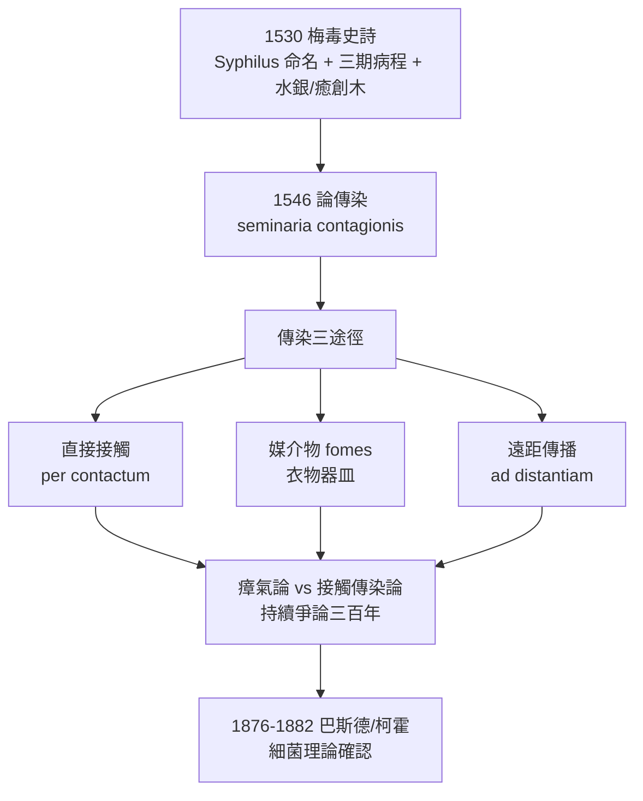

## 1530 - 弗拉卡斯托羅梅毒史詩（一個牧羊人的名字，與早了三百年的傳染小體）

## 案件摘要

**本案偵破的是：一個病名的誕生過程，以及一段比細菌理論早三百年的科學直覺。**

1530 年，維洛那醫生兼詩人 **Girolamo Fracastoro**（1478–1553）在維洛那出版拉丁文田園詩《梅毒或法國病》（*Syphilis sive morbus gallicus*）。詩中，牧羊人 **Syphilus** 因冒犯太陽神而被降下瘟疫，全身潰爛——這個文學角色的名字從此成為疾病的正式名稱：**syphilis**。更驚人的是，十六年後（1546 年）Fracastoro 在《論傳染》（*De contagione*）中提出「傳染小體」（seminaria contagionis）學說：疫病由肉眼不可見的、具自我繁殖能力的微小種子經直接接觸、媒介物（fomes）與遠距傳播——**這是細菌理論的史前版本**，比巴斯德與柯霍早三個世紀。

## 前因 -- 為什麼會有這個案子

- **`1494-那不勒斯梅毒大流行.md` 之後，歐洲需要解釋**。梅毒已橫掃四十年，醫學界分裂為星象派、瘴氣派、天譴派與接觸傳染派。
- **命名戰仍未落幕**。「法國病」（morbus gallicus）是義大利對法軍的甩鍋；Fracastoro 的詩雖沿用法國病為副題，卻在詩中同時記錄了義大利人所稱的「那不勒斯病」與西班牙人的「伊斯帕尼奧拉病」——他本人傾向美洲起源說，詩中把疫病寫成「自新大陸而來」。
- **Fracastoro 不是普通醫生**。他出身維洛那貴族，通曉文學、數學、地質與天文（曾與哥白尼通信，提出星體軌道同心球說），帕多瓦大學醫學出身——文藝復興式的全才，正是能同時寫詩與寫理論的人。
- **詩是當時的科學暢銷書形式**。拉丁文六音步詩歌是學術傳播的高級載體（如同盧克萊修《物性論》之於原子論）；《梅毒史詩》在 16 世紀刊行逾百版，風行全歐。
- **治療現場的絕望**。水銀塗擦＋汗蒸（迫使患者密閉高溫，唾液狂流中毒症狀卻被視為「排毒見效」）與新引進的癒創木（guaiacum，「聖木」，自加勒比進口，昂貴如黃金）是兩大主流——Fracastoro 在詩中皆有記載，且私下水銀療法效果存疑。

## 線索與推理 -- 數學式、程式、理論

Fracastoro 在詩中記錄了梅毒的三階段病程——這是史上最早的分期臨床描述之一：

| 階段 | 詩中與臨床描述 | 現代對應 |
|---|---|---|
| 一期 | 生殖器小潰瘍、無痛性硬結 | 硬下疳（chancre） |
| 二期 | 全身膿皰皮疹、發熱、骨痛 | 二期梅毒疹 |
| 三期（詩中以癒創木療法對應） | 深部潰爛、骨鼻損毀、癱瘓 | 樹膿腫、神經心血管梅毒 |

「傳染小體」學說可以形式化為一組命題，與現代微生物學對照：

| Fracastoro（1546） | 現代對應 | 誤差 |
|---|---|---|
| seminaria（傳染種子） | 病原微生物 | 300 年 |
| 有繁殖力、屬性特異（每病不同） | 病原體專一性 | 正確 |
| 經接觸／媒介物／空氣三途徑 | 直接／間接／氣溶膠傳播 | 正確 |
| 種子「在適合的體液（腐敗體液）中發芽」 | 宿主易感性（部分正確的體液學殘留） | 半對半錯 |

推論：Fracastoro 的洞見在於**拋棄了「病由體內失衡而生」的體液內因論，改採「病由外來個體入侵」的外因論**——這是流行病學思維的分水嶺。但他無法觀察病原體，也解釋不了免疫與潛伏，學說因此仍留有體液論的尾巴（「腐敗體液」作為發病條件）。

## 疑點複核 -- 為什麼是詩？為什麼是牧羊人？

Fracastoro 的兩個選擇——詩體與虛構角色——都不是偶然，值得逐一偵查：

- **詩體是十六世紀的論文**。拉丁文六音步史詩是人文主義學術的最高文體，兼具可背誦、可傳抄、可進入貴族教育體系的傳播優勢；《梅毒史詩》在十六世紀印行上百版，其讀者數遠超任何當代醫學專論。就「傳播學」而言，這首詩本身就是一次成功的 seminaria 播種。
- **牧羊人是完美的替罪羊**。Syphilus 這個名字可能衍生自希臘語 syphon（管、溝）或 su-uphilos（「愛豬者」的戲謔造詞，諷刺豬一般的淫慾）——無論取哪一說，它都是一個**道德寓言角色**：冒犯神明、縱慾、受罰、潰爛。Fracastoro 把病名安在寓言人物身上，既避開了民族甩鍋（對照 `1494-那不勒斯梅毒大流行.md` 的命名戰），又保留了「疾病是罪罰」的敘事骨架——科學命名與道德污名在同一個字裡完成交易。
- **詩中的醫學清單**。全詩三卷：卷一記病症與疫情；卷二記癒創木（以「自新大陸聖木」的神話包裹藥理）；卷三記水銀塗擦與汗蒸。這實際上是一份以韻文包裝的臨床文獻綜述——十六世紀的「系統性回顧」。

另須歸檔一條對照線：同時代的東方，梅毒正被納入中醫的疳瘡譜系（`0061-諸病源候論疳瘡.md`）。歐洲以文學命名，中國以譜系吸收；殊途而同歸的是——兩邊都還要再等三百五十年，才真正看見病原體（`1905-紹丁發現蒼白密螺旋體.md`）。

## 結案 -- 後果與影響

- **syphilis 一詞的勝利**。18 世紀起 syphilis 逐漸取代「法國病」等民族甩鍋名稱，成為國際通名——文學為疾病命名，是醫學史上最著名的案例之一（另一個是中國的「霉瘡」，見 `0061-諸病源候論疳瘡.md` 的陳司成）。
- **《論傳染》成為接觸傳染論的理論旗艦**。它支撐了此後三百年間「傳染需要隔離與消毒」的公共衛生主張，直到 19 世紀細菌理論降臨才獲得實證基礎；但瘴氣論與接觸傳染論之爭持續到 1880 年代。
- **癒創木與水銀的雙重遺產**。癒創木療法在 16 世紀中葉因療效存疑退潮；水銀則一路統治梅毒治療到 1910 年 Salvarsan（砷劑）問世——「與水銀共舞三百年」造成無數中毒病例。
- **一句話結案**：Fracastoro 用一首詩給疾病命了名，用一本書預言了細菌——證明文學與流行病學可以是同一雙手。

## 案件補遺 -- 瘴氣論 vs 接觸傳染論：三百年拉鋸

《論傳染》出版後，歐洲醫學分裂為兩大陣營，這場拉鋸戰值得立案：

- **瘴氣論（miasma theory）陣營**。主張疫病來自腐敗物散發的「壞空氣」（mal aria 之名即源於此）；其防治主張——排水、清運垃圾、通風、消毒空氣——大多有益公共衛生，卻始終找不到真正的病因。優勢在於解釋「為何同區多人同時患病」。
- **接觸傳染論（contagion theory）陣營**。以 Fracastoro 為理論旗手，主張疫病經接觸與媒介物傳播；優勢在於解釋「為何患者接觸者發病、而同住一城的鄰人無恙」。其防治主張——隔離、檢疫、焚燒患者衣物——直接繼承自 `1350-麻風鈴鐺與罪惡身體.md` 的制度遺產。
- **兩論並存三百年**。因為各自都能解釋對方解釋不了的現象，十八世紀的醫學界普遍採取折衷；直到 1854 年 John Snow 以倫敦寬街水泵的地圖推理證明霍亂經水傳播、1876–1882 年巴斯德與柯霍分離出炭疽桿菌與結核桿菌，細菌理論才以實證終結論戰。
- **Fracastoro 的位置**。他沒有顯微鏡、沒有培養技術、沒有實驗方法，全憑臨床觀察與邏輯推演抵達了正確方向——科學史上極少數「只靠推理就走對路」的案例，與 `1494-那不勒斯梅毒大流行.md` 中的毒力衰減推論並列為本書的「純推理破案」典範。

## 關鍵人物與文獻

- Girolamo Fracastoro（1478–1553）——維洛那醫生、詩人、天文學家；《梅毒或法國病》（1530，維洛那刊行）、《論傳染、傳染病及其治療》（1546，威尼斯刊行）。
- Syphilus——詩中冒犯太陽神的牧羊人，病名 syphilis 的字源。
- Ulrich von Hutten（1488–1523）——1519 年《論法國病》的作者，水銀療法受害者與記錄者（見 `1494-那不勒斯梅毒大流行.md`）。
- Niccolò Leoniceno——1497 年《流行病》，最早的梅毒專論之一，Fracastoro 的先驅。
- 盧克萊修《物性論》——以詩體傳播自然哲學的典範，Fracastoro 詩體科學寫作的文學前例。
