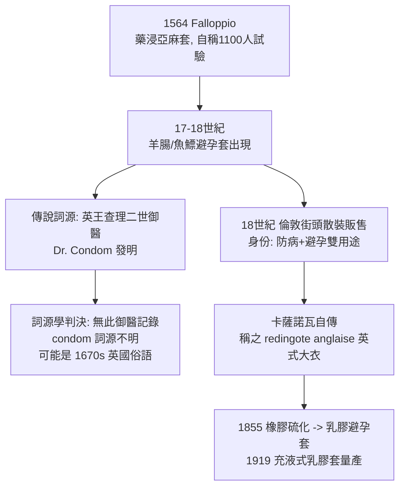

## 1564 - 法洛皮奧亞麻套與早期避孕套（第一件「防病裝置」的出土報告）

## 案件摘要

**本案偵破的是：人類對抗性病的第一件物理防具——以及「防病優先於避孕」這個被現代人遺忘的原始目的。**

1564 年，帕多瓦大學解剖學家 **Gabriele Falloppio**（1523–1562）的遺著《論法國病》（*De morbo gallico*）出版。書中記載：以浸過藥液的亞麻布套覆蓋龜頭，可防「法國病」；他宣稱曾對 **1,100 名男子**進行試驗，無一人感染。這是文獻中最早的陰莖套（屏障防護）紀錄之一。要注意的是：這件亞麻套的設計目的是**防病，不是避孕**——在梅毒仍然致命的十六世紀（見 `1494-那不勒斯梅毒大流行.md`），「保命」的優先順序遠高於「節育」。

## 前因 -- 為什麼會有這個案子

- **梅毒的恐怖是本案的驅動力**。16 世紀中葉梅毒雖毒力減弱，但仍是可致殘致死的主流疫病；水銀療法（見 `1530-弗拉卡斯托羅梅毒史詩.md`）本身中毒風險極高——預防因此成為醫學的迫切課題。
- **Falloppio 是當時歐洲最頂尖的解剖學家**。他是輸卵管（法洛皮奧管）的發現與命名者，也命名了陰蒂、處女膜皺襞與聽小骨中的鐙骨部分結構——由「生殖解剖的權威」來寫防病裝置，並非巧合。
- **藥液浸泡的處方**。Falloppio 的布套以露水沾濕後浸入含沒藥、白鉛、鹽、迷迭香與礬類的溶液，晾乾後使用；布套設計覆蓋龜頭並繫於陰莖根部——更接近「藥用敷料」而非現代橡膠製品。
- **1,100 人的「試驗」意味著什麼**。以當代視角看，這是一項樣本極大、但無對照組、無隨機、無追蹤時程的觀察性試驗——方法學粗糙，卻是史上最早的屏障預防臨床宣稱之一。
- **同時代的「口內保險套」說明需求之烈**。Falloppio 也提及性工作者以亞麻覆頸以防吻頸間傳染（當時相信梅毒可經吻傳染）——預防措施全線鋪開的證據。

## 線索與推理 -- 數學式、程式、理論

屏障預防的原理可以用一條極簡的傳播阻斷式表達：

$$ P(\text{感染}) = P(\text{接觸}) \times P(\text{體液交換} \mid \text{接觸}) \times P(\text{感染} \mid \text{交換}) $$

$$ \text{屏障} \Rightarrow P(\text{體液交換} \mid \text{接觸}) \downarrow \Rightarrow P(\text{感染}) \downarrow $$

歷代屏障裝置的演化對照表：

| 年代 | 裝置 | 材料 | 主要目的 | 文獻證據 |
|---|---|---|---|---|
| 1564 | 亞麻藥浸套 | 亞麻布＋藥液 | 防梅毒 | Falloppio《De morbo gallico》 |
| 17–18 世紀 | 腸衣套 | 羊盲腸、魚鰾 | 防病＋避孕 | 18 世紀英國文本出現 |
| 18 世紀 | 可重複用腸衣套 | 繫繩式 | 同上 | 倫敦商店販售、報刊廣告 |
| 1855 後 | 橡膠套 | 硫化橡膠 | 避孕轉為主流 | 橡膠工業 |
| 1919 後 | 乳膠薄套 | 乳膠 | 防病＋避孕 | 現代避孕套定型 |

推論：屏障防護的歷史軌跡有一個戲劇性的反轉——**最初為防病而生，中間被避孕產業接管（19–20 世紀），最後在愛滋時代（1980s）重新被宣佈為防病工具**。「預防性病」與「節育」的用途鐘擺，擺了四百年又回到原點。

## 疑點複核 -- 1,100 人的試驗可信嗎？

Falloppio 的「1,100 名男子」宣稱是本案最大的疑點，須嚴格審查：

- **樣本從何而來**。帕多瓦是當時歐洲最大的大學城之一，醫學院與駐軍、市井的接觸網密集；以學校附設診療的名義接觸到上千名有風險行為的男性並非全無可能，但文獻未提供任何名冊、時程或追蹤方法。
- **方法學缺陷**。無對照組、無隨機分配、無感染定義、無隨訪期——以現代標準，這只是一項「使用者的自我報告」。此外，梅毒潛伏期可達數週至數月，「無人感染」的判定需要至少數月的追蹤，文中未交代。
- **但原理是對的**。即便試驗數字可疑，物理屏障阻斷體液交換的原理本身無可辯駁；後世的血清流行病學證實，正確使用避孕套可大幅降低 HIV、淋病、披衣菌等經體液傳播病原的感染率（對皰疹、HPV 這類「皮膚接觸傳播」的病原則保護力較低——屏障覆蓋範圍之外的皮膚仍會接觸）。
- **歷史定位**。Falloppio 的價值不在於試驗的嚴謹，而在於**把預防性病從道德勸說轉為工程問題**——這一步的意義，要到四百年後愛滋時代（`1981-CDC報告與愛滋降臨.md`）才被充分理解。

另有一條時代背景線索：本書稍晚的 `1690-水銀療法與劇毒蒸氣.md` 將顯示，當時的「治療」（汞劑汗蒸）比疾病本身更折磨人——這正是亞麻套出現的真正動機：**當治療比病可怕，預防就成了唯一的理性選擇**。

## 結案 -- 後果與影響

- **建立了「行為防護」的概念先例**。在病原體被發現前近三百年，歐洲醫學已接受「在體液交換處設置物理屏障」的預防邏輯——這是流行病學直覺的勝利，與 Fracastoro 的傳染小體理論（`1530-弗拉卡斯托羅梅毒史詩.md`）同屬外因論陣營。
- **condom 詞源懸案**。流行故事稱英王查理二世的御醫「Condom 博士」發明腸衣套以助國王防病（查理二世有多名私生子），但宮廷檔案查無此人；「condom」一詞最早見於 1670 年代前後的英國文獻，詞源不明（可能為人名，也可能是俗語）——**本案的「發明人」是歷史發明的**。
- **卡薩諾瓦的證詞**。18 世紀冒險家卡薩諾瓦在自傳《我的一生》中多次記載使用腸衣套（他稱之為「英式大衣」redingote anglaise），也記載他對套子的抵觸與偶爾的依賴——早期避孕套作為防病工具的第一手使用者證言。
- **一句話結案**：人類防性病的第一件裝置，是一塊浸了藥的亞麻布；四百年後回望，它證明預防從來不是技術問題，而是「願不願意戴」的問題。

## 案件補遺 -- 「防病優先」的四百年鐘擺

把屏障裝置的「用途」按時代排列，可以看到一條清晰的鐘擺曲線：

| 時代 | 首要用途 | 社會脈絡 |
|---|---|---|
| 1564 起 | 防梅毒 | 治療＝汞中毒，防病即保命 |
| 17–18 世紀 | 防病＋避孕並行 | 梅毒常態化，腸衣套商品化 |
| 19 世紀 | 避孕為主 | 梅毒轉慢性化；節育運動興起 |
| 20 世紀中 | 避孕為主 | `1960-避孕藥與性革命.md` 使口服避孕藥接管節育 |
| 1981 後 | 防病重回首位 | 愛滋無藥可治，「戴套」成為公衛口號 |

兩條值得歸檔的觀察：

- **卡薩諾瓦的矛盾心態**。這位 18 世紀最著名的獵豔者在《我的一生》中記載，他既備有「英式大衣」（腸衣套），又多次抱怨它「妨礙愉悅」、有時乾脆不用——結果他自述染過類似梅毒的症狀並接受汞劑治療。使用者抗拒與疾病感染的因果鏈，在第一手證詞裡就已經完整成立。
- **1960 年代的黑暗期**。口服避孕藥問世後，「藥丸取代套子」成為性革命時代的主流選擇——屏障防護的黃金期結束，因為當時的年輕世代已不知道梅毒與淋病曾經多麼可怕（抗生素時代，見 `1943-青黴素治癒梅毒.md`）。這個「防病記憶的消退→防護行為的鬆弛→疫情回潮」的循環，是流行病學上反覆出現的模式。

## 關鍵人物與文獻

- Gabriele Falloppio（1523–1562）——帕多瓦大學解剖學教授，輸卵管發現者；遺著《De morbo gallico》（1562 年卒、1564 年威尼斯刊行）記載亞麻布套與 1,100 人試驗。
- 「Dr. Condom」——傳說中的查理二世御醫，史無其人；condom 詞源至今成謎。
- Giacomo Casanova（1725–1798）——《我的一生》（Histoire de ma vie）記載 18 世紀腸衣避孕套的實際使用。
- Charles Goodyear 與橡膠工業——1855 年前後硫化橡膠避孕套問世，屏障防護進入工業量產時代。
