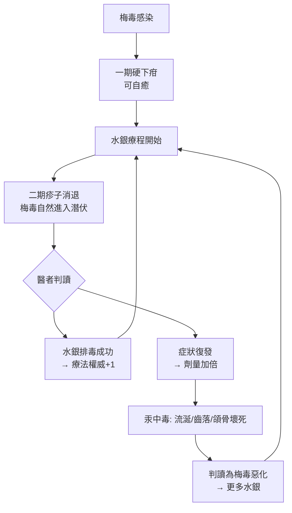

## 1690 - 水銀療法與劇毒蒸氣（「寧可與水銀共度一宵，不可與梅毒共度一生」）

## 案件摘要

**本案的被告不是疾病，而是療法本身——一個毒殺了患者近四百年的「標準治療」。**

自 `1494-那不勒斯梅毒大流行.md` 之後，梅毒席捲歐洲，而醫界找到的第一件武器是水銀（mercury）：口服、油膏塗抹、蒸氣燻洗，三管齊下。它確實能壓制梅毒的潰瘍與皮疹——螺旋體對重金屬敏感——但代價是流涎不止、牙齦潰爛、牙齒鬆脫、頜骨壞死乃至肢體潰爛。諺語說得明白：**「與維納斯共度一宵，就得與水銀共度一生」（A night with Venus, a lifetime with Mercury）**。本案追查的問題是：一種劇毒療法，為何能在沒有任何對照試驗的年代存續四個世紀？答案是一個偵探故事裡最陰險的兇手——**自我實現的推理循環**。

## 前因 -- 為什麼會有這個案子

- **梅毒是全新的絕症**。1490 年代以前歐洲醫學沒有對付它的經驗；它症狀兇猛、經由性傳播、且與「道德墮落」綁定，患者急於求醫，醫者急於獻策。
- **水銀有悠久履歷**。自阿拉伯醫學與煉金術傳統以來，水銀（與硫、鹽並列三要素）被視為具有「溶解腐肉」的力量；15 世紀已用於皮膚病。1496 年左右，費拉拉的 Leoniceno 與維洛那的 Girolamo Fracastoro 一派記錄了水銀油膏治梅毒的用法。
- **蒸氣燻洗法（fumigation）是標準工序**：患者裸身坐進密閉木桶，桶底加熱硃砂（硫化汞）與芳香劑，水銀蒸氣全身吸附，一天數小時、連續數週；皮膚隨之大量流涎（一日可達數公升唾液），被解讀為「病素隨唾液排出」。
- **病人愈多，水銀愈權威**。軍隊、妓院、宮廷──梅毒高風險人群的治療被制度化，水銀成為醫學課本的正統答案。
- **替代療法始終在挑戰**：1500 年代末自加勒比傳入的癒創木（guaiacum，神聖木）一度被法蘭克福等地壟斷成昂貴生意；18 世紀又有鉀鹽（氯化汞之外的重鹽療法）與「無水銀」療程的宣傳——但水銀始終不倒。

## 線索與推理 -- 數學式、程式、理論

**線索一：劑量—毒性曲線。** 水銀的療效與毒性其實是同一條曲線的兩端——這正是問題的本質：

$$ \text{治療窗口} = \text{劑量}_{殺螺旋體} \ \text{與} \ \text{劑量}_{殺病人} \ \text{之間的狹窄區間} $$

以現代毒理學語言，水銀的治療指數（therapeutic index）極小：

$$ TI = \frac{TD_{50}}{ED_{50}} \approx 2 \sim 3 $$

而抗生素如青黴素的 $ TI > 100 $。也就是說，水銀療法是在**每個病人身上同時進行治療與中毒**。

**線索二：自我實現循環。** 在沒有對照試驗的年代，醫者如何「驗證」水銀有效？他們依賴一條推理鏈：

```python
# 16–18 世紀水銀療法的「驗證邏輯」（偽代碼）
def mercury_treatment(patient):
    apply_fumigation(patient, weeks=4)          # 蒸氣燻洗數週
    if patient.salivation and patient.gums_rotten:
        verdict = "病素正在排出（醫學證據：毒副作用=療效）"
    if patient.lesions_disappear(timing="數週後"):
        # 梅毒本來就有一期→二期→潛伏期的自然緩解節奏
        verdict = "水銀把毒排完了（治癒）"
    else:
        verdict = "病人亂了作息/水銀不夠（加大劑量）"
    return verdict   # 任何結果都能被解釋為水銀正確

print(mercury_treatment("某伯爵"))
# 輸出: 病素正在排出（醫學證據：毒副作用=療效）
```

這是一個**不可證偽系統**：流涎＝排毒成功；病癒＝排毒完成；病重＝排毒不夠。劇毒副作用本身被翻譯成療效證據，形成完美閉環。

**線索三：批判者出場。** 1683 年，英國名醫 Thomas Sydenham（「英國的希波克拉底」）公開質疑：他主張梅毒多數病程靠時間與節制自癒，水銀的重劑量弊大於利。1714 年，法國醫生 Jean Astruc 出版《梅毒的醫治》（*De morbis venereis*），以系統性病例對比指出：許多「水銀治癒」的病例，其實是疾病自然進入潛伏期，而水銀中毒的症狀反被誤診為梅毒本身——**醫者在用汞中毒治療梅毒，再治療汞中毒**。



## 結案 -- 後果與影響

- **四百年的制度化傷害**。從 1496 年到 20 世紀初，歐洲與殖民地的梅毒患者平均接受數輪水銀療程；職業病「汞毒性口炎」在妓女、水兵、皮膚科醫生（長期配藥者）身上極為常見。
- **它同時「證明」了自己**。正因為療程夠毒、夠久，且恰好涵蓋梅毒的自然緩解期，水銀療法獲得了假性實證支持——直到 1910 年 `1910-埃爾利希洒爾佛散606.md` 以化學治療取代它，水銀才逐步退場。
- **批判的方法論遺產**。Sydenham 的「觀察自然病程」與 Astruc 的病例對比，是**對照觀念的早期萌芽**——距離 James Lind 1747 年壞血病對照試驗、乃至現代 RCT，這條線索貫穿醫學史。
- **替代療法的教訓**。癒創木與鉀鹽同樣療效可疑，卻因商業壟斷與病人心理需求（「無毒的希望能」）大賣——說明在性病領域，**市場與恐懼可以長期支撐無效療法**。
- **一句話結案**：當副作用可以被解釋為療效，毒藥就能榮任藥王四百年——打破循環的不是新藥，而是「不服解釋、只信對照」的偵探精神。

## 關鍵人物與文獻

- **Thomas Sydenham（1624–1689）**——1683 年前後對水銀療法提出臨床質疑，強調自然病程觀察，被尊為「英國醫學之父」。
- **Jean Astruc（1684–1766）**——1714 年《De morbis venereis》系統批判水銀濫用，並區分汞中毒與梅毒症狀；本人後為路易十五的御醫。
- **Girolamo Fracastoro（1478–1553）**——1530 年史詩《Syphilis sive morbus gallicus》為病命名，也詳載水銀用法（見 `1530-弗拉卡斯托羅梅毒史詩.md`）。
- **Ulrich von Hutten（1488–1523）**——梅毒患者兼作家，1521 年著書鼓吹癒創木，其本人療程記錄是第一手病患史料。
- **《玫瑰園》（Rosa gallica）與17世紀藥典**——蒸氣燻洗的劑量（硃砂用量、時程、禁忌）在德國與荷蘭藥典中被逐步標準化，顯示此療法已完全制度化。
- **Giovanni de Vigo（1460–1525）**——教皇外科醫生，1514 年著《Practica in arte chirurgica copiosa》，詳載水銀油膏配方與蒸氣燻洗流程，是水銀療法最重要的教科書作者之一。
- 現代註腳——20 世紀毒理學確認：汞蒸氣吸入的致死量低、蓄積性強；以今日治療指數標準衡量，18 世紀的重劑量蒸氣燻洗對相當比例患者屬「治療性中毒」。
