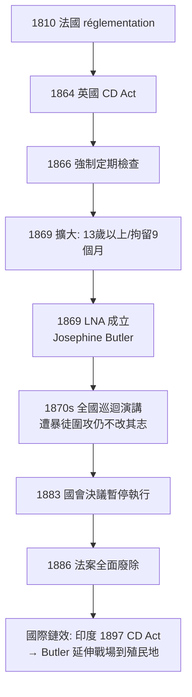

## 1864 - 英國傳染病法案（以公衛之名，把女人的身體交給警察）

## 案件摘要

**本案的兇器不是病原體，而是一部法律。**

1864 年，英國國會通過《傳染病法案》（Contagious Diseases Acts），1866、1869 年兩度擴權。法案在指定軍港與駐軍城市授權警察逮捕任何被「懷疑為娼妓」的女性，強制接受侵入性陰道檢查（金屬窺器）；查 出性病即強制關入「封鎖醫院」（lock hospital）數月。而法案从头到尾**只檢查女性，不檢查男性顧客**。以「保衛軍隊健康」為名的這套制度，在 Josephine Butler 領導的廢除運動堅持十八年之後，於 1886 年被廢除。本案記錄的是：公共衛生如何變成性別暴力的合法外衣，以及一場運動如何以「身體自主」對抗國家權力——這是現代女權與人權論述的里程碑。

## 前因 -- 為什麼會有這個案子

- **軍隊的性病危機**。克里米亞戰爭（1853–1856）之後，軍方統計顯示英軍性病住院人數長期高於戰傷：1860 年代英國駐軍每年約有 20–30% 的官兵感染梅毒或淋病，是「非戰鬥減員」的主因。
- **法國的前身**。拿破崙帝國 1810 年建立 réglementation 系統：全法娼妓須登記、定期接受軍醫陰道檢查、染病即送 diseased hospital。英國陸軍部視之為範本，欲移植本土。
- **警察權的擴張**。1864 年法案先在 11 個軍港/駐軍城鎮（Plymouth、Portsmouth、Woolwich、Aldershot、Chatham 等）試行；1866 年法案把檢查改為**定期強制**（每兩週一次），1869 年法案將適用年齡下修至 13 歲，並把拘留延長至最長 9 個月。
- **「疑似娼妓」的荒謬定義**。女性無需任何犯罪證據，僅憑警察主觀認定（衣著、夜行、獨居）即可被捕——法律處罰的是「身份」而非「行為」，這在英國法史上前所未有。
- **性別單向設計**。法案的理論基礎是：性病由女人傳給男人；男人只是「受害者」。婦女團體一針見血地指出：這是把國家權力外包給軍隊的性需求。

## 線索與推理 -- 數學式、程式、理論

**線索一：法案的流行病學模型根本不成立。** 軍方假設「檢查隔離染病女性」能壓低性病傳播。但把該模型寫成傳播方程就會暴露漏洞：

$$ \frac{dI_m}{dt} = \beta \cdot \frac{I_f}{N_f} \cdot S_m - \gamma I_m $$

模型中男性感染率 $ I_m $ 取決於女性感染者比例 $ I_f/N_f $——但法案只對 $ I_f $ 做強制檢查，**未染病的登記娼妓反而成為「安全認證」的商品**，且男性顧客 $ S_m $ 完全不受檢，繼續散播病原。這是一個只打一端的水桶。

**線索二：雙重標準的資料。** 用模擬還原法案的運作不對稱：

```python
# CD Acts 檢查制度的性別不對稱（示意模擬，Portsmouth 1869 年量級）
acts = {
    "女性被強制檢查(估計)": 8_000,   # 指定城鎮每年受檢女性約數千至數萬人次
    "男性被強制檢查": 0,            # 顧客端：零檢查、零登記
    "女性拒檢入獄人數": 100,        # 含拒檢、未按時報到者
    "士兵性病住院率下降": 0.5,      # 軍方宣稱的降幅（約 1/2），但
    "平民性病率": "指定城鎮反而上升" # 流動人口把傳播推向外圍
}
for k, v in acts.items():
    print(f"{k}: {v}")

# 輸出顯示: 全部成本由女性承擔，全部收益歸軍隊——這不是公衛，是管制。
```

**線索三：Butler 的偵查。** Josephine Butler（1828–1906）於 1869 年創立 **Ladies' National Association for the Repeal of the Contagious Diseases Acts**（LNA），在《Daily News》發表女性簽名的抗議宣言。她的推理有三層：
1. **法律事實**：「疑似」無證據即可逮捕，違反人身保護令傳統；
2. **醫學事實**：窺器檢查對健康女性無任何意義，是「手術式的強暴」（surgical rape）；
3. **政治事實**：國家若能管理女性的子宮與陰道，就能管理任何人的身體。



**線索四：運動的意外聯盟。** Butler 奇蹟般地結合了自由派政治家（Jacob Bright）、工會主義者、福音派「純潔運動」與女性參政權先驅——廢除 CD Acts 因此成為女權運動的第一場全國性動員。
- **暴力與逆流**。Butler 巡迴演講時多次遭暴徒攻擊（含糞便與疑似硫酸）；「純潔運動」盟友主張同時取締賣淫本身，與 Butler 的單純廢除法案路線緊張——這場內部路線之爭，是後世女權運動「性工作」辯論的預演。
- **程序上的制勝手**。1875 年後廢除派改變策略：不在國會正面提案，而是在年度軍費法案（Army Estimates）中逐項刪減執行經費，逼政府逐票表態——1883 年暫停決議與 1886 年廢除，皆由這場消耗戰累積而成。

## 結案 -- 後果與影響

- **1886 年法案廢除**，1883 年國會已以 182:110 決議終止執行；英國從此確立「性病防治不得以強制人身檢查為手段」的原則。
- **國會辯論的金句**。Liberal 議員與 Butler 陣營的反覆質問成為傳世文件：「我們能否想像一部法案，授權逮捕『疑似醉酒的男人』、以窺器檢查其身體、關押數月而不經審判？」——反轉性別的思想實驗，是本案論述最鋒利的武器。
- **女權運動的成年禮**。LNA 證明女性可以組織全國政治動員、改變立法；Butler 之後將戰場延伸至殖民地（印度 1897 年同類法案）與歐洲大陸（日內瓦國際廢除聯盟），是跨國人權倡議的先驅。
- **陰影不散**。法國的 réglementation 存續到 1946 年；一戰期間美國曾以《Chamberlain-Kahn Act》(1918) 復活「疑似娼妓」拘留制度——被廢除的邏輯隨時可能回魂（見 `1932-塔斯基吉梅毒實驗.md` 中同樣以公衛之名踐踏弱勢的案例）。
- **醫學倫理的教訓**。本案確立：公衛政策若不同時保障所有人（含病人、含男性），就是歧視；檢查若違反當事人同意，即屬暴力。
- **一句話結案**：當「防疫」只檢查被欺負的那一半人口，防疫本身就是傳染——傳染的是國家對身體的支配權。

## 關鍵人物與文獻

- **Josephine Butler（1828–1906）**——LNA 創立者，著 *Personal Reminiscences of a Great Crusade*（1896）；今日英國以其名設立人權獎學金，利物浦大學有 Butler 紀念建築。
- 20 世紀迴響——Butler 運動的直接思想後裔包括：1960–70 年代第二波女權主義對身體自主的論述、1980 年代愛滋疫情中「不得強制檢測高危群體」的公衛倫理準則，以及 2000 年代至今關於性工作者權利的國際辯論——1864 年的案卷始終在庭上。
- **James Stansfeld（1820–1898）**——自由黨政治家，國會中長期領導廢除派，1883 年決議案的主要推手。
- **《Daily News》宣言（1869/12/31）**——LNA 創始宣言，124 位女性聯署，史稱「Ladies' Manifesto」。
- **Act papers**——1864 年 29 Vict. c.35、1866 年 29 & 30 Vict. c.90、1869 年 32 & 33 Vict. c.96，三法案原文為本案一手檔案。
- **Judith R. Walkowitz**, *Prostitution and Victorian Society*（1980）——以 Portsmouth 與 Plymouth 個案為本的經典社會史研究，量化了檢查制度的執行數據。
- 現代註腳——1886 年廢除後，英國性病防治轉向自願診所路線；1913 年皇家委員會對性病的結論與 1917 年《國民保險》體系的擴張，皆是在「不得強制」原則下的再設計——Butler 留下的法理邊界，至今仍是公衛強制權力爭議（如愛滋時代的強制檢測辯論）的判準。
