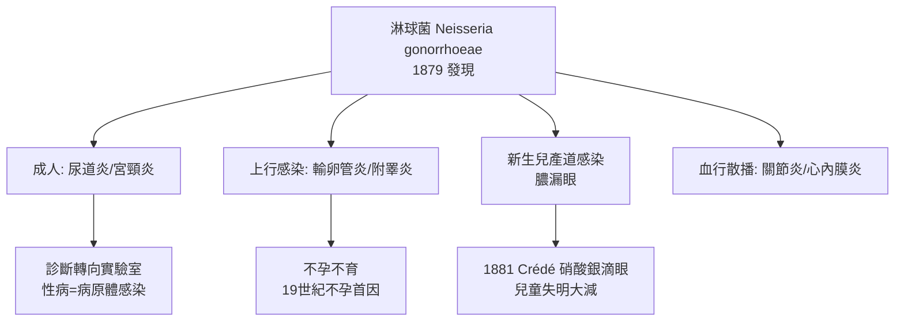

## 1879 - 奈瑟發現淋球菌（顯微鏡下的雙豆，性病第一次有了名字以外的身份）

## 案件摘要

**本案偵破了人類最古老的性病——淋病（gonorrhea）——的兇手身份。**

1879 年，年僅 24 歲的德國皮膚科醫生 Albert Neisser 在布雷斯勞（Breslau）的皮膚病診所裡，於急性淋病患者（多為妓女與尿道炎士兵）的膿液塗片中，發現一種成對排列、狀似咖啡豆的革蘭氏陰性雙球菌。1882 年，他的同事 Ludwig Bumm 在固體培養基上純培養成功，並以培養物接種健康人的尿道，證明其致病性——柯霍法則（Koch's postulates）在性病領域的首次完整執行。兇手後來被命名為 *Neisseria gonorrhoeae*，以發現者為姓。本案的關鍵不在「看見細菌」，而在**一套可重複的偵查流程**：顯微鏡＋染色＋培養，三件套把性病從「道德墮落的懲罰」翻案為「病原體感染的疾病」。

## 前因 -- 為什麼會有這個案子

- **淋病比梅毒古老得多**。古希臘醫生蓋倫（Galen，約西元 150 年）已描述「精液異常流出」（gonorrhoa，希臘文「種子之流」）；《利未記》的「下體流穢」（見 `-1550-埃伯斯紙草與利未記的不潔.md`）很可能也包含此症。但兩千年來它被視為多種疾病的混合體。
- **「淋病≠梅毒」的辨識戰**。18 世紀 John Hunter 著名的 1767 年自體接種實驗（將淋病膿液注入自己尿道）因樣本同時含梅毒而「證明」兩病同源——這個悲劇性錯誤混淆醫界六十年。1838 年 Philippe Ricord 以大量臨床接種區分兩病；1879 年 Neisser 則在微生物層面完成終審。
- **細菌學革命的武裝**。1870 年代 Robert Koch 建立細菌攝影、染色、固體培養與純種分離技術；1882 年發表結核桿菌與柯霍法則（見 `../生理醫學史/1882-Koch結核桿菌.md`）。整個歐洲實驗室進入「找病原」競賽。
- **染色技術是破案關鍵**。淋球菌在未染色塗片中幾乎不可見；Neisser 使用 Koch 學派的苯胺染料（aniline dyes）染色後，膿細胞內被吞噬的雙球菌無所遁形——細胞內雙球菌（intracellular diplococci）成為淋病的診斷標誌。
- **臨床現場的急迫需求**。軍隊與港口城市的性病負擔（見 `1864-英國傳染病法案.md`）使「快速、客觀的診斷」成為當務之急——顯微鏡檢查正好填補這個缺口。

## 線索與推理 -- 數學式、程式、理論

**線索一：偵查三件套流程。** Neisser 的每一步都對應刑偵學的一個環節：

| 步驟 | 技術 | 偵探比喻 | 判準 |
|---|---|---|---|
| 1. 顯微鏡觀察 | Zeiss 油鏡，約 900–1000 倍 | 到案發現場看嫌疑人 | 膿細胞內成對球菌 |
| 2. 染色 | 苯胺染料（美藍/龍膽紫） | 給嫌疑人按指紋 | 革蘭氏陰性、細胞內定位 |
| 3. 培養 | Bumm 1882 年固體培養基 | 抓到活口並錄供 | 純種分離、傳代穩定 |
| 4. 致病性證明 | 培養物接種人類尿道 | 指認兇手 | 出現典型淋病 |

**線索二：柯霍法則的性病版執行。** 將法則形式化：

$$ \text{病原體確立} \iff \begin{cases} 1. \ \text{每個病例皆可檢出同一微生物} \\ 2. \ \text{可體外純培養} \\ 3. \ \text{培養物接種健康宿主可致病} \\ 4. \ \text{可自新病患再次分離同一微生物} \end{cases} $$

Bumm 在 1882 年完成了 2、3、4 步——而這套法則對淋球菌的適用，恰恰凸顯了梅毒偵查的困難：梅毒螺旋體直到 1905 年才被發現（見 `1905-紹丁發現蒼白密螺旋體.md`），且**至今無法體外常規培養**，柯霍法則四步中有兩步永遠缺席。

**線索三：流行病學的即時回報。** 有了微生物診斷，淋病數據第一次變得可信：

```python
# 1880s 起淋病診斷的轉變（歐洲陸軍統計量級示意）
before = {"診斷方式": "症狀描述", "誤診率(估)": 0.3, "軍隊年感染率": 0.25}
after  = {"診斷方式": "塗片染色鏡檢", "誤診率(估)": 0.05, "可與梅毒區分": True}

def diagnostic_power(sensitivity, specificity):
    # 陽性預測值隨特異度上升而急升——客觀判準的價值
    prevalence = 0.2
    ppv = prevalence * sensitivity / (prevalence * sensitivity + (1-prevalence)*(1-specificity))
    return round(ppv, 3)

print(diagnostic_power(0.9, 0.95))  # 輸出: 0.818 → 高可信度的實驗室診斷誕生
```

**線索四：併發症網絡的解密。** 確認病原後，過去互不相干的病症被串成一案：女性輸卵管炎→不孕（淋病是 19 世紀不孕症首因）；男性附睪炎→不育；以及最悲慘的**新生兒膿漏眼（ophthalmia neonatorum）**——產道感染使嬰兒出生 2–5 日內雙眼化膿，19 世紀歐洲約 10% 的兒童失明源於此。1881 年婦科醫生 Carl Siegmund Franz Crédé（Credé）推行的**硝酸銀滴眼法**（1–2% AgNO₃）使新生兒淋病性眼炎發病率驟降九成以上——在抗生素問世前，這是最成功的預防性醫療措施之一。



**線索五：從「道德歸因」到「接觸追蹤」。** 微生物診斷的另一層革命在於：確認病原體後，「誰傳給誰」可以用塗片與培養在實驗室裡重建——妓院、兵營、艦船的傳播鏈第一次成為可查證的數據，而非道德指控。這套「接觸追蹤」的方法雛形，將在 20 世紀的梅毒防治與 1980 年代愛滋疫情（見 `1981-CDC報告與愛滋降臨.md`）中反覆出現；而它被濫用的風險（強制檢查、名單管制）則已由 `1864-英國傳染病法案.md` 預先示警。

## 結案 -- 後果與影響

- **性病的身份翻轉**。從「罪有應得」到「可偵測、可確認的感染」，微生物診斷為之後的實驗室公衛（疫情追蹤、接觸者追蹤）鋪路——這套邏輯一路延伸到愛滋與新冠。
- **Neisser 的第二案**。1880 年代他赴爪哇與婆羅洲研究麻風，1879 年前已在丹麥醫生 Gerhard Hansen 的組織樣本中辨認出麻風桿菌（*Mycobacterium leprae*，1873 年 Hansen 先發現）——他堅稱自己在 1881 年「培養」成功，與 Hansen 爆發命名權之爭，最終麻風桿菌歸功 Hansen。
- **倫理污點**。Neisser 的致病性實驗曾以低廉酬勞接種羅馬尼亞與爪哇貧民與妓女而未充分告知，成為後世研究倫理教材的反面案例——與 `1932-塔斯基吉梅毒實驗.md` 同一條黑線。
- **治療仍停在石器時代**。診斷解決了，治療沒有：直到 1930 年代磺胺、1940 年代青黴素問世，淋病仍靠沖洗、擴張與 `1690-水銀療法與劇毒蒸氣.md` 式的安慰劑療法。
- **一句話結案**：顯微鏡＋染色＋培養三件套不是技術清單，而是一種**新的偵查哲學**——不問罪惡，只問證據；性病從此有了可驗證的「案底」。

## 關鍵人物與文獻

- **Albert Ludwig Sigesmund Neisser（1855–1916）**——布雷斯勞大學皮膚科教授，1879 年發表 *Ueber eine der Gonorrhoe eigenthümliche Micrococcusform*；其名用於奈瑟菌屬與奈瑟菌科。
- **Ludwig Bumm（1848–1899）**——1882 年完成純培養與致病性接種實驗，補齊柯霍法則。
- **Robert Koch（1843–1910）**——1882 年發表結核桿菌與柯霍法則（見 `../生理醫學史/1882-Koch結核桿菌.md`），整個性病細菌學的技術與方法供應者。
- **Gerhard Hansen（1841–1912）**——麻風桿菌發現者，與 Neisser 的命名權之爭是微生物學史著名公案。
- **Carl Credé（1819–1892）**——萊比錫婦科醫生，1881 年硝酸銀滴眼法，新生兒眼炎預防之父。
- 現代註腳——淋球菌是至今仍無疫苗的人類病原體之一（抗原高度變異、反覆感染常見），且 1970 年代起逐步累積抗藥性，2018 年起出現頭孢抗藥株——本案確立的「偵查三件套」仍是全球監測其變異的前線工具。
