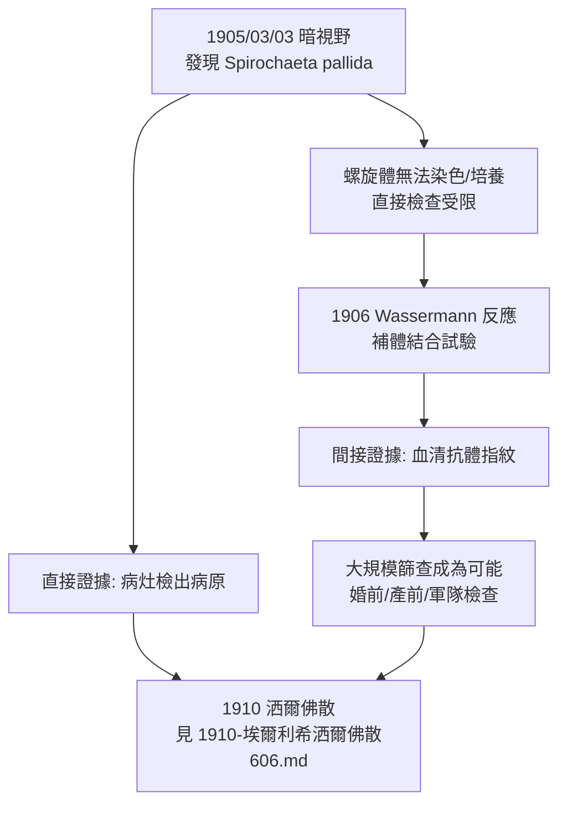

## 1905 - 紹丁發現蒼白密螺旋體（暗視野下的細銀線，梅毒破案的第一張證據）

## 案件摘要

**梅毒追凶四百年的第一張物證，在 1905 年 3 月 3 日被拍進顯微鏡。**

這一天，柏林夏里特醫院（Charité）的皮膚科醫生 Erich Hoffmann 與動物學家 Fritz Schaudinn，在一位梅毒二期女病人的硬性下疳滲出物中，以**暗視野顯微鏡**（dark-field microscopy）親眼看見一種纖細、蒼白、如螺旋鑽頭般扭動的微生物。Schaudinn 命名之 *Spirochaeta pallida*——「蒼白的螺旋體」，今稱 *Treponema pallidum*（蒼白密螺旋體）。自 `1494-那不勒斯梅毒大流行.md` 以來被歸罪於「星象」「堕落」「種族」四百餘年的梅毒，第一次有了明確的被告。本案的後續——1906 年 Wassermann 血清反應——則給了偵探第二件法寶：**指紋比對**。

## 前因 -- 為什麼會有這個案子

- **梅毒是細菌學時代最刺眼的未破案**。淋球菌 1879 年已落網（見 `1879-奈瑟發現淋球菌.md`）、結核桿菌 1882 年被柯霍擒獲，梅毒卻連兇手的形狀都沒人見過——它比細菌小、在普通光學顯微鏡下近乎透明、且無法用當時的苯胺染料染色。
- **Hoffmann 的執著**。皮膚科醫生 Erich Hoffmann（1863–1937）深信病原體就在初期病灶裡，苦於自己不擅長原蟲學技術；他找來的搭檔是當時德國最尖端的原生動物學家之一。
- **Schaudinn 的才華**。Fritz Schaudinn（1871–1906）是研究變形蟲與瘧原蟲的奇才（曾推翻瘧原蟲性周期的既有描述），擅長活體觀察——這正是暗視野技術需要的手藝。
- **暗視野顯微鏡是破案之光**。普通明視野下，螺旋體折光率與背景接近而「隱形」；暗視野以側面斜射光束照亮樣本，使微細顆粒在漆黑背景上如銀線般閃亮——等於把偵查從白天移到夜視儀下。
- **命名的線索早埋伏筆**。1879 年之後，學界已懷疑「某種原蟲或極細的細菌」是梅毒病因；1890 年代 Klebs、Levaditi 等人宣稱的「Cytoryctes」等假兇手一一被淘汰。
- **為什麼挑硬性下疳？** 偵查地點的選擇本身就是推理：一期病灶是螺旋體密度最高的「案發現場」，且在免疫尚未展開前取樣；Hoffmann 長期蒐集新鮮病灶標本，等於提前布好了現場封鎖線——1905 年的勝利，其實是三年準備的收網。

## 線索與推理 -- 數學式、程式、理論

**線索一：暗視野的物理原理。** 為何暗視野能「看見」明視野看不見的物體？關鍵在散射光與直射光的分離：

$$ I_{dark\ field}(x) \propto \sum_i \sigma_i \cdot |E_{scatter}|^2, \quad \sigma_i \ll \text{細胞尺度} $$

螺旋體直徑僅約 $ 0.10\text{–}0.18 \ \mu m $（低於光學解析度極限的一半），但其長達 $ 6\text{–}15 \ \mu m $ 的螺旋柱體散射足夠的光，配合運動軌跡即可辨識——**看不見的嫌犯，靠走路姿態與衣角反光指認**。

**線索二：3 月 3 日的偵查記錄。** 標本來自一位 24 歲梅毒二期女病人的宮頸病灶。兩人使用的流程：

```python
# 1905/03/03 暗視野偵查流程復原
def darkfield_hunt(specimen):
    rinse = "無菌生理鹽水洗去雜菌與膿塊"        # 減少背景噪音
    cover = "蓋玻片封壓，避免氣泡干擾"          # 保持活體運動
    light = "超拋物面聚光器，斜射光 45° 以上"    # 暗視野點亮
    observe = "見蒼白螺旋體: 纖細、規則螺旋、<br/>沿自身長軸旋轉+屈曲運動"
    return {"rinse": rinse, "light": light, "finding": observe}

print(darkfield_hunt("二期梅毒宮頸病灶滲出物"))
# 結果: 每一例梅毒病人皆可重複檢出 → 柯霍法則第一條成立
```

**線索三：血清學＝指紋比對。** 找到病原體只是現場證據；1906 年 August von Wassermann、Albert Neisser 與 Max Bruck 在柏林發表**補體結合試驗**（complement fixation test，今稱瓦瑟曼反應），首次能在病人不發病時從血液「指紋」辨認感染：



補體結合的原理可以濃縮為一條「偵探邏輯」：病人血清中的抗體若與已知梅毒抗原結合，就會**耗盡補體**，使後續加入的溶血系統不再溶血——「不溶血」即「有前科」：

$$ \text{抗體} + \text{抗原} + \text{補體} \rightarrow \text{補體被扣留} \Rightarrow \text{不溶血（陽性）} $$

**線索四：培養的世紀困境。** 與淋球菌不同，梅毒螺旋體至今無法在體外常規培養：它體內缺乏多數代謝酶、需要極低的氧濃度與宿主樣環境，傳統上只能在家兔睪丸中傳代（1912 年確立的兔模型）。柯霍法則四條，梅毒永遠只能完成三條——**嫌犯到案，卻拒絕在拘留所吃飯**。

**線索五：國際確認與命名之爭。** 1905 年 4 月起，維也納的 Paltauf、Reitstock 與巴黎的 Levaditi 相繼以暗視野重現同一螺旋體；1906 年德國細菌學家 Schereschewsky 等主張以發現者命名（*Schaudinnia*），但分類學先例（1905 年命名在先）使 *Treponema pallidum*（1912 年由 Sollmann 等定名）勝出——「蒼白」至今仍寫在其學名裡，而「蒼白密螺旋體」這個中文名，正是從那條暗視野下的銀線翻譯而來。

## 結案 -- 後果與影響

- **診斷革命**。暗視野鏡檢至今仍是一期梅毒的快速確診法；Wassermann 反應使 20 世紀的大規模血清篩查成為可能——丹麥 1910 年代、美國 1930 年代的婚前與產前梅毒檢查皆源於此（美國陸軍 1941 年徵兵檢查陽性率約 4.5%）。
- **治療的引信被點燃**。有了病原體與血清試驗，Paul Ehrlich 得以建立「化合物—病原體」的系統篩選，兩年內便推出洒爾佛散（見 `1910-埃爾利希洒爾佛散606.md`）——**找不到兇手，就永遠只能亂槍打鳥**。
- **命名學的插曲**。1912 年起德國學界主張以 Schaudinn 為名（*Treponema schaudinni*），但 *pallidum* 因先發表而勝出；病原體的俗名「Schaudinn 的螺旋體」仍長期流通。
- **悲劇性的代價**。Schaudinn 1906 年因阿米巴痢疾併發症去世，年僅 35 歲，距離他的世紀發現僅一年；他至死未見梅毒螺旋體被培養或被藥物治癒。
- **臨床與法律的即時應用**。暗視野鏡檢很快成為婚前與軍隊體檢、婚外性行為糾紛訴訟（通姦與離婚案）中的法醫學證據——梅毒第一次能以「物證」而非「名聲」在法庭上出庭作證。
- **一句話結案**：暗視野之光照亮的不是一根細銀線，而是一整個現代性病防治體系的起訴書——病原體到案、血清指紋建檔，剩下的只是尋找武器。

## 關鍵人物與文獻

- **Fritz Schaudinn（1871–1906）**——柏林動物學家、原生動物學家，1905 年 3 月 3 日與 Hoffmann 共同發現梅毒螺旋體；命名人。
- **Erich Hoffmann（1863–1937）**——夏里特醫院皮膚科醫生，梅毒病原研究的策劃者；後任教於波恩，與 Neisser 同為德國性病學奠基者。
- **August von Wassermann（1866–1925）**——柏林傳染病研究所（Koch 研究所）細菌學家，1906 年發表補體結合試驗。
- **Albert Neisser（1855–1916）**——淋球菌發現者（見 `1879-奈瑟發現淋球菌.md`），亦是 Wassermann 反應的共同作者。
- **現代血清學族譜**——從補體結合試驗（1906）到 VDRL（1941）、TPPA、乃至當代的螺旋體特異性化學發光免疫分析，梅毒血清檢測的每次迭代都保留同一個偵探比喻：抗體就是嫌犯在病人體內留下的指紋。
- 原始文獻——Schaudinn & Hoffmann, *Arbeiten aus dem Kaiserlichen Gesundheitsamte*, 1905；Wassermann, Neisser & Bruck, *Deutsche medizinische Wochenschrift*, 1906。
- **Wassermann 反應的篩查遺產**——VDRL（1941）與 RPR 等改良血清試驗沿用其「非特異性抗原＋抗體偵測」架構至今；產前血清篩查使先天性梅毒在已開發國家近乎絕跡（直到 2010 年代因篩查鬆動而回潮）。
- 現代註腳——2000 年代完成梅毒螺旋體基因體定序（約 1.14 Mb 基因組），確認其極端代謝簡化——這正是它無法離開宿主體外培養的分子原因，本案的「世紀困境」終於有了基因組層面的解釋。
