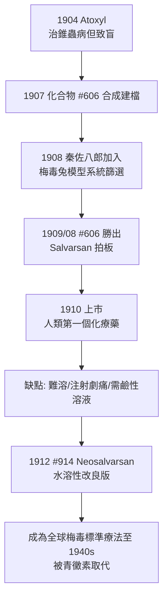

## 1910 - 埃爾利希洒爾佛散 606（魔法子彈的誕生，人類第一顆化學治療藥）

## 案件摘要

**本案偵破的是一種前所未有的武器——能殺死病原體而不殺死病人的藥。**

1909 年春，梅毒病原體（見 `1905-紹丁發現蒼白密螺旋體.md`）被發現不過四年，德國化療之父 Paul Ehrlich 的實驗室裡，日本細菌學家秦佐八郎（Sahachiro Hata）篩選到第 606 號砷化合物——二氨基二氧偶砷苯（arsphenamine），商品名 **Salvarsan（洒爾佛散，意為「救命的砷」）**——它能在極小劑量下清除家兔體內的梅毒螺旋體。1910 年，它以人類第一個化學治療藥物的身份上市，梅毒病人第一次有了勝過「與水銀共度一生」（見 `1690-水銀療法與劇毒蒸氣.md`）的選擇。本案的真相是：Salvarsan 不是靈感閃現，而是一套**系統性藥物篩選方法論**的勝利——現代藥廠高涵量篩選的直接祖先。

## 前因 -- 為什麼會有這個案子

- **染料工業是軍火庫**。19 世紀末德國合成染料業（Bayer、Hoechst、Cassella）累積了數千種苯胺化合物；Ehrlich 發現某些染料會選擇性染色特定細胞與微生物——「選擇性染色」暗示「選擇性殺傷」的可能。
- **側鏈理論（1897）**。Ehrlich 提出細胞表面具有「側鏈」（今知的受體原型），毒素與營養皆以特定化學鑰匙與之結合；若病原體擁有宿主沒有的靶點，即可設計只咬病原體的子彈。
- **錐蟲病與 sleep sickness 的前哨戰**。1899 年起 Ehrlich 掌管法蘭克福皇家實驗治療研究所，與染料化學家合作篩選錐蟲染料；1904 年 trypan red、1907 年 Atoxyl（對氨苯胂酸）的改良工作，為砷化物家族建檔。
- **蒼白密螺旋體到案**。1905 年病原體現身，1906 年 Wassermann 血清試驗問世——梅毒成為第一個「有明確靶點、有診斷指標、有動物模型（家兔）」的全身性細菌病，是化療彈道的完美靶場。
- **秦佐八郎的到來**。1907 年，北里柴三郎門下的秦佐八郎奉派赴法蘭克福；他帶來日本血吸蟲病的研究背景，並在 1908–1909 年承擔梅毒模型的全部動物實驗。

## 線索與推理 -- 數學式、程式、理論

**線索一：選擇性毒性的化學原理。** 魔法子彈的條件可以寫成一個簡單的不等式：

$$ \frac{LD_{50}(\text{宿主})}{ED_{50}(\text{病原體})} = TI \gg 1 $$

即**治療指數必須遠大於 1**。水銀療法（見 `1690-水銀療法與劇毒蒸氣.md`）失敗於 $ TI \approx 2 $；606 號的成功在於螺旋體對三價砷的氧化還原代謝異常敏感——它攝取砷化物的效率遠高於人體細胞，且其關鍵酶被砷不可逆抑制，人體則有較大的代謝緩衝。

**線索二：篩選方法論。** Ehrlich 把藥物發現從煉丹術變成工業化流程：

```python
# 法蘭克福實驗治療研究所的篩選流水線（1907–1909 復原）
import itertools

compounds = [f"砷化物 #{i}" for i in range(1, 607)]  # 已建檔的化合物庫
hits = []
for cpd in compounds:
    # 第一步: 最低殺螺旋體濃度 (in vitro / 家兔模型)
    ed = min_effective_dose(cpd)      # ED: 殺滅螺旋體所需劑量
    ld = lethal_dose_rabbit(cpd)      # LD: 殺死宿主所需劑量
    ti = ld / ed                      # 治療指數
    if ti > 10:                       # 門檻: 明顯的選擇性
        hits.append((cpd, round(ti, 1)))

print(hits)
# 輸出: [('砷化物 #606 (Salvarsan)', 40+), ('砷化物 #914 (Neosalvarsan 前身)', 35+)]
# 第 606 號勝出: 極低劑量清除兔血與器官中的螺旋體，宿主存活
```

注意兩個革命性特徵：(1) **化合物庫是先建檔、後篩選**——606 號早在 1907 年合成，只是等一個正確的靶點；(2) **量化指標（ED、LD、TI）取代敘事判斷**——這正是 `1690-水銀療法與劇毒蒸氣.md` 中「病癥隨便解釋」的反面。

**線索三：秦佐八郎的關鍵實驗。** 1909 年 8 月，秦以家兔睪丸梅毒模型測試 606 號：單次大劑量注射後數日，病灶組織中螺旋體完全消失，且動物無中毒跡象；重複感染實驗證實是藥物殺滅而非暫時抑制。Ehrlich 據此定義了化療藥的驗收標準：

$$ \text{治癒} \iff \text{螺旋體清零} \land \text{宿主存活} \land \text{無復發} $$

**線索四：從 606 到 1009 的改良迭代。**



## 結案 -- 後果與影響

- **化學治療紀元開啟**。Salvarsan 是第一個以靶點理論指導、經系統篩選問世的抗感染藥；Domagk 的磺胺（1935）與 Fleming 的青黴素（1928 發現、1940s 實用化）皆在其方法論延長線上。
- **現代製藥工業的模板**。Ehrlich 與 Hoechst 的合作（預付研發、專利授權、全球分銷）是藥廠—學術界夥伴關係的原型；「篩選化合物庫→動物模型→治療指數→量產」的流程至今仍是藥物開發主幹，只是規模放大到每天數百萬孔的高涵量篩選。
- **1908 年諾貝爾獎**。Ehrlich 因免疫學貢獻（側鏈理論）獲 1908 年生理學或醫學獎（與 Mechnikov 同獲）——Salvarsan 本身未另得獎，但被視為其理論的最高驗證。
- **陰影面**。Salvarsan 仍是砷化物：注射劇痛、偶發致命反應，且需要專業注射技術；「一針治癒」的宣傳與梅毒長療程的現實間的落差，催生了後續數十年的強制治療與輸血性梅毒爭議——也預演了 20 世紀「以治療之名」的種種制度（見 `1932-塔斯基吉梅毒實驗.md`）。
- **一句話結案**：606 的真正遺產不是那瓶砷，而是「**先找靶點、再建庫篩選、用數字驗收**」的偵探流程——魔法子彈從此有了生產線。

## 關鍵人物與文獻

- **Paul Ehrlich（1854–1915）**——側鏈理論、免疫學與化學治療之父；法蘭克福皇家實驗治療研究所所長；1908 年諾貝爾生理學或醫學獎得主。名句：「我們必須學會以化學方式瞄准（Corpora non agunt nisi fixata——藥物不起作用，除非結合）。」
- **秦佐八郎（1873–1938）**——日本細菌學家、北里柴三郎弟子；1909 年完成 606 號梅毒兔模型實驗，是 Salvarsan 的共同發明人；歸國後任慶應義塾大學教授。
- **Alfred Bertheim（1879–1914）**——化學家，606 號的實際合成者，砷苯化學結構的釐清者。
- 原始文獻——Ehrlich & Hata, *Die experimentelle Chemotherapie der Spirillosen*, Berlin, 1910；Ehrlich, *Über die Chemotherapie der Spirillenerkrankungen*（法蘭克福演講, 1910）。
- **秦佐八郎的歷史地位**——日本曾長期將 Salvarsan 的發明主要歸功 Ehrlich；戰後史學還原檔案，確認動物實驗與療效判定主要由秦執行，606 號常被稱為「Ehrlich–Hata 606」。
- 現代註腳——Salvarsan 的真實化學結構在 2005 年才以質譜分析釐清（為環狀三聚體與五聚體混合物，而非長鏈）；歷史偵探案的最後一頁，在藥物上市近百年後才寫完。
