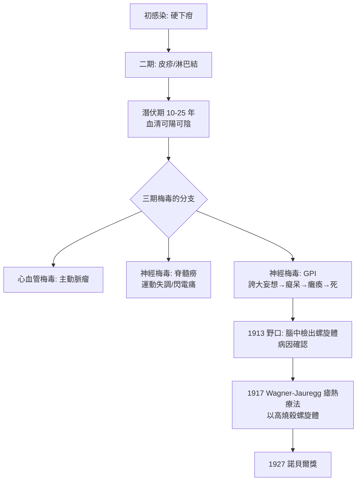

## 1913 - 野口英世解開麻痺性痴呆之謎（瘋人院裡的梅毒螺旋體，改寫「瘋癲」的定義）

## 案件摘要

**本案在瘋人院的大腦裡，找到了四百年來最隱密的梅毒受害者名單。**

1913 年，日本細菌學家野口英世（Hideyo Noguchi）在紐約洛克斐勒醫學研究所，與精神科醫生 J. W. Moore 合作，從**麻痺性痴呆**（general paresis of the insane, GPI）患者死後的腦組織中，直接檢出蒼白密螺旋體——梅毒病原體（見 `1905-紹丁發現蒼白密螺旋體.md`）。這一發現證明：梅毒進入第三期後可以侵襲中樞神經，造成人格崩壞、癡呆與癱瘓；尼采的瘋狂、莫泊桑的死、以及無數收容所裡「被社會遺忘的瘋子」，共享同一個醫學解釋。本案偵破的不只是 GPI 的病因，更推翻了「瘋癲＝道德墮落」的古老敘事——而 1917 年 Wagner-Jauregg 的瘧熱療法，則用「以毒攻毒」為這個案子蓋上了諾貝爾印章。

## 前因 -- 為什麼會有這個案子

- **GPI 是 19 世紀精神病院的頭號疑案**。它佔歐洲男性收容入院者的 5–10% 以上：先是性格改變、誇大妄想（病人自稱帝王）、後是失智、震顫、癱瘓，發病後 2–5 年死亡。法國醫生 Bayle（1822）與 Fournier（1870s）早已懷疑其與梅毒有關，卻始終找不到現場證據。
- **脊髓癆（tabes dorsalis）同屬懸案**。進行性運動失調與閃電樣疼痛，與 GPI 一起構成「神經梅毒」兩大症候群；1870 年代 Fournier 提出「副梅毒」（parasyphilis）概念統稱之，但屬相關性推理，非直接證據。
- **血清陰性的悖論**。許多 GPI 患者病史中「沒有」梅毒記錄、Wassermann 反應（見 `1905-紹丁發現蒼白密螺旋體.md`）有時呈陰性——反對者據此否定梅毒病因。破案需要**在腦組織裡親眼抓到兇手**。
- **野口英世的履歷**。野口（1876–1928）出身福島縣豬苗代，自學成材，1900 年赴美，因毒蛇血清研究被洛克斐勒研究所网罗；他擅長螺旋體的暗視野檢查與動物接種技術，1911–1912 年宣稱培養梅毒螺旋體成功（雖方法有爭議）。
- **文化的暗場景**。尼采 1889 年在都靈崩潰、1900 年死於收容所；莫泊桑 1893 年死於 GPI 所致精神病；梵谷的病情亦被後世醫者懷疑與梅毒相關—— GPI 在當時是名人與平民共同的死法。

## 線索與推理 -- 數學式、程式、理論

**線索一：直接物證。** 1913 年，野口與 Moore 對 14 例 GPI（及脊髓癆）死者腦組織取樣，以鹽水乳化後暗視野鏡檢：

```python
# 1913 年野口—Moore 神經梅毒偵查流程復原
def brain_hunt(cases):
    findings = []
    for case in cases:                       # GPI 死者腦皮質/腦膜組織
        emulsion = homogenize(case.brain)    # 生理鹽水乳化
        spirochetes = darkfield(emulsion)    # 暗視野鏡檢
        if spirochetes.morphology == "Treponema pallidum":
            findings.append(case.id)
    return {
        "檢出病例": len(findings),
        "檢出率": f"{len(findings)}/{len(cases)}",
        "結論": "GPI 腦組織中存在梅毒螺旋體 (直接物證)"
    }

print(brain_hunt("14 例 GPI 與脊髓癆死者"))
# 輸出: {'檢出病例': 多數, '檢出率': '逾半數可檢出', '結論': ...}
```

腦組織中螺旋體數量極少（每視野可能僅 1–2 條），這正是四十年來無人發現的原因；野口的貢獻在於**系統性大量取樣＋濃縮處理**，而非單純運氣。

**線索二：病程模型。** 神經梅毒的時序可以用一條「延遲引信」曲線描述：

$$ P(\text{GPI} \mid \text{感染後 } t) \ \text{在初感染後 } 10\text{–}25 \ \text{年達峰} $$

一期下疳（數週）→ 二期皮疹（數月）→ 潛伏期（數年至數十年）→ 三期梅毒：心血管（主動脈炎）、神經（GPI、脊髓癆）。梅毒因此被稱為「**模仿大師（the great imitator）**」——它能偽裝成幾乎任何疾病，而 GPI 是它最深度的偽裝：病人看起來是「瘋了」，實際上是「被感染了」。



**線索三：瘧熱療法——以毒攻毒的奇想。** 1917 年，維也納精神科醫生 Julius Wagner-Jauregg 執行其 1880 年代即構想的方案：讓 GPI 患者感染良性間日瘧，以週期性高燒（$ 39\text{–}40°C $）抑制不耐熱的螺旋體，再以奎寧治癒瘧疾。統計上約 1/3 患者症狀顯著改善或緩解，是史上第一個對 GPI 有效的治療——諾貝爾獎 1927 年予以肯定（青黴素 1940 年代問世後，發燒療法退場）。

**線索四：野口的餘案與悲劇。** 野口 1918 年起轉戰黃熱病、1928 年在非洲阿克拉研究黃熱病時感染身亡；他關於梅毒螺旋體「體外培養」與鉤端螺旋體分類的部分結論後來被證明有誤——偵探本人並非永遠正確，但本案的物證無可動搖。

## 結案 -- 後果與影響

- **「瘋癲」的除污名與再污名**。GPI 被證明是感染而非道德墮落，精神醫學獲得生物學基礎；但「梅毒致瘋」同時強化了對病人（及其性伴）的恐懼與隔離——真相既有解放力，也有殺傷力。
- **神經梅毒的臨床體系確立**。腦脊髓液檢查（細胞數、蛋白、瓦氏反應）成為標準診斷流程；「梅毒血清反應必須在大規模人群檢查」的呼聲直通 1930 年代的篩查政策——以及它的黑暗面（見 `1932-塔斯基吉梅毒實驗.md`）。
- **治療史的轉折**。Salvarsan（見 `1910-埃爾利希洒爾佛散606.md`）對神經梅毒效果有限（藥物難以通過血腦屏障），這正是瘧熱療法能獨領風騷二十年的空檔；青黴素最終補上最後一塊拼圖。
- **文化史的翻案**。尼采的病歷在 20 世紀被反覆爭論（2003 年有學者主張其為腦瘤），但 GPI 診斷在當代醫學史書寫中仍占主導；莫泊桑的死亡證書則無爭議——「文學天才死於梅毒」成為世紀末歐洲的著名悲劇敘事。
- **一句話結案**：當偵探把顯微鏡從病灶移向大腦，四百年的「瘋癲敘事」崩塌了——病人不是罪人，是宿主；瘋人院不是地獄，是沒有查明案情的事故現場。

## 關鍵人物與文獻

- **野口英世（Hideyo Noguchi, 1876–1928）**——洛克斐勒醫學研究所研究員；1913 年發表 *A pure cultural cultivation of Spirochaeta pallida* 與神經梅毒系列論文；日幣千元鈔上的人物（2004 年版）。
- **J. W. Moore**——紐約州立精神病院（Ward's Island）臨床醫生，提供 GPI 死者腦組織與臨床鑑別。
- **Julius Wagner-Jauregg（1857–1940）**——維也納大學精神科教授；1917 年首例瘧熱療法成功，1927 年諾貝爾生理學或醫學獎。
- **Friedrich Nietzsche（1844–1900）**、**Guy de Maupassant（1850–1893）**、**Vincent van Gogh（1853–1890）**——GPI 時代最著名的（疑似）受害者，本案的文化註腳。
- 原始文獻——Noguchi & Moore, *J. Exp. Med.*, 1913；Wagner-Jauregg, *Verh. Wien. Ärztekammer*, 1918。
- **Wagner-Jauregg 的爭議側記**——他曾在一次大戰期間為「癔症性戰爭神經症」士兵施行強電流「療法」而受爭議；諾貝爾獎表彰的瘧熱療法亦因瘧疾本身致死（約 1–2%）而評價分歧——以毒攻毒的奇想，劑量同樣在刀鋒上（見 `1690-水銀療法與劇毒蒸氣.md` 的迴聲）。
- 現代註腳——神經梅毒今日仍非罕見：HIV 世代中早期神經梅毒病例回升；青黴素 G 靜脈注射 14 日仍是 GPI 的標準治療——本案確立的「腦脊髓液檢查」流程未曾退場。
