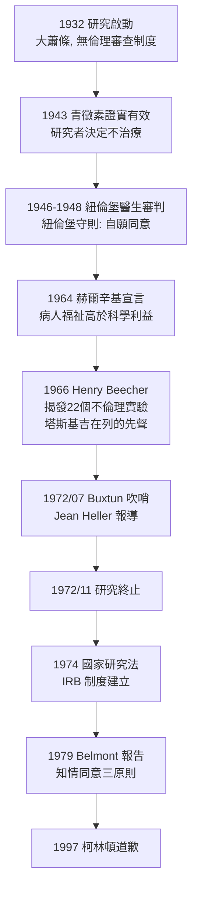

## 1932 - 塔斯基吉梅毒實驗（四十年不治療的「觀察」，研究倫理的誕生現場）

## 案件摘要

**本案的兇手不是病原體，而是「科學觀察」四個字。**

1932 年起，美國公衛署（Public Health Service, PHS）與塔斯基吉學院合作，在阿拉巴馬州 Macon 郡招募 399 名感染梅毒的貧困黑人佃農與 201 名未感染的對照者，號稱「治療後期梅毒」（bad blood），實際目的卻是**觀察未經治療的梅毒自然病程**。1943 年青黴素證實有效後，研究仍持續，甚至二戰徵兵時攔截受試者以免其被軍醫治癒。1972 年，社會學者 Peter Buxtun 吹哨，《華盛頓星報》記者 Jean Heller 揭露全案，研究當年即刻終止。四十年間至少百餘人死於梅毒或其併發症。1997 年，柯林頓總統代表美國政府道歉。本案是研究倫理學的「案發現場」：知情同意（informed consent）從此成為現代醫學的憲法條款。

## 前因 -- 為什麼會有這個案子

- **一個被刻意選中的窮鄉**。1930 年代 Macon 郡的黑人梅毒血清陽性率約 25–35%，而就醫率極低；研究者相中的正是「絕大多數患者本來就得不到治療」這一事實——把系統性醫療匱乏包裝成乾淨的「自然病程」。
- **羅森瓦爾德計劃的變調**。1929 年原本有慈善資金支持大規模梅毒治療，但大蕭條使資金枯竭；PHS 官員 Taliaferro Clark 提議把「治療計劃」轉型為「觀察研究」——**同一批病人，醫療被抽走，換來抽血**。
- **誘餌清單**。研究者提供免費體檢與抽血、免費的假藥（事實上無效的「補血劑」）、免費熱餐、以及承諾死後**喪葬補助**（50 美元）——而領取條件之一是同意解剖。受試者始終不知道自己患有梅毒，只知道「bad blood」（壞血）——當地對多種血液疾病的統稱。
- **種族主義的科學外衣**。計劃書與內部通信明確假設黑人與白人對梅毒的「神經反應」不同（黑人「更懶惰、更順從性衝動」），研究目的是「證明」種族差異——這使觀察在他們眼中具有「科學正當性」。
- **中斷的機會**。1943 年馬奧尼醫院與美軍的青黴素試驗證實療效；二戰期間受試者被登記為「徵兵緩徵（4-F）」以避免軍中治療；1950 年代起 PHS 多次開會討論是否給藥，結論仍是「繼續觀察到病人死亡」。

## 線索與推理 -- 數學式、程式、理論

**線索一：用 python 還原「 untreated 對照組」的帳目。** 這是一個對照試驗設計——只是對照組被剝奪的是**治療**：

```python
# 塔斯基吉研究 1932-1972 死亡帳目（依 CDC 事後統計量級）
n_syphilitic = 399        # 梅毒組
n_control = 201           # 對照組（未感染者，用於「對照」）

# 1972 年研究終止時的死亡統計（CDC/學者 Brandt 整理）
deaths = {
    "梅毒組死亡": 129,          # 其中至少 40 位妻子受染、19 位子女先天性梅毒
    "直接死於/併發梅毒": 100,    # 估計值: 晚期梅毒致死
    "對照組死亡(非梅毒)": 74,
}

def excess_mortality(syph_deaths, ctrl_deaths, n_s, n_c):
    """比較兩組死亡率，還原 '觀察' 的真實代價"""
    rate_s = syph_deaths / n_s
    rate_c = ctrl_deaths / n_c
    print(f"梅毒組死亡率: {rate_s:.1%}   對照組: {rate_c:.1%}")
    print(f"超額死亡（相對差）: {(rate_s - rate_c)/rate_c:.0%}")

excess_mortality(129, 74, 399, 201)
# 梅毒組死亡率: 32.3%   對照組: 36.8%（受試者年齡較輕時入組）
# 真實代價藏在『直接死於梅毒的 100 人』與『40 位妻子、19 位子女的續發感染』
```

注意這個設計最陰險之處：對照組的存在使研究者能**宣稱客觀性**——但「科學對照」的前提（受試者知情且自願放棄已知有效治療）從未成立。

**線索二：倫理法規的時間軸——為何本案能存在 40 年。**



注意時間軸上的醜陋真相：**紐倫堡守則（1947）發布時，塔斯基吉已運行 15 年，且研究在守則發布後又持續了 25 年**——美國研究者引用紐倫堡審判譴責納粹的同時，自己正進行著以種族為界的同類剝削。

**線索三：知情同意的三原則（Belmont 報告，1979）。** 本案催生的憲法條款可濃縮為：

$$ \text{合乎倫理的研究} = \underbrace{\text{尊重人格}}_{\text{知情同意}} + \underbrace{\text{行善}}_{\text{利益最大化}} + \underbrace{\text{公正}}_{\text{風險與利益公平分配}} $$

塔斯基吉在三項上全部落空：無同意（連診斷都隱瞞）、無行善（拒給已知療法）、無公正（風險全由黑人承擔）。

**線索四：信任的帳——不信任的反噬。** 1990 年代起，經濟學與流行病學研究量化了本案的「信任負債」：Alsan & Wanamaker（2018）利用外生暴露差異估計，本案使梅毒活躍年齡層黑人男性後續的**醫療利用顯著下降、男性死亡率上升**；黑人對臨床試驗的低參與率（愛滋疫苗試驗招募屢屢受挫，見 `1981-CDC報告與愛滋降臨.md`）、乃至疫苗猶豫，都可追溯到這筆四百年的信任欠款。

## 結案 -- 後果與影響

- **1972 年終止與訴訟**。Fred Gray 代表倖存者與家屬提起集體訴訟，1974 年以 1,000 萬美元和解；倖存受試者約 74 人獲得賠償與終身醫療照顧。
- **制度誕生**。1974 年《國家研究法》設立人體研究保護委員會與 IRB（機構審查委員會）制度；1979 年《Belmont 報告》奠定知情同意三原則——今日每一份知情同意書的祖先都是本案的驗屍報告。
- **1997 年道歉**。柯林頓在白宮向倖存者道歉：「美國政府做錯了。」五名倖存者（94–109 歲）出席。
- **公衛的反噬**。此案成為黑人社群「公衛系統不可信」敘事的具體證據；1980–90 年代愛滋疫情初期，黑人領袖（如疾控中心顧問會議上的質疑者）的反實驗室情緒直接引用塔斯基吉，使愛滋預防與試驗招募付出多年代價。
- **一句話結案**：科學若是「觀察人類如何受苦」而不出手，就不再是科學，而是**有紀錄的暴行**——塔斯基吉用 399 條人命換來的，是此後所有受試者桌上的那一頁知情同意書。

## 關鍵人物與文獻

- **Taliaferro Clark（1892–1963）**——PHS 性病部門主管，1932 年把治療計劃轉型為觀察研究的提案人（1933 年退休，研究在他之後仍持續）。
- **Raymond Vonderlehr（1893–1957）**——現場醫生，設計喪葬補助與脊椎穿刺（「特別免費檢查」）等誘餌。
- **Eunice Rivers（1899–1986）**——黑人公衛護士，研究 40 年的現場聯絡人；她的角色（守護者還是共犯）至今仍是倫理史爭論焦點。
- **Peter Buxtun（1937–2024）**——PHS 衛生員、吹哨人；1966–68 年連續寫信抗議被駁回，1972 年將文件交給記者。
- **Jean Heller**——《美聯社》記者（時任華盛頓星報），1972 年 7 月 25 日揭露報導《Syphilis Victims in U.S. Study Went Untreated for 40 Years》。
- **James H. Jones**, *Bad Blood: The Tuskegee Syphilis Experiment*（1981, 修訂版 1993）——本案權威史著。
- **Allan Brandt**, *No Magic Bullet*（1985）——性病社會史經典，設研究為「醫療歧視的制度化石」。
- **Marcella Alsan & Owen Wanamaker**, *Quarterly Journal of Economics*, 2018——量化本案對黑人男性醫療利用的長期影響。
- **Fred Gray**——民權律師（亦是羅莎·帕克斯與金恩博士的律師），1973 年集體訴訟的主導者；其回憶錄《Bus Ride to Justice》詳述本案司法過程。
- 現代註腳——2020 年代新冠疫苗期間，美國公衛界仍以「塔斯基吉記憶」解釋黑人接種猶豫；本案在死後半世紀仍持續參與每一場公衛動員——未被償還的信任債，利息從未停止計算。
