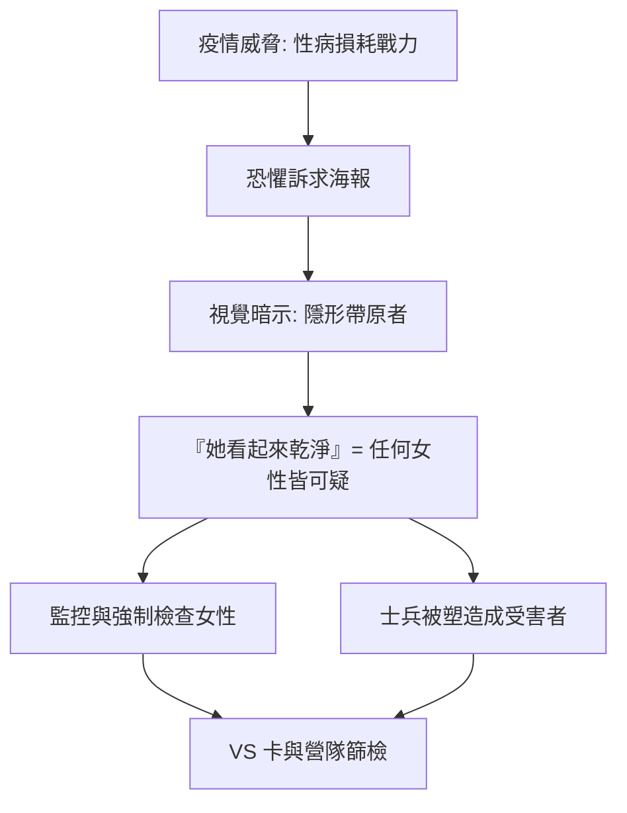

## 1940 - 她看起來很乾淨（二戰美國如何用一張海報把性病變成道德審判）

## 案件摘要

**本案的兇器不是螺旋體，而是一張印刷海報。**

1944 年，美國公衛署（USPHS）與社會衛生協會（ASHA）發行了一張日後最著名的性病宣傳海報：一名笑容明朗、衣著端莊的年輕女子，配上一行字——「She may look clean—but…」（她看起來很乾淨——但是……）。海報的下文是：她可能帶著梅毒或淋病，6800 萬美國人染有性病，其中多數不自知。本案要偵查的是：一場反疾病的公衛運動，如何一步步滑向一場針對「放蕩女性」的道德獵巫——而這套話術，將一路延續到 `1981-CDC報告與愛滋降臨.md` 時代的神罰論述。

## 前因 -- 為什麼會有這個案子

- **一戰的教訓刻在統計表上**。1917–18 年，美國遠征軍中性病住院人數一度**超過戰傷住院**：陸軍年度性病住院約 31 萬人次，損失逾 700 萬個戰鬥日。ASHA 自 1914 年起推動的「Fit to Fight」／「Fit to Win」宣導運動，正是為此而生。
- **1918 年 Chamberlain-Kahn Act**：國會撥款設立「攔阻線」（interpolation zone）制度，軍營周邊的妓院被關閉，疑似染病女性可被**強制拘留與身體檢查**——注意，被管制的從來只有女性。
- **1940 年 7 月 May Act**：二戰爆發後，國會通過《May Act》，禁止在聯邦防務區域內從事賣淫，違者以聯邦重罪起訴；1941–45 年間聯邦檢察官以此起訴了數千件案子，軍營周邊的紅燈區被整片掃蕩。
- **動員規模空前**：到 1944 年，超過 1200 萬人入伍。1940 年陸軍新兵性病檢出率約 3.3%（梅毒血清陽性率約 2.6%），軍方視之為戰鬥力的直接威脅——每一個性病兵，都是一門被自己人打啞的炮。

- **大眾宣傳的量化評估**：戰時民調（國家意見研究中心 National Opinion Research Center 的調查）顯示，到 1944 年，約 90% 的士兵知道性病的傳染途徑與預防措施——認知目標達成；但同一批調查也記錄到士兵對「平民女性」的懷疑態度顯著上升，而對自己軍中同伴的風險評估則偏低——恐懼教育成功傳遞了知識，也同步傳遞了偏差的風險歸因模型。

## 線索與推理 -- 數學式、程式、理論

在拆解宣傳心理之前，先看軍方自己留下的數據——這是本案最誠實的證人。美國陸軍的年度醫療統計顯示，性病造成的「損兵折將」長期被低估：1918 年陸軍每千人的性病入院率高達 87.5，1940 年代經過整頓後已降至一半以下，但絕對數字仍然驚人。海軍的紀錄同樣證明：珍珠港事件前，艦隊官兵因性病住院的總人日，一度可與機械事故並列為最大非戰鬥減員來源。這些表格是 ASHA 與公衛署說服國會撥款的原始彈藥。

宣傳的邏輯核心是一條**恐懼訴求（fear appeal）方程式**。現代傳播心理學（Witte 的擴展平行過程模型，EPPM）可將其形式化：

$$ \text{行為改變} = f(\text{威脅感 } T, \text{效能感 } E) $$

- 當 $ T $ 高且 $ E $ 高：防護行為增加（去驗血、用保險套）。
- 當 $ T $ 高且 $ E $ 低：**防衛性逃避**——否認、污名化受害者、把威脅投射到「他人」身上。

```python
# 恐懼訴求的副作用：污名轉移模型
def propaganda_effect(threat, efficacy, scapegoat_available=True):
    if threat > 0.7 and efficacy < 0.5:
        if scapegoat_available:
            return "防衛性逃避 → 污名化『放蕩女性』/『高危險群』"
        return "恐慌蔓延"
    if threat > 0.7 and efficacy >= 0.5:
        return "驗血、體檢、防護行為上升"
    return "無感"

print(propaganda_effect(threat=0.9, efficacy=0.4))
# 輸出: 防衛性逃避 → 污名化『放蕩女性』/『高危險群』
```

1944 年那張海報的視覺結構，正是污名機制的解剖圖：



值得細看的是海報的排版語法：主圖女子穿著整齊、手持相機、笑容陽光——完全不是嫖妓場所的暗號形象；配文刻意列舉「她可能是鄰家女孩、可能是護士、可能是速記員」。這套敘事的傳播學效果是**把監視權下放給每個士兵**：不再只有妓院是危險區，而是所有交往對象都需被心理篩檢。其隱含的邏輯公式是：

$$ P(\text{帶原} \mid \text{外表正常}) \neq 0 \quad \Rightarrow \quad \text{所有女性皆需被懷疑} $$

後半句在邏輯上根本推不出來（貝氏推論還需要基準率與行為史），但恐懼訴求不需要貝葉斯——它只需要一張臉和一個省略號。同期的軍中單張甚至建議士兵「問她的過去」，把流行病學問診變成道德盤查。

「她看起來很乾淨——但是……」——後半句被刻意留白，交由讀者的想像力補完。這是心理學上經典的**模糊威脅技術**：具體的警告可以被反駁，模糊的暗示無法反駁。海報下方的小字補上一組數據：約 6800 萬美國人染有性病或隱性感染，許多人「不知道自己有病」。把「人人皆可能帶原」與「外表無法辨識」兩件事並置，效果是摧毀日常社交信任——每一個陌生異性都成為潛在病例。

**制度性線索**：士兵行前領取「VS 卡」（Venereal Disease prophylaxis packet）——內含磺胺類藥膏與说明單張，性行為後須至「pro station」沖洗與登記；營隊定期強制驗血（Wassermann 反應）與尿道塗片篩檢。統計上這套組合有效：陸軍性病率從 1940 年的每千人 43 例降到 1945 年的每千人 21 例以下。但代價是把「傳染鏈」的另一半——女性——建構成獵物與汙源。

## 結案 -- 後果與影響

- **短期有效，長期有毒**。性病率確實被壓低（配合 `1943-青黴素治癒梅毒.md` 的醫療革命），但宣傳語法——「乾淨的外表下藏著病」——把帶原者與「可辨識的墮落」畫上等號，成為日後一切性病污名的模板。
- **教育片的雙面性**。戰時軍方製作的性教育影片，如 1942 年給新兵看的《Personal Hygiene》（J. E. Smyth 導演版）與 1945 年著名的《Easy to Get》，一方面首度以官方身分承認士兵會發生性行為、教導預防措施；另一方面，片中染病的女性角色清一色被塑造為被驅逐出鎮的「流浪娼婦」——預防教育與道德懲罰總是同框出現。
- **娼妓掃蕩的統計**：1941–45 年間，聯邦與地方合作關閉了戰時紅燈區逾 700 處；被 May Act 起訴的對象包括房東、皮條客，但被「強制身體檢查與拘留」的絕大多數是女性。戰後這套隔離所制度被悄悄移交給各州社福機構，以「道德矯治」之名繼續運作多年。
- **性別不對稱被制度化**：女性可被強制檢查、拘留於「隔離所」；男性士兵只是「受害者與病患」。May Act 的執法紀錄中，被告九成以上是女性。
- **ASHA 的百年傳統**延續至今：從 1914 年的「Fit to Fight」到 1944 年的海報，同一套「愛國＝潔身」的修辭，戰後轉進學校性教育與婚前十項檢查運動。ASHA 的檔案（明尼蘇達大學社會福利史檔案館藏）顯示，其宣傳部門在 1942–46 年間印製與分發的海報、單張、士兵口袋卡超過 5,000 萬份——以印刷量計，這是當時人類史上最大規模的單一健康傳播行動。
- **一句話結案**：當公共衛生借用道德恐懼的槍，槍口永遠先對準最沒有談判籌碼的人——這條規律，將在 `1981-CDC報告與愛滋降臨.md` 與 `1987-ACT UP與沉默等於死亡.md` 中再度應驗。

## 關鍵人物與文獻

- Thomas Parran——美國公衛署署長（1936–48），《Shadow on the Land》（1937）作者，大力推動梅毒全民驗血，也是 VS 制度與 May Act 的幕後推手。他曾因媒體拒登「梅毒」「淋病」字樣而公開抱怨：報紙肯登「黑死病」，卻不敢登「syphilis」。
- 美國社會衛生協會（ASHA）——1914 年創立，一戰「Fit to Fight」與二戰海報運動的主要製作方，1959 年併入美國社會健康協會（後為 ASHA，仍存續至今）。
- 〈She may look clean—but…〉——1944 年公衛署／ASHA 海報，插畫家 Asher Brallier，現被視為二戰宣傳藝術與污名史的代表檔案。
- Allan Brandt——《No Magic Bullet: A Social History of Venereal Disease in the United States since 1880》（1985），本案最重要的史學偵查報告。
- Philip Jenkins——《The Cold War at Home》與《Moral Panic》系列的污名傳播框架；Kim Phillips-Fein 與 Marilyn Hegarty 則分別從性別史與宣傳史角度重審 May Act 時期對女性的制度性管控。
- 軍醫總署（Surgeon General's Office）年度醫療統計報告（1919、1945）——本案所有感染率數據的一手來源。
