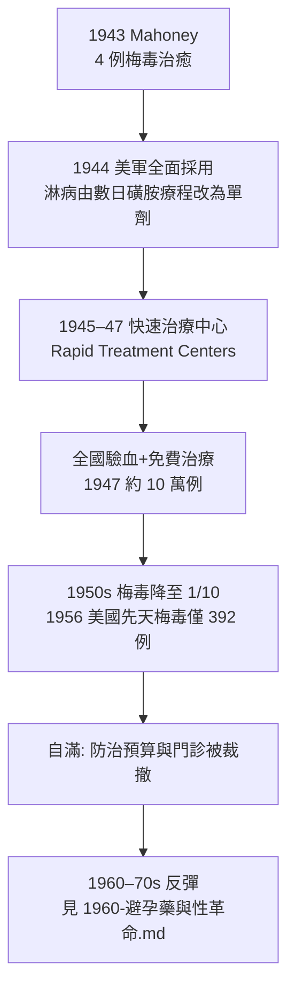

## 1943 - 青黴素治癒梅毒（五百年絕症，在幾針之內投降）

## 案件摘要

**本案的兇器，來自一顆被忘在培養皿角落的黴菌。**

1943 年，美國海軍醫院的 John Mahoney 用一種新藥治癒了四名梅毒患者。此前的五個世紀裡，梅毒以水銀、砷凡納明（Salvarsan）、瘧疾熱療輪番上陣，全都只能壓制不能根治；此後的兩年內，美軍全面改用青黴素，戰後展開全國篩檢與「快速治療中心」網絡，美國梅毒年報告病例從 1947 年的約 10 萬例，跌到 1950 年代的十分之一。人類第一次把一種「世紀絕症」降格為「幾針治癒的小病」——然後，正如本案將揭示的，這場勝利本身埋下了 `1960-避孕藥與性革命.md` 時代的自滿與反彈。

## 前因 -- 為什麼會有這個案子

- **1928 年 9 月 3 日**，倫敦 St Mary's 醫院的 Alexander Fleming 度假返任，發現一枚被黴菌污染的金黃色葡萄球菌培養皿中，黴落周圍出現透明的抑菌環——Penicillium notatum 的分泌物被他命名為青黴素（詳見另一本書 `../生理醫學史/1928-Fleming青黴素.md`）。但他無法純化量產，十年間幾乎無人聞問。
- **1940 年**，牛津的 Howard Florey、Ernst Chain 與 Norman Heatley 接手：成功以小鼠實驗證明療效（8 隻感染鏈球菌的小鼠，4 隻未治療全死、4 隻治療全活），並突破冷凍乾燥與逆流萃取的量產難關。
- **珍珠港事件後**，美國投入戰爭生產體系：1943 年產量 210 億單位，1945 年暴增至 6.8 兆單位，價格從每劑 20 美元跌到 0.55 美元。深槽發酵（用玉米浸液 corn steep liquor）是關鍵。
- **梅毒當時的治療地獄**：砷劑 Salvarsan 需每週靜脈注射、療程逾一年、毒性猛烈；瘧疾熱療（故意讓病人發燒到 40°C 殺死螺旋體）仍在使用。神經梅毒與先天梅毒繼續製造癱瘓、失明與瘋人院的住民。
- **戰場本身就是試驗場**。1943 年前後，盟軍醫療體系累積了數十萬例的青黴素用藥紀錄：傷口感染、肺炎、氣性壞疽……這些戰地數據一方面證明了藥物安全窗極寬（青黴素干擾的肽聚醣合成是人類細胞沒有的途徑，故毒性極低），另一方面讓軍醫體系建立了量產、冷鏈與給藥流程——這正是 Mahoney 試驗得以快速展開的基礎設施。
- **一個尷尬的前情**：1943 年前，梅毒治療的「主流」仍是瘧疾熱療法（Wagner-Jauregg 因之獲 1927 年諾貝爾獎）與砷劑長程療法；全科醫生對「根治」二字已失去想像。青黴素登場時，最大的阻力其實不是技術，而是醫界的經驗惯性——「梅毒不可能治好」是當時教科書的標準句式。

## 線索與推理 -- 數學式、程式、理論

青黴素為何對梅毒螺旋體如此致命？答案在細菌細胞壁的化學結構。青黴素的 β-內醯胺環是 D-丙胺酸-D-丙胺酸的結構類似物，會騙過轉肽酶（transpeptidase）：

$$ \text{肽聚醣交聯}: G - L - Ala - D - Ala \xrightarrow{\text{轉肽酶}} G - L - Ala \cdots D - Ala \; (\text{交聯完成}) $$

$$ \text{青黴素} + \text{轉肽酶} \rightarrow \text{共價結合（青黴素結合蛋白 PBPs）} \Rightarrow \text{交聯中止} $$

```python
# 細胞壁合成的「開關失效」模型
def penicillin_kill(bacterium):
    wall_strength = 1.0
    while bacterium.dividing:
        wall_strength -= 0.3   # 轉肽酶被抑制，每次分裂壁變薄
        if wall_strength < 0.2:
            return f"{bacterium.name}: 細胞溶解（lysis）"
    return f"{bacterium.name}: 僅抑制增殖（bacteriostatic）"

print(penicillin_kill(type("T", (), {"name": "梅毒螺旋體", "dividing": True})()))
# 梅毒螺旋體正處於分裂活躍期 → 直接被溶解
```

關鍵在於：梅毒螺旋體（*Treponema pallidum*）細胞壁合成活躍且對 β-內醯胺極度敏感、外膜滲透性好，而青黴素在腦脊髓液也能達到治療濃度（高劑量時）——這使它同時拿下早期梅毒與神經梅毒。**臨床證據鏈**：



淋病線則更早收官：1944 年起，美軍對急性淋菌性尿道炎改用青黴素單次肌肉注射，治癒率接近 100%；磺胺類（1937 年起使用、抗藥性已四處蔓延）被迅速淘汰。戰後民間診所跟進，「打一針就好」成為大眾對性病的新常識——這個常識的副作用，是讓保險套從預防工具降格為「避孕的次選」。

Mahoney 的試驗設計本身也值得偵查：他把青黴素用於各期梅毒患者，觀察血清學反應（VDRL 滴度）下降與臨床病灶消退。早期梅毒患者在接受總量約 120 萬單位（分次肌肉注射）後，皮疹與硬下疳在數日內消退、血清在數週內轉陰——這在 Salvarsan 時代需要一年以上且從不敢承諾。此後劑量學迅速標準化，到 1940 年代末，「單次 240 萬單位長效青黴素（benzathine penicillin G）肌肉注射」成為早期梅毒的標準療法，沿用至今超過七十年——螺旋體至今未對青黴素產生顯著抗性，這在抗生素史上近乎孤例（因其基因組不含 β-內醯胺酶基因、無質體交換途徑）。

1947 年後的「快速治療中心」（Rapid Treatment Centers）是本案的制度性收網：各州以聯邦補助設立專門病院，對血清陽性者提供免費全程治療，配合婚檢、產檢、入伍體檢與入監體檢的強制驗血，把「發現—治療」的漏斗口徑開到最大。到 1950 年代初，美國梅毒防治體系檢測量達每年數千萬人次——公共衛生史上，一種疾病被這樣系統性圍剿，前無古人。

一個反諷的對照組同期上演：1932 年起的美國 Tuskegee 梅毒實驗，以「觀察未治療病程」之名讓數百名黑人患者被剝奪治療——而當青黴素在 1943 年後已成標準療法，實驗竟持續到 1972 年才被記者揭發。**藥已經有了，制度卻決定不給。**這是本案最黑暗的物證。

還有一樁與本案糾纏半世紀的懸案：瓜地馬拉實驗。1946–48 年，美國公衛署、NIH 與瓜地馬拉政府合作，在當地讓囚犯、精神病患者與士兵**被故意暴露於梅毒與淋病**（部分經由被付費的性工作者），以測試青黴素預防與治療效果——事前知情同意完全不存在。此計畫因療效不彰而中止，檔案塵封至 2010 年才由史學家 Susan Reverby 揭露，歐巴馬政府為此正式道歉。青黴素治癒梅毒的同一頁歷史裡，寫著兩種截然不同的道德答卷。

## 結案 -- 後果與影響

- **流行病學斷崖**：美國梅毒年報告病例 1947 年約 97,000 例 → 1956 年約 6,400 例（初、二期梅毒）；先天梅毒幾乎絕跡。淋病同樣被青黴素降伏，1940 年代末劑量降至數十萬單位即可治癒。
- **戰後的全球擴散**：美國的 RTC 模式被世界衛生組織（WHO，1948 年成立）納入性病防治範本；1950 年代，歐洲、北非與亞洲的群體注射運動在烏干達、海地等地展開，單次全社區注射使雅司病（yaws，螺旋體近親）病例下降逾 95%——青黴素成為史上第一種被當作「公共衛生消滅工具」使用的抗生素。
- **1945 年諾貝爾生理學或醫學獎**頒給 Fleming、Florey、Chain。Fleming 本人則在 1945 年的演講中精準預警：「無知之人可能透過用量不足，讓微生物對青黴素產生抗性」——數十年後，淋病將以抗藥性逐步反攻（見 `1960-避孕藥與性革命.md`）。
- **制度性自滿**：1950 年代，性病防治被視為「已解決的問題」，專門門診縮編、醫學院性病課程刪減、公共教育停擺。到 1957 年，美國聯邦性病防治預算較 1947 年實質腰斬，專職性病調查員（epidemiological field investigators）人數從 1,200 人裁至不足 400 人。這份自滿與避孕藥時代（`1960-避孕藥與性革命.md`）疊加，釀成 1960–70 年代淋病狂潮。
- **病恥感的殘留並未隨病例下降**。1950 年代的報紙仍以「隱疾」「社交病」代稱性病；患者寧願私下找醫生自費打針，也不願進入免費的公立診所留下紀錄。公共衛生擁有了史上最強的性病武器，卻沒有同時擁有讓人敢於使用的社會氛圍——這個「藥有效、人不來」的落差，直到愛滋時代（`1981-CDC報告與愛滋降臨.md`）才被社群運動部分修補（`1987-ACT UP與沉默等於死亡.md`）。
- **病恥感的殘留並未隨病例下降**。1950 年代的報紙仍以「隱疾」「社交病」代稱性病；患者寧願私下找醫生自費打針，也不願進入免費的公立診所留下紀錄。公共衛生擁有了史上最強的性病武器，卻沒有同時擁有讓人敢於使用的社會氛圍——這個「藥有效、人不來」的落差，直到愛滋時代（`1981-CDC報告與愛滋降臨.md`）才被社群運動部分修補（`1987-ACT UP與沉默等於死亡.md`）。
- **一句話結案**：抗生素贏了戰役，卻讓人類提前宣布戰爭結束——解散軍隊的那一刻，就是下一次潰敗的起點。

## 關鍵人物與文獻

- Thomas Parran 在本案中也有一席：這位公衛署長早在 1936 年就任時就把梅毒列為頭號戰役，1938 年促成國會通過《National Venereal Disease Control Act》設立聯邦防治撥款；正因為他的全國驗血網與 RTC 藍圖在 1943 年前已鋪好，青黴素一問世就能立刻接入既有制度——**藥是新的，管道是現成的**，這是 1947 年病例斷崖的制度前提。
- Alexander Fleming——1928 年發現者，倫敦 St Mary's 醫院；1945 年諾貝爾獎得主（另見 `../生理醫學史/1928-Fleming青黴素.md`）。
- Howard Florey 與 Ernst Chain——牛津團隊，1940–41 年完成純化、動物與人體試驗及量產方法，1945 年諾貝爾獎共同得主。
- Norman Heatley——牛津團隊的工程天才，逆流萃取與玻璃器皿量產的實際解決者，諾獎遺珠。1941 年他為湊不夠藥的第一批病人，親自從患者尿液中回收青黴素——早期的每一劑，都有一半是從膀胱「搶」回來的。
- John F. Mahoney——美國公衛署 Marine Hospital（Staten Island）院長，1943 年 6 月與 Ronald Arnold 等發表青黴素治療梅毒的四例報告（*Am. J. Public Health*）。他同時主持了對淋病的青黴素療法評估，是「青黴素時代性病學」的奠基者。
- Allan Brandt, *No Magic Bullet*（1985）；John Parascandola, *Sex, Sin, and Science: A History of Sexually Transmitted Diseases in America*（2008）。
- James H. Jones, *Bad Blood: The Tuskegee Syphilis Experiment*（1981/1993）——本案黑暗對照組的權威調查；1997 年柯林頓總統代表政府正式道歉。
- Susan Lederer 的青黴素倫理史研究與 *The Challenge of Antibiotic Resistance*（2025）等新近綜述，追蹤了 Fleming 1945 年預警的驗證過程。
