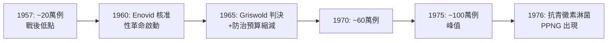

## 1960 - 避孕藥與性革命（把懷孕從賭桌上撤走之後，淋病坐了上來）

## 案件摘要

**本案要偵查的是一場「看不見的交易所」：用感染風險，換取懷孕風險。**

1960 年 5 月 9 日，美國 FDA 核准 Enovid（norethynodrel）作為口服避孕藥——人類史上第一個以「健康人的生活方式」為目的的處方藥。此後十五年，美國的性行為規範被重寫；同一時期，淋病年報告病例從 1950 年代的低點（約 20 萬例）一路爬升，1975 年突破 100 萬例，成為美國當時最常見的報告傳染病。經濟學與流行病學在此交會：當避孕技術把「懷孕」這個最重的代價移走，感染風險的**邊際成本**相對暴漲，於是風險被替代，而非被消除。

## 前因 -- 為什麼會有這個案子

- **四位推手的十萬里長征**：節育運動先驅 Margaret Sanger（1916 年開設美國第一家避孕診所，為此坐牢）與富遺孀 Katharine McCormick（資助全部研發經費，累計約 200 萬美元）委託生理學家 Gregory Pincus（Worcester 基金會）研發；婦科醫師 John Rock 執行臨床試驗（以「月經週期調節」之名在麻州進行）。這個組合的荒謬之處在於：避孕在麻州與康乃狄克州當時仍是刑事犯罪——科學家必須在法律禁止其成果的州境內研發避孕藥。- **1951 年**，Carl Djerassi 在 Syntex 合成 norethisterone；Pincus 團隊改用 norethynodrel（Searle 藥廠），1956 年在波多黎各 Río Piedras 展開大規模試驗（當地婦女被告知程度至今有爭議；試驗初期約 17% 受試者出現難以忍受的副作用而退出，報告中被輕描淡寫為「神經症狀」）。
- **1957 年**，FDA 先核准 Enovid 治療「月經失調」——處方箋背後的實際用途，人人皆知。1960 年正式核准避孕適應症；1965 年 *Griswold v. Connecticut* 判決確立已婚者避孕的憲法隱私權，1972 年延伸至未婚者。
- **同一時間，抗生素時代的自滿達到頂點**（見 `1943-青黴素治癒梅毒.md`）：性病專門門診被裁撤、醫學生不再認真學梅毒血清學、聯邦防治經費轉向小兒麻痺等「新戰場」。青黴素治淋病便宜到一根針的事，沒人再願意花錢宣導保險套。防治體系的「眼睛」也閉上了：聯邦性病實驗室網絡縮編，接觸者追蹤員從 1947 年的 1,200 人裁到 1957 年的不足 400 人——偵查系統先於疫情解散。

## 線索與推理 -- 數學式、程式、理論

把性決策寫成一條期望成本式。對個體 $ i $ 而言，一次未保護性行為的期望代價為：

$$ E[C] = P_{\text{孕}} \cdot C_{\text{孕}} + P_{\text{病}} \cdot C_{\text{病}} + C_{\text{套}} $$

1960 年之後，$ P_{\text{孕}} \cdot C_{\text{孕}} $ 被避孕藥壓到趨近於零；縱使 $ P_{\text{病}} \cdot C_{\text{病}} $ 不變，整體 $ E[C] $ 大幅下降，於是性行為頻率 $ N $ 上升、保險套使用率 $ q $ 下降。傳染動力學的總效果：

$$ R_0 = c \cdot \beta \cdot D \cdot (1 - q) \quad \text{其中 } c=\text{伴侶更換率}, \beta=\text{傳染力}, D=\text{傳染期} $$

若 $ c $ 上升且 $ q $ 下降，即使 $ \beta $、$ D $ 完全不變，$ R_0 $ 也能突破流行閾值——這正是 1960–75 年美國淋病疫情的核心數學結構，與任何病原突變無關。

```python
# 風險替代的簡化模型：R0 對性行為頻率與防護率的敏感度
def r0(partners_per_year, trans_per_act, acts_per_partner, condom_cut=0.7):
    return partners_per_year * trans_per_act * acts_per_partner * (1 - condom_cut)

before = r0(2.0, 0.5, 10, condom_cut=0.5)   # 避孕藥前: 保險套較常用（兼避孕）
after  = r0(3.0, 0.5, 12, condom_cut=0.2)   # 避孕藥後: 頻率↑、套率↓
print(f"避孕藥前 R0≈{before:.1f} → 避孕藥後 R0≈{after:.1f}")
# R0 上升 → 即使單次感染機率不變，疫情也會指數放大
```

美國淋病報告病例的實測曲線（單位：萬例）：



曲線的轉折點值得精確定位：1965–66 年病例開始加速，恰與 Griswold 判決後避孕藥使用率躍升、以及聯邦性病防治預算實質下降（`1943-青黴素治癒梅毒.md` 所述的裁編效應）兩條曲線交叉的時間重合。單一變因無法定案，但兩個制度的同向作用，構成了流行病學上的足夠證據鏈。梅毒同期走勢不同——初、二期梅毒在 1960 年代中期同樣回升（1956 年低點 6,400 例 → 1965 年約 2 萬例），顯示問題不限於淋病的抗藥性，而是**整個檢測—治療系統的鬆弛**。

另一條推論同樣關鍵：**無症狀比例**。女性淋病感染約半數無明顯症狀，在抗生素萬能的年代，患者沒有動機主動就醫、醫療體系也停止主動篩檢——無症狀帶原者成為繁殖率最高的隱形節點。1970 年代 CDC 重建夥伴通知（partner notification）與接觸者治療制度，正是對本案推理的遲到回應。

數據層面還有三條交叉證據。其一，年齡結構：1960–75 年間淋病報告病例的成長最集中在 15–24 歲族群——正是避孕藥普及率最高的世代。其二，地理與種族分布：病例成長在城市貧民區與年輕非白人社群尤烈，反映的不只是行為，更是醫療可近性的崩壞——性病門診被裁撤後，窮人失去最後的免費檢測站。其三，青黴素劑量通脹：淋菌對青黴素的最小抑菌濃度（MIC）逐年爬升，1976 年產青黴素酶的淋菌（PPNG）在西非與東南亞出現並於數年內傳遍全球——**抗藥性本身就是過度治療與不完整治療的自然實驗結果**。

$$ \text{MIC}_{t+1} > \text{MIC}_t \quad \forall t \in [1955, 1976] \quad \Rightarrow \quad \text{選擇壓力累積} \rightarrow \text{PPNG 爆發} $$

此外，公共政策研究（如 1970 年代 CDC 的 gonorrhea control program 評估）發現一個反直覺結果：**把治療資源集中在「高頻核心群」（core group）**——性網絡的中心節點——比全民教育更能壓低 R0；這個源自數學流行病學（Hethcote & Yorke, 1984 的經典模型）的結論，日後成為所有性病防治計畫的理論基石。

## 結案 -- 後果與影響

- **淋病的悲劇三部曲**：病例暴增（1960s）→ 抗青黴素淋菌（PPNG）1976 年出現、1980 年代擴散，青黴素時代正式落幕 → 治療成本與後遺症（女性不孕、骨盆腔炎）同步上升。1980 年代初，骨盆腔炎成為 15–34 歲女性住院的首要傳染病病因，每年新增不孕病例逾 10 萬。
- **梅毒的次要回升**：初、二期梅毒從 1956 年的低點回升，1980 年代末再度逼近 5 萬例；但真正戲劇化的是 1980 年代中期以後——愛滋的恐懼（`1981-CDC報告與愛滋降臨.md`）反而壓低了梅毒傳播，「恐懼成為最有效的殺微生物劑」成為公衛界的黑色笑話。
- **風險替代理論被寫進經濟學**：Avery 等經濟學家後來以 AIDS 時代的資料驗證同構邏輯——「治療或避孕的進步可能提高整體感染率」，這對一切「科技解決風險」的樂觀論是一記回馬槍。後續研究（如 Philipson & Posner, *Private Choices and Public Health: The AIDS Epidemic in an Economic Perspective*, 1993）把性病防治正式變成微觀經濟學的分支。風險替代的核心洞見可以用一句話概括：**任何降低特定風險成本的技術，都會同時降低整體風險成本的邊際，從而改變行為的均衡點**。
- **社會學的另一面**：性革命也帶來女性對身體的實質自主權、婚姻內外性行為的除罪化氛圍；避孕藥上市五年內使用者突破 600 萬，1970 年代中期約四分之一的美國育齡女性曾使用。問題從來不在避孕藥本身，而在**防治體系沒有跟著風險結構一起重組**——這不是個人墮落的問題，而是制度設計滯後於技術變革的問題。
- **現代迴聲**：二十一世紀的 PrEP（暴露前預防用藥）時代，同樣的風險替代辯論重演——「藥丸讓人不再用套」的爭議，幾乎是 1960 年辯論的逐字重印；性病史的循環性在此顯露無遺。
- **一句話結案**：人類拿到新科技的瞬間，會自動重算風險帳本——而公共衛生的任務，是在帳本重寫之前，先看清哪些成本只是被換了個科目。

## 關鍵人物與文獻

- Margaret Sanger——節育運動創始者，避孕藥計畫的發想人；《Woman and the New Race》（1920）。
- Katharine Dexter McCormick——MIT 第一位女畢業生之一、遺孀慈善家，避孕藥研發的實質金主。她在斯坦利·麥考密克（患精神分裂症的丈夫）病情惡化後，把家族財富的很大部分投入兩件事：精神醫學研究與女性節育——避孕藥對她而言既是科學也是人身自由的重構。
- Gregory Pincus——Worcester 基金會生理學家，口服避孕藥的技術總工程師。他 1934 年因體外受精實驗引發的醜聞被哈佛解職，「避孕藥之父」的第二次科學豪賭，用的是被主流生物學放逐的十年。
- John Rock——天主教徒婦科醫師，臨床試驗主持者，並以宗教論述為避孕辯護（《The Time Has Come》，1963）。
- Carl Djerassi——合成第一個高活性口服孕激素的化學家，後為小說家與「避孕藥之父」之名的糾纏者。
- Enovid／Searle——1960 年 5 月 9 日 FDA 核准案，官方檔案編號 NDA 10-825。
- Elizabeth Siegel Watkins, *On the Pill: A Social History of Oral Contraceptives*（1998）——本案藥政與社會接受度的權威研究。
- Robert Hethcote 與 James Yorke 的淋病傳播動力學模型（見前述 1984 經典），以及 CDC《STD Surveillance》歷年報告，是本案全部病例數據的一手來源。
- Thomas C. Schelling 式的風險行為分析，以及 Kahneman-Tversky 的機率加權理論，是「性病經濟學」推理的理論工具箱。
- Hethcote & Yorke, *Gonorrhea Transmission Dynamics and Control*（1984）——核心群模型的數學經典。
- Elaine Tyler May, *America and the Pill*（2010）；Jonathan Eig, *The Birth of the Pill*（2014）——本案兩部主要的通俗史偵查報告。
