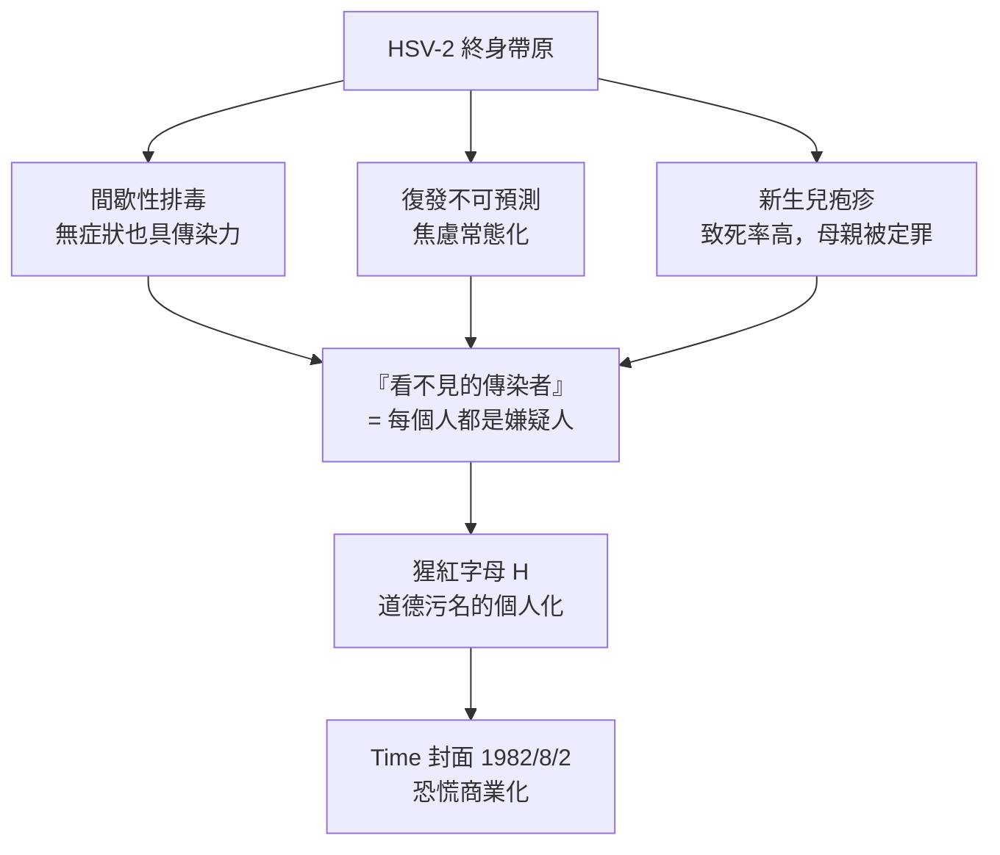

## 1982 - 疱疹恐慌與時代封面（當「治癒」變成神話，恐懼搬回了家）

## 案件摘要

**本案的嫌犯不會被任何抗生素處死，因為它根本不住在可以被殺死的地方。**

1982 年 8 月 2 日，《時代》雜誌以「Herpes: The New Scarlet Letter」（疱疹：新的猩紅字母）為封面故事：估計 1,000 萬至 2,000 萬美國人感染 HSV-2，每年新增 50 萬例，而醫學拿不出治癒手段。抗生素黃金時代（`1943-青黴素治癒梅毒.md`）結束後，性病第一次以「終身帶原」的姿態重返大眾恐懼中心；疱疹熱線（ASHA National Herpes Hotline）被打爆，交友市場上出現「皰疹者專屬聯誼」。本案要拆解：一個臨床上多屬輕症的病毒，為何能造成全國性道德恐慌——答案藏在潛伏機制與污名傳播的耦合裡。

## 前因 -- 為什麼會有這個案子

- **1960 年代起**，HSV-2 血清流行率隨性革命（`1960-避孕藥與性革命.md`）穩定攀升；到 1980 年代末，美國成人 HSV-2 血清陽性率約 20–25%（1988–94 年 NHANES 實測 21.9%）。更棘手的是血清學的盲區：約八成感染者從未被告知診斷——典型復發被誤認為蚊蟲叮咬、尿布疹或黴菌感染；直到 1990 年代型特異性抗體檢測（gG-based）問世，流行病學界才看清疱疹感染的真實規模。
- **臨床困境**：抗病毒藥 acyclovir（阿昔洛韋）1981 年上市，可縮短發作、抑制復發，但**不能根除**——停藥後病毒照樣從潛伏庫復出。「壓得住、殺不死」成為新常態。
- **診斷的滯後**：1980 年代的標準檢測只有病毒培養（取水泡液培養，敏感度低、僅在發作期可用）與非特異性抗體檢測（無法區分 HSV-1 與 HSV-2）；臨床上「確診」經常依賴醫生的目視判斷——誤診與漏診雙向泛滥。
- **文化背景**：1970 年代末美國性解放的餘溫遇上 1980 年代新保守主義的道德反撲；1981 年愛滋初步現蹤（`1981-CDC報告與愛滋降臨.md`），大眾媒體正急著為「性自由報應論」找第一個主角——疱疹先上了封面。
- **商業與媒體燃料**：Time 故事刊出後，全國性病診所就診量暴增；1983 年疱疹支持團體 HELP（ Helping Empower Lonely People）網絡成立，前患者成為輔導員——污名管理的組織化自此開端。1982 年 8 月之後數週，Newsweek、Time 與多家電視網連續跟進報導，《新英格蘭醫學雜誌》的疱疹論文被大眾媒體轉載成聳動標題；診所候診室出現從未有任何症狀、只因讀了封面故事而要求驗血的訪客——這是媒體誘發的「疫情敘事自我實現」的早期案例。
- **股市的平行劇情**：1982 年 8 月的封面故事刊出後，宣稱研發疱疹療法的小型生技公司股價出現投機性暴漲—— Venereal-disease biotech 成為 1980 年代初生技股熱的敘事素材之一；資本市場對恐慌的敏感度，與讀者對封面的敏感度同步。

## 線索與推理 -- 數學式、程式、理論

疱疹恐慌的技術核心是**潛伏感染（latency）**。HSV-2 感染黏膜上皮後，病毒顆粒沿軸突逆行進入薦椎背根神經節（S2–S4），病毒基因組以環狀游離體（episome）形式長期駐留：

$$ \text{病毒 DNA} \; \circleddash \; \text{（環狀 episome）} \subset \text{神經元細胞核，不整合、不複製} \Rightarrow \text{免疫系統與藥物皆不可及} $$

潛伏的分子機制在 1980–90 年代逐步解密：潛伏期中，LAT（latency-associated transcript）非編碼 RNA 是唯一高量表達的病毒轉錄本，它抑制神經元凋亡、維持基因組的表觀遺傳靜默（組蛋白去乙醯化）；而復發時，ICP0 等 immediate-early 蛋白啟動，把染色質重新打開——「睡眠／清醒」的開關由宿主壓力荷爾蒙與局部發炎信號共同調控。這個「藏進神經、關掉自己」的策略，是病毒演化史上最成功的免疫逃逸設計之一。

```python
# HSV 生命週期：為什麼 acyclovir 治不了「帶原」
def hsv_cycle(state):
    if state == "active_replication":
        # acyclovir 經病毒胸苷激酶(thymidine kinase)磷酸化 → 選擇性毒殺
        return "Acyclovir 有效: 抑制病毒 DNA 聚合酶"
    elif state == "latency_in_dorsal_root_ganglion":
        # 潛伏期無 DNA 複製、幾乎無胸苷激酶表現
        return "Acyclovir 無靶點: 基因組靜默沉睡於神經元"
    else:  # 復發觸發: 壓力/發燒/月經/日曬
        return "triggers → 軸突運輸 → 重建感染"

print(hsv_cycle("latency_in_dorsal_root_ganglion"))
# 輸出: Acyclovir 無靶點: 基因組靜默沉睡於神經元
```

真正放大恐懼的，是三個生物學事實與社會心理的乘積：



同一時期，病毒致癌理論也在推進：1976 年 Harald zur Hausen 提出子宮頸癌可能由 HPV（人類乳突病毒）引起的假說（對照當時主流懷疑的 HSV-2 假說）；1983–84 年他團隊自子宮頸癌組織中克隆出 HPV-16、HPV-18，關聯逐步坐實，2008 年獲諾貝爾獎——「菜花」這個百年笑談（見 `1564-法洛皮奧亞麻套與早期避孕套.md` 時代的記載），悄悄升格為癌症病源。性病「可治癒」的神話，在 1980 年代被病毒們徹底埋葬。

兩種病毒的命運對照，是本案最精緻的推理支線。HSV-2 與 HPV 都是潛伏或持續感染的雙股 DNA 病毒，都在 1970–80 年代被懷疑致癌；但致癌機制完全不同——HPV 的 E6/E7 蛋白直接綁架宿主的 p53 與 Rb 腫瘤抑制路徑（致癌途徑明確），而 HSV-2 與子宮頸癌的相關性最終被證明只是「性行為的代理指標」（confounder）。zur Hausen 堅持 HPV 假說的二十年間，一度被主流病毒學界視為異端；檢驗這類「性病—癌症」因果鏈的統計工具（血清陽性 vs 腫瘤組織內病毒 DNA 的區分）成為日後感染致癌學的標準方法論：

$$ P(\text{癌} \mid \text{病毒 DNA 在腫瘤細胞內}) \gg P(\text{癌} \mid \text{血清陽性}) \Rightarrow \text{因果在細胞內，不在血裡} $$

## 結案 -- 後果與影響

- **恐懼權的移交**：疱疹證明了細菌性病可治、病毒性病不可治的分水嶺；兩年後愛滋接棒（`1981-CDC報告與愛滋降臨.md`），恐懼全面升級。疱疹恐慌某種程度上是愛滋恐慌的預演與洩壓閥——它測試了美國社會對「無藥可醫的性病」的反應模式，包括媒體恐慌、道德歸因、患者隱匿與最終的社群自助。
- **保險套的復權**：「皰疹會傳染」的公共認知，讓保險套從避孕工具轉型為「防病工具」的敘事重啟，為愛滋時代的防護文化鋪路。1980 年代末，美國保險套年銷量從 1980 年代初的低迷回升至約 10 億只，藥局貨架首次出現以「防病」而非「避孕」為主文案的產品線。
- **病人自助組織模式**確立：ASHA 熱線（1981 年起）、HELP 小組、以及 1980 年代末的 dating-with-herpes 服務，成為後來 HIV 感染者社群支持（`1987-ACT UP與沉默等於死亡.md`）的社會技術原型。「告訴伴侶」（partner disclosure）的倫理劇本——何時說、如何說、說什麼——也是在疱疹熱線的接線紀錄中首次被系統性整理。
- **商業的回應**：1980 年代中期，acyclovir 的抑菌療法（每日口服抑制性給藥）成為藥廠史上第一個「終身服藥」的性病適應症；同時出現的還有專攻疱疹者的交友俱樂部與「陽性篩檢約會服務」——把帶原狀態變成擇偶市場的分類變項，這個模式在三十年後的 HIV 約會 App 中原樣重現。
- **公共衛生的果實姍姍來遲**：zur Hausen 的 HPV 研究最終孕育出 2006 年問世的 HPV 疫苗（Gardasil）——疱疹恐慌時代播下的科學種子，在三十年後開花。HPV 血清流行率的真相同樣驚人：約 80% 的性活躍人口一生中會感染至少一型 HPV，絕大多數在兩年內被免疫系統清除——「最常見的性傳染病原」同時也是「最常被無症狀自癒的病原」，這個矛盾直到疫苗時代才成為公共常識。
- **心理學的遺產**：1980 年代的追蹤研究顯示，初次確診疱疹患者的焦慮、自殺意念與社交退縮率顯著升高，而復發頻率與心理壓力呈雙向關聯——壓力誘發復發，復發加重壓力。心身醫學第一次在病毒學實驗室之外，找到了壓力—免疫—病毒復發的量化通路（皮質醇對細胞免疫的抑制是生理機轉）。
- **一句話結案**：當疾病從「事件」變成「身分」，恐慌的對象就不再是病毒，而是彼此——這正是媒體最擅長的生意。

## 關鍵人物與文獻

- Gertrude Elion 與 George Hitchings——Burroughs Wellcome 的核苷類似物設計搭檔，acyclovir（1981 上市）的發明者，1988 年諾貝爾生理學或醫學獎；「以代謝差異殺病毒」的先驅。其設計哲學——利用病毒胸苷激酶對底物的專一性做「兩步激活」（單磷酸化由病毒酶、三磷酸化由宿主酶完成）——是 rational drug design 的里程碑，後繼的 valacyclovir、famciclovir 皆承其法統。
- Harald zur Hausen——1976 年 HPV 致癌假說、1983–84 年 HPV-16/18 發現，2008 年諾貝爾獎。
- 《時代》雜誌，〈Herpes: The New Scarlet Letter〉，1982 年 8 月 2 日封面——本案的核心媒體物證。
- ASHA（American Sexual Health Association）——疱疹熱線（1981 年起）與 HELP 支持網絡的營運者。
- Susan Sontag, *Illness as Metaphor / AIDS and Its Metaphors*（1989）——對「性病＝道德懲罰」隱喻體系的哲學清算；她指出癌症與愛滋的隱喻結構，同樣適用於 1982 年的疱疹恐慌。
- Paula Treichler, *How to Have Theory in an Epidemic*（1999）——「流行病中的意義生產」；媒體如何把一種輕症病毒敘事成道德瘟疫的符號學分析。
- Richard Whitley 等皰疹病毒臨床研究者；Ian H. Gotlib 與其他心理學者對疱疹患者焦慮的早期量化研究（1985），為「病恥感—復發頻率」相關性提供數據。
- 《時代》與《新聞週刊》1982 年 8 月的疱疹專題與《Newsweek》的「Herpes: The Epidemic You Can't Cure」式標題群，構成本案媒體物證鏈；媒體史研究者後來以此批評 1980 年代健康新聞的恐慌化傾向。
- NHANES III（1988–1994）與後續 NHANES 世代的 HSV-2 血清學調查——確認「恐慌遠大於診斷、診斷遠大於實際自覺」三層落差的官方數據。
