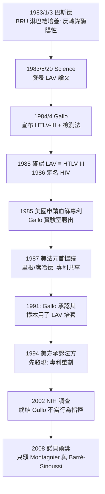

## 1983 - 蒙塔尼耶發現 HIV（一粒淋巴結、一場反轉錄、和一場打了二十五年的榮譽官司）

## 案件摘要

**本案的證物是一個腫大的淋巴結；兇手是一種會把自己寫進宿主基因組的病毒。**

1983 年 5 月 20 日，法國巴斯德研究所的 Luc Montagnier 與 Françoise Barré-Sinoussi 在《Science》發表：從一名淋巴結病變的前驅症患者（代號 BRU）頸部淋巴結中，分離出一種反轉錄病毒，命名 LAV（lymphadenopathy-associated virus）。四天後，美國國家癌症研究所（NCI）的 Robert Gallo 首次報告 HTLV-I；1984 年 5 月，Gallo 宣布分離出 HTLV-III 並開發出血液檢測。1985 年確認 LAV 與 HTLV-III 為同一病毒，1986 年國際命名委員會定名 HIV。此後的專利訴訟、國家元首外交與諾貝爾風波，把一場病毒發現變成科學政治學的教科書案例。

值得先澄清一個常見誤解：1983 年 5 月的《Science》論文本身**並未宣稱 LAV 就是 AIDS 的病因**——標題只說「分離出一株嗜 T 淋巴細胞反轉錄病毒」；因果宣稱是在後續血清學與分離率數據中逐步建立的。發現權之爭的每一步，都精確踩在「誰先分離」「誰先證明因果」「誰先做出可用的檢測」三個不同問題的縫隙上。

## 前因 -- 為什麼會有這個案子

- **流行病學已畫好嫌犯側寫**（`1981-CDC報告與愛滋降臨.md`）：血源性、性傳播、慢病程、破壞 CD4 T 細胞——這幾乎是反轉錄病毒的標準履歷。1970 年代 Gallo 團隊發現的第一個人類反轉錄病毒 HTLV-I（1980 年發表），提供了偵查模板。
- **猴子的線索**：1983–85 年間，美國新英格蘭與加州靈長類中心爆發猴免疫缺乏症候群（SAIDS），其病原 SIV 被確認為 HIV 的近親；後續溯源研究（1990s–2000s，包括 Beatrice Hahn 與 Paul Sharp 的系統發育工作）指出 HIV-1 源自喀麥隆的黑猩猩 SIVcpz，約 1908–1921 年間跨種傳播給人類，經剛果河沿岸的殖民城市網絡擴散——病毒的历史比疫情早了七十年，2021 年剛果金沙薩 1959/1960 年代存檔血樣的基因分析是關鍵物證。
- **技術條件在 1981–82 年齊備**：反轉錄酶檢測（1970 年 Baltimore 與 Temin 的發現使偵測反轉錄活性成為可能）、T 細胞培養技術（含 IL-2 促進 T 細胞生長）、電子鏡檢。
- **巴斯德的路徑**：臨床醫師 Jacques Leibowitch、Willy Rozenbaum 主張「前驅症（淋巴結病變）期比末期病人更易分離病毒」；1983 年 1 月 Rozenbaum 取得 BRU 的淋巴結切片，交給病毒腫瘤科的 Montagnier 與 Barré-Sinoussi。
- **關鍵實驗日**：1983 年 1 月 3 日，培養上清液偵測到反轉錄酶活性；淋巴細胞死亡促使研究團隊加入旁觀者供者的新鮮淋巴細胞維持培養——病毒開始持續複製。電鏡下見到反轉錄病毒顆粒，且**對 CD4 T 細胞有專一性殺傷**。

## 線索與推理 -- 數學式、程式、理論

HIV 的致命設計是「反轉錄＋整合」——它不寄生於細胞外，而是把自己編譯成宿主 DNA 的一部分：

$$ \text{RNA 病毒基因組} \xrightarrow{\text{反轉錄酶}} \text{雙股 DNA} \xrightarrow{\text{整合酶}} \text{整合入宿主基因組（前病毒 provirus）} $$

```python
# HIV 的「特洛伊木馬」攻擊模型: 感染的正是防禦系統本身
class ImmuneSystem:
    def __init__(self):
        self.cd4_t_cells = 1000  # cells/µL, 正常值

def hiv_attack(host, years):
    # CD4 細胞表面有 CD4 受體 → 反成病毒入口
    while host.cd4_t_cells > 200 and years < 12:
        host.cd4_t_cells *= 0.93   # 每年約 7% 淨損耗(未治療)
        years += 1
    return host.cd4_t_cells

host = ImmuneSystem()
print(f"約 {round((__import__('math').log(200/1000))/__import__('math').log(0.93))} 年後 CD4 < 200 → AIDS 期")
# 輸出: 約 24 年(未治療潛伏期的上界; 實際中位數約 8-10 年)
```

榮譽之爭的證據鏈時間軸：



反轉錄病毒理論的另一個重要後果是**潛伏庫**：前病毒 DNA 可在記憶 T 細胞中靜默多年，藥物只能殺正在複製的病毒——這解釋了為何愛滋不能像 `1943-青黴素治癒梅毒.md` 的梅毒那樣「幾針治癒」，也預示了日後高效能抗反轉錄病毒療法（HAART）必須終身服用的困境。

關鍵在於：分離到病毒只是第一關，證明**它就是 AIDS 的病因**才是第二關。巴斯德團隊的證據是陽性率隨病程上升（AIDS 患者血清對 LAV 抗原的反應率高於前驅症患者與對照組）、病毒在 CD4 細胞中複製並殺死 CD4 細胞；Gallo 團隊則在 1984 年提供了「持續培養株」（H9 細胞株上的 HTLV-III 與多株病毒分離）——量產的病毒直接支撐了血清學檢測與專利申請。科學史上，發現與驗證、方法與應用之間的貢獻切分，正是本案所有法律與榮譽爭議的技術根源。

1985 年的基因定序完成結案：LAV 與 HTLV-III 的基因組同源性確認兩者是同一病毒（後續分析甚至顯示 Gallo 實驗室的 HTLV-III_B 與巴斯德的 LAV-BRU 序列高度相近——這正是「樣本來源」爭議的分子生物學基礎）。國際病毒分類委員會於 1986 年定名 HIV，1987 年命名 HIV-1；1986 年西非發現的 HIV-2 則溯源至烏白眉猴的 SIVsmm。

## 結案 -- 後果與影響

- **1985 年 3 月**：血漿製品與供血篩檢（第一代 ELISA）在美國上市——血液供應安全從此制度化，血友病群體的新增感染在 1987 年後趨近於零。
- **專利收入戰**：血篩檢測專利年收逾億美元；1987 年美法元首協議分帳，1994 年重劃後巴斯德所獲更大份額——科學發現權最終由外交條約而非同行評議裁決，史無前例。爭議的技術核心是一個樣本之謎：1991 年 Gallo 承認其 HTLV-III 培養所用的細胞株來自巴斯德研究所寄送的 LAV 樣本（LAV-BRU 與其後的 LAV-MO），意味著「獨立發現」的前提根本不成立；但 1992–93 年 NIH 調查辦公室（ORI）的最終裁定卻認為無法證明「故意挪用」——歷史留下一個未完全關閉的案卷。
- **血液安全的制度遺產**：1985 年血篩上線前，法國輸血感染醜聞（指官員延遲引入檢測，數千名受血者感染）導致多位官員被起訴定罪——歐洲與美國各自以法庭或條約的形式，為血液供應建立了不可妥協的安全標準；血漿經濟的全球化監管（單一供血者溯源、去血漿銀行商業化採血）由此確立。
- **2008 年 10 月 6 日**：諾貝爾生理學或醫學獎頒給 Montagnier 與 Barré-Sinoussi（Gallo 落選；諾獎單項至多三人的規則與「首要發現」認定是官方理由）。隔年 Montagnier 的反科學傾向（水中記憶等主張）成為諾獎史上的遺憾註腳。
- **一句話結案**：病毒把自己藏進基因組，榮譽把自己藏進專利——兩者的共同點是，一旦整合就極難拔除。

## 關鍵人物與文獻

- Luc Montagnier——巴斯德研究所病毒腫瘤科主任，LAV 首要發現人，2008 年諾貝爾獎（晚年爭議纏身，2022 年歿）。
- Françoise Barré-Sinoussi——反轉錄酶檢測與分離工作的實際執行者，2008 年諾貝爾獎，此後成為國際愛滋科學政策的要角。
- Robert Gallo——NCI 腫瘤細胞生物學主任，HTLV-I 發現者、HTLV-III 與血篩檢測的推手；發現權爭議的中心人物。
- Willy Rozenbaum 與 Jacques Leibowitch——法國臨床端，提出「前驅症期取樣」策略的醫師。Rozenbaum 的臨床直覺（淋巴結活化期的病毒負載高於末期）在多年後被病毒載量研究證實為真——臨床觀察再次快過分子生物學。
- Jean-Claude Chermann——巴斯德團隊第三人，長期被諾獎忽略的關鍵合作者。
- Barré-Sinoussi et al., "Isolation of a T-lymphotropic retrovirus from a patient at risk for acquired immune deficiency syndrome (AIDS)," *Science* 220:868–871 (1983)——本案的原始物證。
- Gallo et al., "Frequent detection and isolation of cytopathic retroviruses (HTLV-III) from patients with AIDS and at risk for AIDS," *Science* 224:500–503 (1984)——爭議的另一端；同期《Science》還刊出 Gallo 實驗室與 Max Essex 的三篇姊妹論文，一次四篇的安排本身就是科學政治的註腳。
