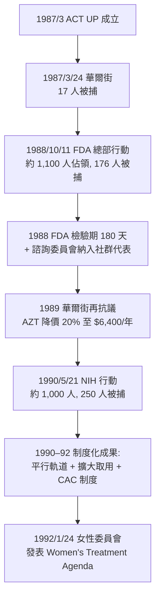

## 1987 - ACT UP 與沉默等於死亡（病人帶著自己的數據，衝進了臨床試驗的會議室）

## 案件摘要

**本案的原告是一群被醫學判了死刑的人，被告是一整套制度。**

1987 年 3 月 10 日晚，紐約 LGBT 社區中心，約 250 人響應劇作家 Larry Kramer 的號召，成立 ACT UP（AIDS Coalition to Unleash Power）。三天後，17 名成員在華爾街證交所門口綁住自己抗議藥價；1987 年 3 月 24 日首場大遊行封鎖華爾街。粉底黑字的「SILENCE = DEATH」海報已經貼滿曼哈頓。此後五年，這個由病患組成的團體改寫了 FDA 的藥物審核規則、臨床試驗的設計倫理，以及「病人」這個身分本身的定義。本案要拆解：一次絕望的抗爭，如何變成一場制度工程的勝利。

## 前因 -- 為什麼會有這個案子

- **背景是六年的制度性緩慢**：從 `1981-CDC報告與愛滋降臨.md` 首報到 1987 年，美國已有約 4 萬例確診、2 萬餘人死亡；裡根政府到 1987 年 5 月才首次公開演說談愛滋。
- **AZT 的憤怒**：第一個抗 HIV 藥 zidovudine（AZT）1987 年 3 月 19 日核准上市，由 Burroughs Wellcome 定價**每年約 10,000 美元**（當時紐約中位年收入的一半以下），是史上最貴處方藥之一；且早期的 Phase II 試驗設計粗糙（安慰劑組過長、存活分析倉促）。AZT 本身是 1964 年 Jerrold Beeson 在抗癌藥篩選中合成的舊分子（胸苷類似物），因毒性被棄置二十年——1984–85 年它被重新篩選出抗 HIV 活性，「舊藥新用」的戲劇性反而加深了社群對藥價的憤怒：合成成本每劑不到 1 美元。
- **藥物審核的速度地獄**：美國 FDA 標準審批需 8–10 年；對預期壽命只剩 1–2 年的病人，這套「安全優先」的體系等於死刑緩期。
- **社群的知識暴動**：Nyra Gordon、Michael Callen 等人自發編纂防治手冊（Callen 與 Richard Berkowitz 的《How to Have Sex in an Epidemic》, 1983，是「安全性行為」概念的發明文件之一）；Mark Harrington、Iris Long 等人以科學素養自學試驗設計，ACT UP 內部成立 Treatment and Data 委員會——病人開始讀 *New England Journal of Medicine*，並在會議上向 NIH 官員提問。
- **組織設計本身就是武器**：ACT UP 採無領袖的 affinity group（親和團體）結構——每個 5–15 人小組自行決定行動分工（佔領、法律觀察、媒體、醫療支援），使警方無法「斬首」；每週一晚間的公開會議動輒數百人，以共識決程序運作。Zaps（突襲式短時行動）與大型 civil disobedience（公民不服從）交替使用，行動前都有「tadpole to frog」訓練營教新成員如何被捕、如何拒保。
- **關鍵戰役的節奏**：1987 年 3 月 24 日華爾街（要求 AZT 降價）→ 1988 年 10 月 11 日 FDA 總部（要求加速審批，約 1,100 人參與、176 人被捕，全國電視直播）→ 1989 年 9 月 14 日重返華爾街（AZT 降價 20%）→ 1990 年 5 月 21 日 NIH 行動（抗議婦女與有色人種被排除於試驗組別之外）。每一次行動都綁定一條具體的行政訴求，而非籠統抗議——這是它與同時代其他抗爭的分水嶺。
- **成員構成即證物**：初代 ACT UP 名單上有律師、印刷工、藥師、資料庫工程師、前和平隊志工與劇場工作者——一支自帶專業分工的「平民官僚團」；這解釋了為何他們能在 FDA 諮詢會上提交可比肩官員的技術意見書。

## 線索與推理 -- 數學式、程式、理論

ACT UP 的策略可以用社會運動的 framing theory（Snow & Benford）拆解——三個框架作業的成功是其制度戰果的前提：

```python
# 社會運動框架分析: 為什麼 SILENCE = DEATH 有效
def framing_analysis():
    diagnosis = "疾病: 政府/藥廠/恐同的制度殺人"      # 歸因框架: 不怪受害者
    prognosis = "解方: 病人以專家身分介入研發與審批"  # 動員框架: 有具體戰術
    motivation = "口號: Silence = death, action = life"  # 緊迫框架: 立即行動
    # 關鍵創新: 把『病人』重新框架為『有科學素養的談判者』
    return {"diagnostic": diagnosis, "prognostic": prognosis,
            "motivational": motivation, "result": "制度化談判地位"}

print(framing_analysis()["result"])
# 輸出: 制度化談判地位
```

這個框架的殺傷力在於它**同時否定了兩種既有敘事**：既不是「可憐的受害者」（求助敘事，暗示無能），也不是「高危險行為的咎由自取」（懲罰敘事，污名原有框架），而是「被制度拖延的公民」——這個身分把矛頭精準指向 FDA、NIH 與藥廠的可改變決策點，而不泛化為「社會」或「命運」。

AZT 爭議的技術核心是劑量：早期療程每日 1,200–1,500 mg，骨髓毒性嚴重；後續試驗（ACTG 175, 1990s）證明每日 600 mg 以下療效相當、毒性大減：

$$ \text{療效} \not\propto \text{劑量} \quad\Rightarrow\quad \frac{\text{毒性}}{\text{效益}} \text{ 在低劑量區急劇改善} $$

制度改寫的時間軸：



行動的美學設計同樣是武器：粉三角源自納粹集中營標記同性戀囚犯的粉色布章——把強加的污名符號反轉為團結徽章；「SILENCE = DEATH」的六人設計小組刻意選用類似 IBM/翠貝卡海報的極簡排版，使其在城市視覺噪音中「像地鐵廣告一樣易讀」。1990 年 National AIDS Conference 的 stop-the-church 行動（包圍聖派翠克主教座堂）則展示了運動的另一面：把「宗教右派介入政府防政策」直接定位為敵人目標。

1992 年，以 Maxine Wolfe 為首的 ACT UP/Women 委員會發表《Women's Treatment Agenda》並在 International AIDS Conference 上擲出避孕套與假陰莖抗議，指控臨床研究長期排除女性感染者（陰道傳播途徑、子宮頸病變、避孕與防病需求）。這場內部分裂（多人退團、運動轉型）也標誌著「AIDS＝同性戀男性疾病」的預設被自己人攻破。

同一時期，運動的內部張力浮上檯面：白人男性中產主導的 Treatment and Data 與主張街頭政治的 faction 決裂；黑人与拉丁裔感染者組成 scotch（後續的 PWA of Color）批評中心主義；1990 年代的 Housing Works（住房權）與 GMHC（照護服務）各自接手了 ACT UP 不願官僚化的職能。「運動的分裂」與「運動的成果」同時發生——成功本身改變了戰場。

## 結案 -- 後果與影響

- **FDA 制度被永久改寫**：1988 年起縮短檢驗期、加速審批；1992 年設立加速核准（Accelerated Approval）制度；1992 年的 parallel track 政策讓試驗外重症患者可提前取得試驗藥；compassionate use／擴大取用成為常態機制。2000 年代之後的癌症藥物運動直接援引 ACT UP 模式——FDA 自己的官方史料館（1988 年 FDA 行動的紀念展）承認：這是 agency 歷史上第一次被被管制者要求「管我少一點」。- **臨床試驗倫理的翻轉**：社群顧問委員會（CAC）成為 NIH 與藥廠的標準配備；安慰劑對照在有效療法存在時的倫理爭議（與 1997 年《赫爾辛基宣言》修訂呼應）；參與式研究（community-based participatory research）從此有了原型。ACT UP 成員甚至為 FDA 諮詢委員會起草過審查提問清單——外行人的問題有時比委員會的更尖銳：「你們憑什麼說這藥還要再等兩年？」
- **實際療效回報運動**：HAART（1995–96 蛋白酶抑制劑問世）大幅降低死亡率——而蛋白酶抑制劑的加速核准，正是 1988 年改制的直接產物。紐約愛滋死亡率在 1996 年後斷崖下跌，同期聖像「AIDS quilt」（1987 年首展於國家大草坪）覆蓋的面積則成為死者數的視覺等價物：名單 project（NAMES Project）的 48,000 塊拼布，每一塊是一張床的大小。
- **全球擴散的治理架構**：ACT UP 分會在全球 30 餘國開花，其「以數據武裝的抗爭」模式被南非 Treatment Action Campaign（2000 年代贏得政府強制提供抗病毒藥的憲法訴訟）直接繼承；1990 年代末，「藥物可及性」成為 WTO TRIPS 談判與 WHO 的核心議題——病人運動的最終戰場，是全球貿易法。
- **一句話結案**：他們沒有等到救世主，而是讓自己變成了制度的一部分——病人從受試者變成談判者，這是醫學史權力結構的第一次翻轉。

## 關鍵人物與文獻

- Larry Kramer——《The Normal Heart》（1985）作者、GMHC（1981 創立）與 ACT UP 的發動者；1986 年 3 月演講〈AIDS: The Need for Drama〉是成立藍圖，1989 年文集《Reports from the Holocaust》收錄。他的修辭學是把「溫和的哀悼」重新定義為「合謀的沉默」——1983 年他在《紐約時報》發表的〈1,112 and Counting〉是這套修辭的首次全國性展示。
- Mark Harrington——Treatment and Data 委員會核心，1992 年發表影響深遠的〈AIDS research rethink〉；1997 年共同創立 TAG（Treatment Action Group）。
- Iris Long——化學博士、素人科學家，ACT UP 藥物知識的啟蒙者。
- Maxine Wolfe——ACT UP/Women 委員會領袖，女性議程的主要談判者。
- Avram Finkelstein 等——Silence=Death Project 成員（1986 設計、1987 年起廣泛張貼），海報現藏 MoMA。
- David France——《How to Survive a Plague》（2013 書與 2012 紀錄片），本案最完整的影像與文字偵查報告。
- Steven Epstein, *Impure Science: AIDS, Activism, and the Politics of Knowledge*（1996）——「病人賦權改寫科學」的社會學經典。
- Deborah Gould, *Moving Politics: Emotion and ACT UP's Fight against AIDS*（2009）——情感社會學視角的運動史，解釋悲憤如何轉化為組織動能。
- Benoit Denizet-Lewis 與 Sarah Schulman（《Let the Record Show》, 2021）對 ACT UP 口述史的重建——特別是女性與有色人種成員長期被敘事邊緣化的問題。
- FDA Accelerated Approval 法規（21 CFR Part 314, Subpart H, 1992）與 parallel track 政策聲明（1992）——「病人賦權」沉澱為成文規章的制度物證。
