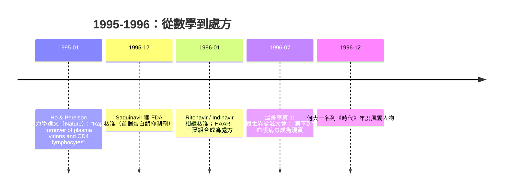

## 1995 - 何大一雞尾酒療法（用一條數學方程式，把絕症變成慢性病）

## 案件摘要

**本案的兇手不在實驗室，而在一條被誤讀了十年的微分方程裡。**

1995 年，華裔美籍醫師何大一（David Ho）與理論免疫學家 Alan Perelson 聯手，用數學模型分析 HIV 感染者的血漿動力學，得到兩個改寫教科書的結論：HIV **每天產生約 100 億顆病毒顆粒**，被摧毀的 CD4 細胞**平均壽命只有約 1.5 天**。病毒從來不是「靜靜潛伏」，而是以最狂暴的速度與免疫系統同歸於盡。同年，第一代蛋白酶抑制劑（protease inhibitor）saquinavir 上市；何大一提出三藥聯合的 HAART（高效能抗反轉錄病毒療法，俗稱雞尾酒療法）。1996 年溫哥華世界愛滋大會上，多名講者報告病患血漿病毒量降至「測不到」。美國愛滋死亡率在 1995–97 年間近乎腰斬再腰斬——下降近三分之二。何大一名列 1996 年《時代》雜誌年度風雲人物（Time Man of the Year）。

## 前因 -- 為什麼會有這個案子

- **十年的誤診般誤解**：自 `1987-ACT UP與沉默等於死亡.md` 以來，醫界普遍相信 HIV 感染後有漫長的「臨床潛伏期」（平均 ~10 年），期間病毒安靜躲在淋巴組織，因此只需低強度用藥。CONCORDE 試驗（1993）已顯示早期 AZT 無長期效益，卻無人能解釋為何。
- **關鍵工具到位**：1990 年代初，血漿 HIV RNA 的定量 PCR 技術（branched-DNA 與 RT-PCR）成熟，人類第一次能「數」出每毫升血漿裡有多少病毒 RNA 拷貝——這是本案的指紋採集器。
- **新藥槍枝到位**：1995 年 12 月，FDA 核准第一個蛋白酶抑制劑 saquinavir（隨後 1996 年 ritonavir、indinavir），與既有的反轉錄酶抑制劑（AZT、ddI、3TC）作用於病毒生命週期的**不同環節**。
- **數學家進場**：Perelson 是洛斯阿拉莫斯國家實驗室的理論學家，長期用微分方程描述病毒—免疫細胞動力學。他與何大一的相遇，讓臨床數據第一次擁有了「動態物理學」。

## 線索與推理 -- 數學式、程式、理論

**線索一：病毒動力學方程組。** HIV 感染的極簡模型：

$$ \frac{dT}{dt} = s - d_T T - k V T, \qquad \frac{dT^*}{dt} = k V T - \delta T^*, \qquad \frac{dV}{dt} = N \delta T^* - c V $$

其中 $T$ 為 CD4 細胞、$T^*$ 為感染細胞、$V$ 為病毒量；$\delta$ 是感染細胞死亡率、$c$ 是病毒清除率、$N$ 是每個感染細胞釋出的病毒數。給予蛋白酶抑制劑後，**新產出的病毒失去感染力**，於是血漿病毒量的下降曲線近似：

$$ V(t) \approx V_0 \, e^{-ct} $$

實測半衰期 $ t_{1/2} \approx 0.3 \sim 0.5 $ 天（初期相）。代入藥物阻斷後的指數衰減曲線，反推 $ c \approx 3 $ /天、$ \delta \approx 0.5 $ /天（感染細胞壽命 $\approx 1/\delta \approx 1.5$ 天），再由穩態 $ V_{steady} = N \delta T^* / c $ 解出：

$$ \text{每日病毒產量} \approx V_0 \times c \approx 10^{10} \ \text{顆/天} $$

**線索二：抗藥性的必然性——單藥為何必敗。** HIV 反轉錄酶無校對功能，每輪複製突變率約 $ 3 \times 10^{-5} $／鹼基，基因組約 $10^4$ 鹼基：

```python
# 為什麼單藥必敗、雞尾酒必勝：抗藥性聯合機率計算
import math

genome_bp = 10_000            # HIV 基因組長度
mu = 3e-5                     # 每鹼基每輪複製的突變率
daily_replication = 1e10      # Perelson/Ho 估計的每日病毒顆粒產量

def p_resistance_to_drug(mutation_sites=1):
    # 產生對某藥抗藥所需全部突變的機率（近似每 site 獨立）
    return (mu * genome_bp) ** mutation_sites

# 對單一藥物：一天產生數十萬顆抗藥突變體
p1 = p_resistance_to_drug(1)
print("單藥抗藥/天 ~", daily_replication * p1)          # ~ 3e9 * 3e-5 = 10^5 量級

# 對三種藥同時抗藥（假設各需獨立突變、機率相乘）：
p3 = p_resistance_to_drug(1) ** 3
print("三藥同時抗藥/天 ~", daily_replication * p3)      # 指數級下降
```

單藥時，每天 $10^{10} \times 3\times 10^{-5} = 3\times 10^{5}$ 顆單突變病毒誕生——抗藥性**數週內必然出現**；三藥聯合時，同時攜帶三組突變的機率是指數級的小數，病毒被壓到**突變庫存枯竭**（因為複製被壓制，突變的原料也沒了）。這就是「機率推理直接決定處方」的經典案例：**不是藥不夠強，是數學不容許單藥。**

**線索三：時間軸。**



## 結案 -- 後果與影響

- **死亡率的斷崖**：美國 AIDS 死亡數從 1995 年的約 43,000 例降至 1997 年的約 16,000 例——**兩年下降近三分之二**，是流行病學史上罕見的急轉折。紐約州病房的「末期清洗潮」在 1996 年夏天戛然而止。
- **治療範式重寫**：「早期、強力、多靶點、持續監測病毒量」取代「觀望+單藥」。病毒量檢測成為治療核心指標，血漿病毒量「測不到」（< 50 copies/mL）成為治療目標。
- **代價浮現**：HAART 初期需每日服藥 10–20 顆，副作用（脂肪分布異常、血脂異常）與依從性負擔沉重；服藥不規則正是抗藥性突變的溫床——雞尾酒不是免費午餐，而是紀律的合約。
- **新問題誕生**：病毒動力學證明了「病毒儲存庫」（reservoir）的存在——某些靜止 CD4 細胞藏有前病毒 DNA，即使血漿測不到也不會被藥物清除。這成為日後根治研究的核心難題（見 `2009-柏林病人HIV根治.md`）。
- **何大一與 Aaron Diamond 愛滋研究中心**成為全球旗艦；1996 年《時代》封面把一位病毒學家放上年度風雲人物，是科學家在二十世紀末的少數殊榮。
- **公共衛生的長影**：病毒量與傳染力的定量關係，最終演繹出 2010 年代的「治療即預防」（TasP）與 U=U（見 `2016-U=U共識宣言.md`）——雞尾酒療法不只救人，還切斷了傳播鏈。

## 關鍵人物與文獻

- **David Ho（何大一，1952–）**——洛克菲勒大學醫學博士、Aaron Diamond 愛滋研究中心主任；1996 年《時代》年度風雲人物；「打擊早期、打擊強力」（Hit early, hit hard）口號的提出者（後來部分修正為「長期管理」）。
- **Alan S. Perelson**——洛斯阿拉莫斯國家實驗室理論生物學家，病毒動力學數學模型的共同作者。
- **Wei, X. et al. (Ho lab)**——"Viral dynamics in human immunodeficiency virus type 1 infection", *Nature* 373:117 (1995)。
- **Ho, D.D. et al.**——"Rapid turnover of plasma virions and CD4 lymphocytes in HIV-1 infection", *Nature* 373:123 (1995)。
- **Perelson, A.S. et al.**——"HIV-1 dynamics in vivo: virion clearance rate, infected cell life-span, and viral generation time", *Science* 271:1582 (1996)。
- **Cameron, B. & Mellors, J.** 等——1996 年溫哥華大會的蛋白酶抑制劑臨床報告者。
- 延伸閱讀：`1987-ACT UP與沉默等於死亡.md`、`1991-紅絲帶與世界愛滋日.md`、`2009-柏林病人HIV根治.md`、`2012-Truvada PrEP.md`、`2016-U=U共識宣言.md`
