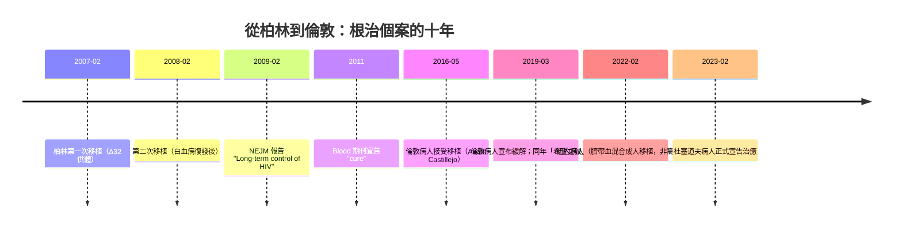

## 2009 - 柏林病人 HIV 根治（把病毒所在的那扇門，整個拆掉）

## 案件摘要

**本案不是一場治療，而是一場賭命——賭注是「證明人類可以徹底清除 HIV」。**

Timothy Ray Brown（1966–2020）是住在柏林的美籍同志男性，同時罹患 HIV 感染與急性骨髓性白血病。2007 年 2 月，柏林 Charité 醫院的血液科醫師 Gero Hütter 為他進行異體造血幹細胞（骨髓）移植，並刻意挑選了一位**攜帶 CCR5-Δ32 純合突變**的供體。術後 Brown 不再服用任何抗反轉錄病毒藥物，血漿、腦脊髓液、腸道與淋巴組織中**再也測不到 HIV**——史上第一例 HIV 根治。2009 年《新英格蘭醫學雜誌》報告，2011 年確認「治癒」。本案追查的是：一個幾乎不可複製的個案，如何改寫「HIV 無法治癒」的教科書定論。

## 前因 -- 為什麼會有這個案子

- **鎖與鑰匙的發現**：HIV 進入 T 細胞，除了需要 CD4 這個「大門」，還需要一個「輔受體」——CCR5（多數感染初期毒株，R5 嗜性）或 CXCR4（後期毒株，X4 嗜性）。1996 年，五個實驗室（包括 Edward Berger 在 NIH 的團隊）同時確認 CCR5 是 HIV 的輔受體——這是 `1987-ACT UP與沉默等於死亡.md` 之後最關鍵的病毒學發現。
- **Δ32 突變的天賦**：CCR5 基因第 32 密碼子附近的 32 個鹼基缺失，使 CCR5 蛋白被截短、無法上膜。**純合子（兩條染色體都突變）的人對 R5 型 HIV 幾乎完全免疫**。北歐人群中 Δ32 對偶基因頻率約 10%（北歐最高、南歐遞減、非洲與亞洲罕見），推測與中世紀天花或鼠疫的選擇壓力有關——一場古代瘟疫留下的免疫遺產，救了一個現代的絕症患者。
- **白血病的絕境**：Brown 的 AML 化療失敗後，唯一生路是骨髓移植。2006 年底，Hütter 與同事（腫瘤科 Eckhard Thiel）在配對的 267 位供體中，刻意搜尋第 61 位的 CCR5-Δ32 純合供體——**真的找到了一位**。
- **「測不到」還不夠**：`1995-何大一雞尾酒療法.md` 已揭示病毒儲存庫（reservoir）的存在——即使血漿測不到，潛伏的前病毒仍藏在靜止 CD4 細胞裡，停藥即反彈。要「根治」，必須把整個可被感染的細胞族群**換成免疫的品種**。

## 線索與推理 -- 數學式、程式、理論

**線索一：病毒入侵的兩把鑰匙。**

$$ \text{HIV 進入細胞} = \text{結合 CD4} + \text{結合輔受體（CCR5 或 CXCR4）} $$

CCR5-Δ32 純合子 = 鑰匙孔在出廠時就被封死。就算病毒粒子還在血液裡，**它找不到可以進去的門**。

**線索二：突變頻率的地理分布。**

| 人群 | CCR5-Δ32 對偶基因頻率 | 純合子比例（估算） |
|---|---|---|
| 北歐（芬蘭、瑞典） | ~14–16% | ~1–2% |
| 中西歐（德國） | ~10% | ~1% |
| 南歐 | ~4–6% | <0.5% |
| 東亞、非洲、美洲原住民 | 罕見（<1%） | 幾乎為 0 |

配型條件（HLA 全相合）再疊加 Δ32 純合，使「可用的供體」機率跌到千分之一以下——這正是本案幾乎孤例的原因。

```python
# 為什麼骨髓移植無法普及：可遇不可求的機率估算
import math

# 假設：HLA 全相合無血緣供體找到機率 ~ 1/100000（族群隨機搜尋）
p_hla_match = 1e-5
p_d32_homozygous = 0.01          # 德國族群 Δ32 純合子比例
p_available = p_hla_match * p_d32_homozygous
print("同時找到「配型合 + Δ32 純合」供體的機率 ~", p_available)   # ~ 1e-7

# 移植手術本身的死亡風險（異體造血幹細胞移植 GVHD、感染等）
mortality_transplant = 0.10      # 早期文獻約 10-30%
# 而 HAART 的年死亡率已 < 1%
print("HAART 年死亡率 ~ 0.01，移植術死風險 ~", mortality_transplant)
# 結論：除非原本就必須移植（如白血病），否則賭注不成立
```

**線索三：兩次移植，雙重確認。** Brown 在 2007 年 2 月與 2008 年 2 月接受兩次移植（第一次復發後補做）。術後檢測項目包括：血漿 HIV RNA PCR、腸道與淋巴組織活檢、以及**病人體內重新分化出的免疫細胞都是 Δ32 純合**——等於整個免疫系統被「改寫成免疫版」。Hütter 的推理鏈非常乾淨：`換掉所有可被 HIV 感染的細胞 → 換成無 CCR5 的細胞 → 病毒失去宿主，儲存庫自然枯竭`。

**線索四：與「功能性治癒」的對照。** 柏林病人屬於「絕對根治」（sterilizing cure，體內測不到任何複製能力的病毒）；另有一類「功能性治癒」（functional cure）嘗試——如 2013 年密西西比嬰兒（出生 30 小時內高劑量用藥，停藥 27 個月未反彈，最終仍在 2014 年復發）、以及「治療後控制者」（post-treatment controllers，停藥後靠自身免疫壓制病毒）。這些個案說明：儲存庫可以被壓到極小，但**只有把宿主細胞整個換成免疫品種，才真正達成柏林病人的零**。兩條路線的差異，定義了此後十年根治研究的分岔。



## 結案 -- 後果與影響

- **2009 年 NEJM 報告，2011 年正式宣告「治癒」**。Timothy Ray Brown 從此被稱為「柏林病人」，並於 2010 年主動公開身分，成為根治研究的活旗幟。2020 年 9 月他因白血病復發去世（**不是死於 HIV**）——HIV 始終沒有回來。
- **根治研究從科幻變成計畫**：柏林病例證明「清除儲存庫」在理論上可行，催生了「柏林策略」的各種衍生路線——CCR5 基因編輯（CRISPR/zinc-finger nuclease）、shRNA 敲低 CCR5、免疫細胞体外改造等。
- **後續個案證明不是流星**：2019 年「倫敦病人」Adam Castillejo（Hodgkin 淋巴瘤+骨髓移植，CCR5-Δ32 供體，2020 年正式宣告治癒）；2022 年「紐約病人」（混合臍帶血與成人造血幹細胞移植，對非裔病患首次成功——因 Δ32 在非裔中極罕見，需用臍帶血庫）；此後還有杜塞道夫病人（2023 確認）等個案。**全世界至今（2026 年）確認根治個案仍為個位數。**
- **「證明可行」≠「可以普及」**：移植死亡率 10–30%、GVHD 終生風險、HLA 配型困難、Δ32 供體稀缺、費用數十萬美元——對一位已在 HAART 下穩定的病患，移植是**風險遠大於效益**的選擇。醫學史在這裡畫下一條殘酷的分界線：**知道一件事可能發生**（可行性）與**知道如何讓它發生一億次**（可及性）之間，隔著整個工程學與經濟學。
- **基因治療的路線圖**：CCR5 作為靶點啟發了 ex vivo 細胞編輯公司（Sangamo 的 zinc-finger CCR5 敲除）、以及後來被倫理爭議圍繞的 CRISPR 胚系編輯事件（2018 年「賀建奎事件」——以 CCR5 為靶點修改胚胎，遭全球科學界譴責）：一個絕症個案的成功，竟然引出一場科學倫理的全球危機。

## 關鍵人物與文獻

- **Timothy Ray Brown（1966–2020）**——「柏林病人」，史上第一例 HIV 根治；2020 年死於白血病復發，不是死於愛滋。
- **Gero Hütter**——柏林 Charité 醫院血液科醫師，搜尋並執行 Δ32 供體移植的關鍵執行者；移植時他相對年輕、非 HIV 領域出身——「外行的乾淨推理」成就了內行不敢做的賭注。
- **Eckhard Thiel**——柏林腫瘤科教授，Δ32 策略的共同構想者。
- **Berger, E. et al.**——"A chemokine receptor encoded by a HIV entry cofactor", *Science* 272:1955 (1996)——CCR5 輔受體的確認。
- **Hütter, G. et al.**——"Long-term control of HIV by CCR5 Delta32/Delta32 stem-cell transplantation", *NEJM* 360:692 (2009)；**Allers, K. et al.**——"Evidence for the cure of HIV infection by CCR5Δ32/Δ32 stem cell transplantation", *Blood* 117:2791 (2011)。
- **Huang, Y. et al. (1996)**——CCR5-Δ32 純合子對 HIV 感染的天然抗性。
- 延伸閱讀：`1987-ACT UP與沉默等於死亡.md`、`1995-何大一雞尾酒療法.md`、`2012-Truvada PrEP.md`、`2016-U=U共識宣言.md`
