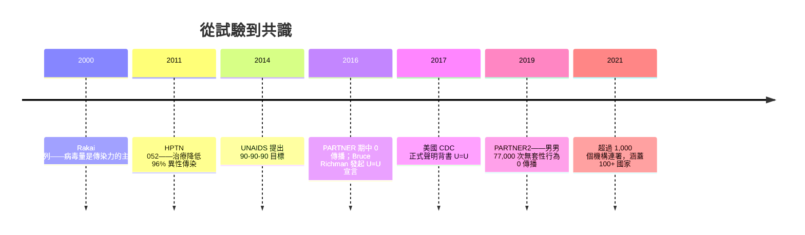

## 2016 - U=U 共識宣言（測不到 = 傳不出去——科學如何拆掉污名的最後一道牆）

## 案件摘要

**本案的證據是一條統計學上近乎完美的直線，而被告是持續了三十年的恐懼。**

2011 年，Myron Cohen 主持的 HPTN 052 試驗發表：感染者接受抗反轉錄病毒治療、血漿病毒量測不到時，**傳染給異性伴侶的風險下降 96%**。這是「治療即預防」（Treatment as Prevention, TasP）第一次獲得隨機對照試驗的背書。2016 年，歐洲的 PARTNER 研究公布期中結果：**在病毒量測不到的伴侶之間，超過 58,000 次無套性行為中，HIV 傳播為零**。同年，紐約活動家 Bruce Richman 發起「U=U（Undetectable = Untransmittable，測不到 = 傳不出去）」全球共識宣言，迅速獲得數百個機構連署。2017 年美國 CDC 正式聲明背書；2019 年 PARTNER2 確認男男傳播同樣為零——超過 77,000 次無套性行為，零傳播。本案追查的是：一個統計學命題如何成為去污名的核彈。

## 前因 -- 為什麼會有這個案子

- **病毒量與傳染力的定量關係**：1990 年代末的烏干達 Rakai 佇列研究（Quinn 等, NEJM 2000）已顯示血漿病毒量是異性傳染的最強預測因子——**病毒量每 log10 上升 1 單位，每回性行為傳染率約上升 2.5 倍**。當病毒量 < 1,500 copies/mL 時，觀察到的傳播趨近於零。這是 TasP 的流行病學基石。
- **雞尾酒療法改變了遊戲規則**：`1995-何大一雞尾酒療法.md` 之後，「測不到」（<50 copies/mL）從夢想變成常規治療目標。醫學上已能穩定地把感染者血漿病毒壓到 PCR 測不到。
- **倫理困境**：要「證明零傳染」，必須讓測不到的感染者**停用保險套**並追蹤多年——這在倫理委員會裡是艱難的辯論。Cohen 的團隊以「感染者一方治療」的隨機設計繞過了僵局（對照組延遲治療，一旦病毒量上升即轉入治療組）。
- **污名的數據化**：2010 年代，法律層面仍有數十國（包括美國多州）保留「HIV 暴露/傳播罪」——感染者即使病毒測不到、即使用保險套，理論上仍可能因暴露而入罪。U=U 的訴求不只是醫學，而是**法律與人權的平反**。

## 線索與推理 -- 數學式、程式、理論

**線索一：傳染風險的階梯。**

| 病毒量（copies/mL） | 每次性行為傳染率（每萬次） | 相對風險 |
|---|---|---|
| > 50,000 | ~12 | 基準 ×5 |
| 1,500–50,000 | ~6 | 基準 ×2.5 |
| < 1,500 | 趨近 0 | — |
| 測不到（< 50，持續治療） | 觀察值 0 | HPTN 052 下降 96% |

**線索二：HPTN 052 的設計。** 1,763 對血清不一致（一方陽性、一方陰性）異性伴侶，隨機分為「立即治療」與「延遲治療（CD4 降至 250 以下才開始）」兩組。中期分析在 2011 年提前揭盲：**立即治療組的 28 起感染中，只有 1 起與治療組的原發感染者相關**——保護力 96%。Cohen 的論文發表於《NEJM》363:493 (2011)。

**線索三：零的統計學——零案例≠零風險。**

```python
# 統計詮釋：觀察到 0 次傳播，不等於真實風險 = 0
import math

def upper_bound_95(n_events):
    # 觀察到 0 次事件時，真實率的 95% 信賴上限 ≈ 3/n（rule of three）
    return 3.0 / n_events

# PARTNER (2016): 58,000 次無套性行為（異性+男男），0 次傳播
print("PARTNER  95% CI 上限 ~", upper_bound_95(58_000))     # ~ 5.2e-5
# PARTNER2 (2019): 77,000 次男男無套性行為，0 次傳播
print("PARTNER2 95% CI 上限 ~", upper_bound_95(77_000))     # ~ 3.9e-5
# 即真實風險 < 每次行為約 4-5 萬分之一，且極可能為 0
```

關鍵詮釋：**「0 例」的統計力量來自大樣本**——樣本愈大，95% 信賴上限愈低。這就是為什麼 PARTNER2 必須累積到 77,000 次才能說「幾乎零風險」。科學上永遠無法證明「絕對零」，但可以把上限壓到比日常生活風險（如車禍）更低。

**線索四：U=U 宣言的擴散。**



**線索五：反例與邊界。** U=U 的前提有三：**感染者正在接受治療、病毒量持續測不到（通常需連續數月）、且遵循醫囑**。例外情況——急性感染期（病毒量飆升）、治療中斷、抗藥性失敗——都不在保護傘內。2016 年巴西的回溯報告曾質疑「測不到仍可能傳播」，但那些個案的血漿病毒量實際上並未穩定抑制。科學的嚴謹之處正在於：U=U 不是道德口號，而是**有明確操作定義的醫學聲明**——這也是它能被 CDC 白紙黑字背書的原因。

**線索六：Opposites Attract 補上最後一塊拼圖。** 2018 年悉尼 Kirby 研究所發布的 Opposites Attract 研究（358 對男男血清不一致伴侶、17 個國家追蹤）同樣報告零傳播——確保了結論不僅限於歐洲與異性伴侶。三大研究（HPTN 052、PARTNER/PARTNER2、Opposites Attract）構成完整證據三角。

## 結案 -- 後果與影響

- **去污名的核彈級事實**：U=U 被病運團體稱為「愛滋史上最有力量的預防訊息」。它第一次讓感染者可以**對伴侶說「我對你零風險」**——不只是道德安慰，而是有 77,000 次數據背書的科學事實。
- **UNAIDS 90-90-90（2014）與後續 95-95-95（2021）**：診斷 95%、治療 95%、病毒抑制 95%——這套目標的理論根基正是 TasP。模型估算：當三個 95% 達成，群體層面的新增感染可降至流行病學上的「終結」門檻（見 `2018-超級淋病與未來防線.md` 的 2030 目標）。
- **法律改革**：美國加州 2017 年把「HIV 暴露罪」從重罪降為輕罪（SB 239）；多國檢視並修改過時的刑事化條文。U=U 成為法庭上的科學證據。
- **公共衛生的重新分工**：治療門診成為預防前線——「找得到、治得起、壓得下」成為防疫的 KPI。瑞士專家聲明（2008，Swiss Statement）其實早於 U=U 提出類似主張，但當時證據不足、引起爭議；八年後，證據追上了勇氣。
- **倫理的勝利**：PARTNER 與 Opposites Attract（澳洲，2018）研究邀請感染者伴侶自願參與、知情同意、停用保險套——這在 1990 年代是不可想像的研究設計。當科學尊重受試者的自主性，它反而跑得更快。
- **殘留的難題**：U=U 的前提是**穩定治療與病毒抑制**——資源不足地區的藥物中斷、青少年與年輕男性的治療覆蓋率偏低，仍是 U=U 承諾未兌現的部分。科學已經到位，公衛的馬拉松還在跑。

## 關鍵人物與文獻

- **Myron Cohen**——北卡羅來納大學教堂山分校傳染病學家，HPTN 052 總主持人；2011 年 *NEJM* 論文的通訊作者。
- **Bruce Richman**——U=U 宣言發起人（Prevention Access Campaign 創辦人）；本身為感染者，以「一句標語改變全球公共衛生政策」聞名。
- **Alison Rodger / Andrew Phillips**——倫敦大學學院 PARTNER 與 PARTNER2 研究的主要研究者。
- **Quinn, T.C. et al.**——"Viral load and heterosexual transmission of HIV-1", *NEJM* 342:921 (2000)。
- **Cohen, M.S. et al.**——"Prevention of HIV-1 infection with early antiretroviral therapy", *NEJM* 365:493 (2011)。
- **Rodger, A.J. et al.**——"Sexual activity without condoms and risk of HIV transmission in serodifferent couples when the HIV-positive partner is using suppressive ART", *JAMA* 315:1714 (2016)；PARTNER2 結果於 *Lancet* 394:765 (2019)。
- 延伸閱讀：`1995-何大一雞尾酒療法.md`、`2012-Truvada PrEP.md`、`2018-超級淋病與未來防線.md`
