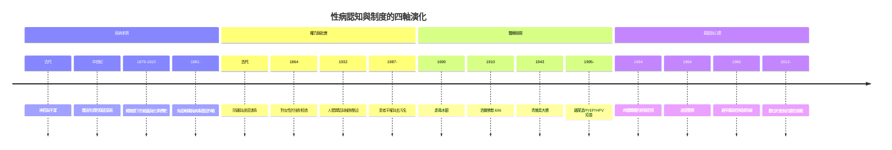

# 性病的歷史：從梅毒大流行、道德污名、病原體獵人到愛滋風暴與基因防線

> 本書以「推理探案」的體例，為人類性傳播疾病（STIs/STDs）史上的每個關鍵事件寫一篇 wiki：
> 誰是兇手（病原、制度、偏見）？偵探是誰（醫生、流行病學家、社運者）？線索與推理是什麼？
> 每篇檔名以年份開頭（4 位數，負年以 `-` 開頭）。

## 雙線主軸

| 線 | 演變 |
|---|---|
| **醫學認知線** | 神罰/不潔 → 體液失調 → 顯微鏡病原 → 血清學診斷 → 化學治療 → 抗生素 → 病毒與免疫 → 基因醫學 |
| **社會權力線** | 神殿隔離 → 中世紀身體標記 → 對女性的強制檢查 → 人體實驗與種族壓迫 → 病人平權抗爭 → 去污名化與生物醫學預防 |

---

## 年表（非常詳細版）

### 第一篇：神的詛咒與隱密之疾——古代世界的性病迷霧

| 年份 | 事件 | 意義 | wiki |
|---|---|---|---|
| 約前 1550 | 埃及《埃伯斯紙草》記載生殖器潰瘍與排尿疼痛療法；美索不達米亞泥板視之為神罰 | 最早的性病醫學記錄 | [-1550-埃伯斯紙草與利未記的不潔](-1550-埃伯斯紙草與利未記的不潔.md) |
| 約前 1300–前 500 | 《舊約·利未記》第 15 章把生殖器排泄物定為「不潔」，需洗滌與隔離 | 道德污名＋公共衛生的雙面起源 | 同上 |
| 約前 400 | 希波克拉底學派描述尿道流膿的「精滴症」 | 性病首次被自然化觀察 | [-0400-希波克拉底精滴症](-0400-希波克拉底精滴症.md) |
| 約 150 | 蓋倫命名 gonorrhea（誤以為流出的是精液），以四體液學說解釋 | 一個解剖錯誤統治 1500 年 | 同上 |
| 610 | 隋代巢元方《諸病源候論》記載「疳瘡」「妒精瘡」，以濕熱淫邪解釋 | 東方醫學的性病敘事 | [0061-諸病源候論疳瘡](0061-諸病源候論疳瘡.md) |
| 6 世紀–14 世紀 | 中世紀麻風大流行：Lazaretto 隔離所、鈴鐺、特殊服裝、「麻風葬禮」 | 身體標記＝道德標記的制度範本 | [1350-麻風鈴鐺與罪惡身體](1350-麻風鈴鐺與罪惡身體.md) |

### 第二篇：哥倫布的禮物——梅毒大流行與全歐震盪

| 年份 | 事件 | 意義 | wiki |
|---|---|---|---|
| 1493 | 哥倫布船員返航西班牙；潘尼亞船員們被疑攜帶梅毒 | 哥倫布大交換假說的起點 | [1494-那不勒斯梅毒大流行](1494-那不勒斯梅毒大流行.md) |
| 1494–1496 | 查理八世圍攻那不勒斯；雇傭軍解散後梅毒席捲全歐（法國兵死了 3 萬人） | 歐洲第一場性病大流行 | 同上 |
| 1490s–1500s | 各國甩鍋命名：法國病、那不勒斯病、基督教徒病、西班牙病、大痘 | 疾病命名＝政治戰 | 同上 |
| 1530 | 弗拉卡斯托羅拉丁文詩《梅毒或法國病》，牧羊人 Syphilus 成為病名 | 「syphilis」一詞誕生 | [1530-弗拉卡斯托羅梅毒史詩](1530-弗拉卡斯托羅梅毒史詩.md) |
| 1546 | 弗拉卡斯托羅《論傳染》提出「傳染小體（seminaria contagionis）」 | 比細菌理論早 300 年 | 同上 |
| 1564 | 法洛皮奧記載藥浸亞麻布套防「法國病」，宣稱 1100 人試驗有效 | 最早的避孕套記錄 | [1564-法洛皮奧亞麻套與早期避孕套](1564-法洛皮奧亞麻套與早期避孕套.md) |
| 16–18 世紀 | 水銀療法全盛：口服、塗抹、蒸氣燻洗；「寧可與水銀共度一宵」 | 以毒攻毒的劇毒醫學 | [1690-水銀療法與劇毒蒸氣](1690-水銀療法與劇毒蒸氣.md) |
| 1683–1714 | Sydenham、Astruc 等批判水銀療法；癒創木、鉀鹽替代 | 無對照試驗年代的自我修正 | 同上 |
| 17–18 世紀 | 羊腸避孕套流行；卡薩諾瓦自傳中的防病實踐 | 屏障預防（防病優先於避孕） | [1564-法洛皮奧亞麻套與早期避孕套](1564-法洛皮奧亞麻套與早期避孕套.md) |

### 第三篇：維多利亞道德、軍營檢疫與性學的誕生

| 年份 | 事件 | 意義 | wiki |
|---|---|---|---|
| 1810 | 法國 réglementation 制度：登記娼妓、強制體檢 | 國家管制性病的先聲 | [1864-英國傳染病法案](1864-英國傳染病法案.md) |
| 1864/1866/1869 | 英國《傳染病法案》：軍港城市強制檢查「疑似娼妓」，鋼窺器侵入檢查，拒檢入獄 | 只查女性不查男性的雙重標準 | 同上 |
| 1869–1886 | Josephine Butler 領導 Ladies' National Association 廢除運動 | 現代女權運動的里程碑 | 同上 |
| 1870s–1880s | 梅毒併發麻痺性痴呆（GPI）、脊髓癆；尼采（1889 發瘋）、莫泊桑（1893 死）等悲劇 | 「模仿大師」的文明焦慮 | [1913-野口英世解開麻痺性痴呆之謎](1913-野口英世解開麻痺性痴呆之謎.md) |
| 1879 | 奈瑟在淋病膿液中發現雙球菌（1882 年 Bumm 培養成功） | 第一個被發現的性病細菌 | [1879-奈瑟發現淋球菌](1879-奈瑟發現淋球菌.md) |
| 1881 | Crede 用硝酸銀滴新生兒眼，預防淋菌性膿漏眼 | 母嬰傳播阻斷的第一招 | 同上 |
| 1905 | 紹丁與霍夫曼以暗視野顯微鏡發現蒼白密螺旋體 | 梅毒病原體現形 | [1905-紹丁發現蒼白密螺旋體](1905-紹丁發現蒼白密螺旋體.md) |
| 1906 | Wassermann 補體結合試驗：第一個血清學梅毒診斷 | 「指紋比對」式診斷誕生 | 同上 |
| 1907–1910 | 埃爾利希＋秦佐八郎系統篩選砷化合物，第 606 號洒爾佛散成為首個化療藥 | 「魔法子彈」時代開始 | [1910-埃爾利希洒爾佛散606](1910-埃爾利希洒爾佛散606.md) |
| 1913 | 野口英世在 GPI 患者腦中發現螺旋體，證明梅毒致瘋 | 精神病學謎團被病理學偵破 | [1913-野口英世解開麻痺性痴呆之謎](1913-野口英世解開麻痺性痴呆之謎.md) |
| 1917 | Wagner-Jauregg 的瘧熱療法治神經梅毒（1927 諾獎） | 以發燒殺螺旋體的奇想 | 同上 |

### 第四篇：青黴素革命、大眾宣導與性解放

| 年份 | 事件 | 意義 | wiki |
|---|---|---|---|
| 1914–1918 | 一戰美軍性病住院人數一度超過戰傷；ASHA「Fit to Fight」宣導 | 大眾性病宣導的起點 | [1940-她看起來很乾淨](1940-她看起來很乾淨.md) |
| 1932–1972 | 塔斯基吉梅毒實驗：399 名黑人男性被瞞騙觀察未治療病程 | 醫學倫理史最黑暗一頁 | [1932-塔斯基吉梅毒實驗](1932-塔斯基吉梅毒實驗.md) |
| 1940 | 美國《May Act》；二戰 VD 宣傳海報（「She may look clean—but…」，1944） | 恐懼訴求＋把感染歸咎女性 | [1940-她看起來很乾淨](1940-她看起來很乾淨.md) |
| 1943 | Mahoney 以青黴素治癒梅毒（Florey–Chain 1940 量產，1945 諾獎） | 梅毒降格為「幾針治癒」 | [1943-青黴素治癒梅毒](1943-青黴素治癒梅毒.md) |
| 1947–1950s | Rapid Treatment Centers、全民篩檢；梅毒病例降至 1947 年的 1/10 | 抗生素的輝煌勝利 | 同上 |
| 1947 | 紐倫堡守則（塔斯基吉的道德反噬要到 1972） | 研究倫理的第一份宣言 | [1932-塔斯基吉梅毒實驗](1932-塔斯基吉梅毒實驗.md) |
| 1950s–60s | 防治自滿、預算轉向；淋病回升 | 抗生素時代的鬆懈 | [1943-青黴素治癒梅毒](1943-青黴素治癒梅毒.md) |
| 1960 | Enovid 成為首個口服避孕藥；性革命 | 懷孕焦慮消失，感染風險重估 | [1960-避孕藥與性革命](1960-避孕藥與性革命.md) |
| 1960s–1975 | 美國淋病病例升至 100 萬例/年（風險替代效應） | 避孕藥的流行病學副作用 | 同上 |
| 1976–1982 | zur Hausen 提出 HPV 致癌假說；HSV-2 感染率攀升 | 病毒性性病崛起 | [1982-疱疹恐慌與時代封面](1982-疱疹恐慌與時代封面.md) |
| 1981 | acyclovir 上市（核苷類似物，1988 諾獎） | 首批抗病毒藥物 | 同上 |
| 1982.8.2 | 《時代》封面「Herpes: The New Scarlet Letter」 | 「可治癒」時代終結的恐慌符號 | 同上 |

### 第五篇：愛滋狂潮、世紀黑死病與人權抗爭

| 年份 | 事件 | 意義 | wiki |
|---|---|---|---|
| 1981.6.5 | CDC MMWR 報告洛杉磯 5 例肺囊蟲肺炎；7 月卡波西氏肉瘤群 | 愛滋病現形的第一份案卷 | [1981-CDC報告與愛滋降臨](1981-CDC報告與愛滋降臨.md) |
| 1982 | GRID 改名 AIDS；「4-H 風險群」標籤造成污名 | 命名即政治 | 同上 |
| 1983.5 | 巴斯德研究所 Montagnier 與 Barré-Sinoussi 分離 LAV（HIV） | 病原體被捕 | [1983-蒙塔尼耶發現HIV](1983-蒙塔尼耶發現HIV.md) |
| 1984 | Gallo 宣布 HTLV-III；1985 確認兩者同一，改名 HIV；ELISA 血篩 | 發現權之爭與血液安全 | 同上 |
| 1985 | Ryan White 被逐出學校；神罰論述與「世紀黑死病」恐慌 | 污名的全盛期 | [1981-CDC報告與愛滋降臨](1981-CDC報告與愛滋降臨.md) |
| 1987 | AZT 上市（$10,000/年）；ACT UP 成立、粉三角 Silence=Death | 病人由受試者變談判者 | [1987-ACT UP與沉默等於死亡](1987-ACT UP與沉默等於死亡.md) |
| 1988 | ACT UP 佔領 FDA 總部；首屆世界愛滋日（12/1） | 藥審制度被改寫 | 同上 / [1991-紅絲帶與世界愛滋日](1991-紅絲帶與世界愛滋日.md) |
| 1991 | Visual AIDS 設計紅絲帶（艾美獎之夜爆紅） | 團結的象徵符號誕生 | [1991-紅絲帶與世界愛滋日](1991-紅絲帶與世界愛滋日.md) |
| 1993 | 電影《費城》；CONCORDE 試驗質疑 AZT 長期療效 | 早期藥物樂觀破滅 | 同上 |
| 1990s | 非洲愛滋孤兒達千萬級；2000 年聯合國安理會首次以疾病為議題 | 全球化的疫情與人權 | 同上 |
| 1995 | 何大一＋Perelson 數學模型（病毒日產 100 億顆粒）；HAART 雞尾酒療法 | 愛滋由絕症變慢性病 | [1995-何大一雞尾酒療法](1995-何大一雞尾酒療法.md) |
| 1996 | 溫哥華世界愛滋會議宣告「測不到」；美國 AIDS 死亡兩年降近 2/3；何大一當選《時代》風雲人物 | 生命線破冰 | 同上 |

### 第六篇：PrEP 革命、超級細菌與未來的終結防線

| 年份 | 事件 | 意義 | wiki |
|---|---|---|---|
| 1991 | Frazer 與周健發明 HPV 類病毒顆粒（VLP）技術 | 防癌疫苗的技術基礎 | [2006-HPV疫苗加衛苗](2006-HPV疫苗加衛苗.md) |
| 2002 | NEJM 雙盲試驗：HPV 疫苗 100% 防護持續感染 | 疫苗設計被證實 | 同上 |
| 2006 | FDA 核准 Gardasil 四價疫苗；2007 澳洲全球首個全國接種 | 人類第一支防癌疫苗 | 同上 |
| 2007–2008 | 柏林病人 Timothy Ray Brown 接受 CCR5-Δ32 骨髓移植（2009 NEJM 報告） | 史上第一例 HIV 根治 | [2009-柏林病人HIV根治](2009-柏林病人HIV根治.md) |
| 2010 | iPrEx 試驗證實 PrEP 有效（依從者 >90%）；同時引發「chemo-sex」倫理論戰 | 生物醫學預防的先聲 | [2012-Truvada PrEP](<2012-Truvada PrEP.md>) |
| 2011 | HPTN 052：治療使異性伴侶傳染率降 96% | 「治療即預防」的證據 | [2016-U=U共識宣言](2016-U=U共識宣言.md) |
| 2012 | FDA 核准 Truvada 為首個 PrEP 藥物 | 從禁欲教育到藥物預防的典範轉移 | [2012-Truvada PrEP](<2012-Truvada PrEP.md>) |
| 2014 | UNAIDS 90-90-90 目標；WHO 建議高風險群 PrEP | 終結疫情的全球路線圖 | 同上 |
| 2016 | PARTNER 研究＋Richman 發起 U=U 全球共識宣言 | 去污名的核彈級事實 | [2016-U=U共識宣言](2016-U=U共識宣言.md) |
| 2017 | CDC 背書 U=U；WHO 將耐藥淋球菌列入高優先病原 | 科學與抗藥性同時推進 | 同上 |
| 2018.3 | 英國全球首例「超級淋病」（對一、二線抗生素皆耐藥） | 「無藥可醫」的警鐘 | [2018-超級淋病與未來防線](2018-超級淋病與未來防線.md) |
| 2017–2019 | 紐西蘭 MeNZB 疫苗附帶降低淋病 31%（OMV 交叉免疫）；紐約病人（臍帶血 CCR5-Δ32，2022 確認） | 淋病疫苗曙光與根治個案續集 | 同上 |
| 2010s–2020s | Tinder/Grindr 時代：匿名簡訊伴侶通知、App 篩檢預約、數位接觸追蹤 | 科技重塑性病防治網絡 | 同上 |
| 2020s | CRISPR 對 HIV 潛伏庫（reservoir）的清除研究；2030 UNAIDS 終結目標 | 最後一哩路 | 同上 |

---

## 核心線索：四大維度的演變

## 章節目錄

### 第一篇：神的詛咒與隱密之疾
1. [-1550 埃伯斯紙草與利未記的不潔](-1550-埃伯斯紙草與利未記的不潔.md)
2. [-0400 希波克拉底精滴症](-0400-希波克拉底精滴症.md)
3. [0061 諸病源候論疳瘡](0061-諸病源候論疳瘡.md)
4. [1350 麻風鈴鐺與罪惡身體](1350-麻風鈴鐺與罪惡身體.md)

### 第二篇：哥倫布的禮物
5. [1494 那不勒斯梅毒大流行](1494-那不勒斯梅毒大流行.md)
6. [1530 弗拉卡斯托羅梅毒史詩](1530-弗拉卡斯托羅梅毒史詩.md)
7. [1564 法洛皮奧亞麻套與早期避孕套](1564-法洛皮奧亞麻套與早期避孕套.md)
8. [1690 水銀療法與劇毒蒸氣](1690-水銀療法與劇毒蒸氣.md)

### 第三篇：維多利亞道德、軍營檢疫與性學的誕生
9. [1864 英國傳染病法案](1864-英國傳染病法案.md)
10. [1879 奈瑟發現淋球菌](1879-奈瑟發現淋球菌.md)
11. [1905 紹丁發現蒼白密螺旋體](1905-紹丁發現蒼白密螺旋體.md)
12. [1910 埃爾利希洒爾佛散606](1910-埃爾利希洒爾佛散606.md)
13. [1913 野口英世解開麻痺性痴呆之謎](1913-野口英世解開麻痺性痴呆之謎.md)

### 第四篇：青黴素革命、大眾宣導與性解放
14. [1932 塔斯基吉梅毒實驗](1932-塔斯基吉梅毒實驗.md)
15. [1940 她看起來很乾淨](1940-她看起來很乾淨.md)
16. [1943 青黴素治癒梅毒](1943-青黴素治癒梅毒.md)
17. [1960 避孕藥與性革命](1960-避孕藥與性革命.md)
18. [1982 疱疹恐慌與時代封面](1982-疱疹恐慌與時代封面.md)

### 第五篇：愛滋狂潮、世紀黑死病與人權抗爭
19. [1981 CDC報告與愛滋降臨](1981-CDC報告與愛滋降臨.md)
20. [1983 蒙塔尼耶發現HIV](1983-蒙塔尼耶發現HIV.md)
21. [1987 ACT UP與沉默等於死亡](1987-ACT UP與沉默等於死亡.md)
22. [1991 紅絲帶與世界愛滋日](1991-紅絲帶與世界愛滋日.md)
23. [1995 何大一雞尾酒療法](1995-何大一雞尾酒療法.md)

### 第六篇：PrEP 革命、超級細菌與未來的終結防線
24. [2006 HPV疫苗加衛苗](2006-HPV疫苗加衛苗.md)
25. [2009 柏林病人HIV根治](2009-柏林病人HIV根治.md)
26. [2012 Truvada PrEP](<2012-Truvada PrEP.md>)
27. [2016 U=U共識宣言](2016-U=U共識宣言.md)
28. [2018 超級淋病與未來防線](2018-超級淋病與未來防線.md)
