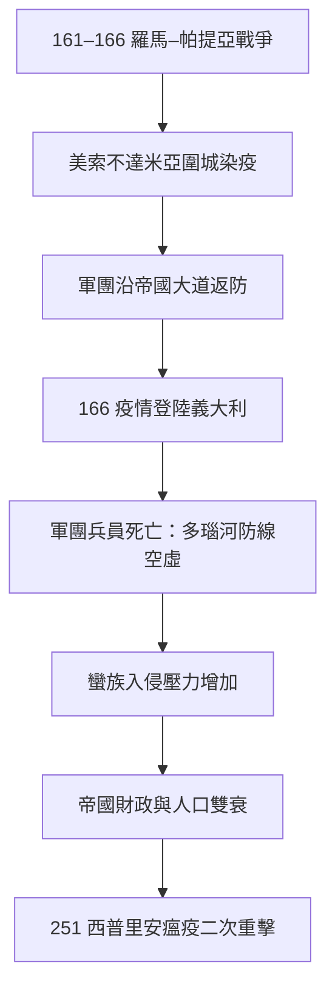

## 0165 - 安東尼瘟疫（羅馬帝國的第一次免疫重擊）

## 案件摘要

**本案兇手可能是一種會在倖存者臉上留下麻點的病毒——證據是一枚帶著痘疤的古代神像與一份軍醫的手稿。**

公元 165 年，羅馬皇帝馬可·奧里略統治時期（安東尼王朝），從東征帕提亞（今兩河流域）凱旋的軍團把一場瘟疫帶回了帝國。疫情沿著羅馬軍道蔓延，到 180 年平息時估計已殺死帝國人口的 5%–10%（數百萬人），連皇帝本人的共治者 Lucius Verus（169 年）與許多學者都死於疫中。九十年後（251 年）另一場「西普里安瘟疫」再度重擊。本案是羅馬帝國由盛轉衰的流行病學序章，也是蓋倫——古代最偉大的醫生——唯一一次親臨大流行的現場紀錄。

## 前因 -- 為什麼會有這個案子

- **帝國就是傳播網**：羅馬的道路、軍團調動、奴隸貿易與糧船航線，把地中海世界縫合成一個約 6,000 萬人的單一傳播場。這正是現代流行病學所說的**高連通性網絡**——任何新病原一旦進入，可以以空前的速度觸達每個行省。
- **戰場是病原交換站**：161–166 年羅馬—帕提亞戰爭，羅馬軍團深入美索不達米亞。Seleucia 與 Ctesiphon 圍城期間士兵染疫，回程時疫情隨軍團散布——亞美尼亞、小亞細亞、希臘、義大利、高盧、萊茵河軍區，軍道走多遠瘟疫走多遠。
- **天花假說的核心物證**：蓋倫的記載（《蓋倫論瘟疫》保存於 *Scripta Minora*）描述了發燒、咽炎、皮膚黑色或乾燥的潰瘍性皮疹、第九至十二天出疹——這個序列與天花高度吻合。史家普遍稱之為「蓋倫瘟疫」。
- **宗教史線索**：疫情之後基督教在帝國內加速擴張。史家（如 William McNeill）指出，基督徒願意照顧病患（他們的死亡率反而更低，因為獲得基本照護），這構成了實際上的隔離與支持性照護——**信仰先於醫學，提供了流行病學上有效的干預**。

## 線索與推理 -- 數學式、程式、理論

蓋倫的紀錄是本案唯一的「現場筆錄」。他描述：

- 病程第九天出疹（「第九日危象」——蓋倫用四體液論的「危象日」框架解讀）
- 皮疹乾燥、覆蓋全身、部分變黑潰爛
- 腹瀉、口咽潰瘍、高熱
- 一人發病，全家相繼倒下（家庭傳播鏈）

用現代天花流行病學參數檢驗：

| 參數 | 天花典型值 | 與本案吻合度 |
|---|---|---|
| $R_0$（無免疫力人群） | 3–6 | 可解釋快速席捲全帝國 |
| 潛伏期 | 10–14 天 | 與「第九日危象」記載接近 |
| 病後免疫 | 終身 | 可解釋疫情約 15 年後自然熄滅（易感者耗盡） |
| 死亡率（未接種人群） | 約 30% | 與估計的帝國 5–10% 人口損失相容 |

$$ \text{易感者耗盡條件：} \; S \to N \cdot \frac{1}{R_0} \Rightarrow R_0 \approx 3 \text{ 時，} \tfrac{2}{3} \text{ 人口感染後疫情熄火} $$

若帝國 6,000 萬人的 2/3 感染、死亡率 10%–15%（人口擁擠與營養不良使死亡率高於平常），總死亡即達 500 萬至 900 萬——與古代史家的推估相合。**這是 SIR 數學在古代史料上的首次回溯應用。**

反方證據也要偵訊：麻疹派主張蓋倫未明確描述天花典型的深層凹陷痘疤；伊波拉樣出血熱派則強調出血症狀。但流行病學的天平（終身免疫、皮疹、家庭鏈、熄滅模式）仍最偏向天花。有趣的是，2011 年在羅馬 Lucrezia 化石帳營遺址出土的數千具屍體曾被傳言與本案相關，DNA 檢測卻指向瘧疾（*Plasmodium falciparum*）——證明古瘟疫的病原學偵查，每一案都需要古 DNA 這個指紋鑑識科。

## 結案 -- 後果與影響

- **人口與經濟**：估計帝國人口損失 5%–10%，農村勞力短缺、稅基萎縮、銀幣貶值——安東尼盛世（Pax Romana 的頂點）就此止步。
- **軍事多米諾**：多瑙河軍團減員使馬可曼尼戰爭（166–180）曠日持久；軍隊開始大量招募日耳曼蠻族入伍——半世紀後的三世紀危機，種子在這裡已經埋下。
- **醫學史的教訓**：蓋倫雖然親臨現場並留下紀錄，他的四體液論框架卻讓他把瘟疫讀成「體液失衡」——**一流的觀察者配上錯誤的理論，得到的是一流記錄的二流解釋**。這個僵局要等到 1546 年弗拉卡斯托羅（`1546-弗拉卡斯托羅傳染論.md`）與 1876 年科赫（`1876-科赫炭疽桿菌.md`）才被打破。
- **宗教競爭的意外推手**：基督徒照護病患帶來的存活差異，成為宗教社會學家研究「危機時期信仰擴張」的教科書案例——流行病學優勢轉化為傳教優勢。
- **一句話結案**：帝國修好了路，卻沒修好路的副作用——把地中海縫成一張網的那雙手，也替病毒鋪好了高速公路。

## 關鍵人物與文獻

- **蓋倫（Galen, 129–216）**——當時最著名的醫生，疫情期間從帕加馬趕回羅馬服務皇室；其瘟疫記載保存於 *De Methodo Medendi* 與 *Scripta Minora*。
- **馬可·奧里略**——《沉思錄》的作者，後半生幾乎都在瘟疫與戰爭中度過；本人倖存，卻死於另一場疫病（180 年，維也納軍營，或為天花復發疫潮）。
- William H. McNeill, *Plagues and Peoples*（1976）——把本案放入「疾病池」理論的經典敘事。
- R. P. Duncan-Jones 對安東尼瘟疫人口衝擊的量化研究（*JRA*, 1996）。
- Kyle Harper, *The Fate of Rome*（2017）——以氣候與疾病重建羅馬衰亡史的近作，本案是其核心章節。
