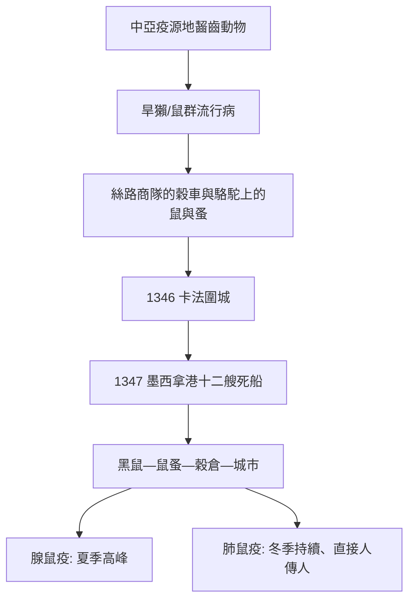

## 1347 - 黑死病（四十天隔離的發明，與歐洲三分之一人口的死亡）

## 案件摘要

**本案是史上最大的連環命案——兇手早在 1894 年就被抓獲，但牠的完整犯罪網絡要到六百多年後的 DNA 鑑識才被拼出來。**

1347 年 10 月，十二艘熱那亞商船駛入西西里的墨西拿港，船上大多是死人。此後六年（1347–1351），俗稱「黑死病」的鼠疫席捲歐洲，估計殺死 2,500 萬至 5,000 萬人——歐洲人口的 30%–60%。本案留下的最重要遺產不是死亡數字，而是一個制度發明：**威尼斯（雷佐港）在 1348 年開始對來自疫區的船隻實施 30 天（後延長為 40 天）的隔離**，義大利語 *quaranta giorni*——這就是「隔離」（quarantine）一詞的由來。人類第一次系統性地把「潛伏期」的模糊直覺，變成可執行的港口法律。

## 前因 -- 為什麼會有這個案子

- **疫源與路線**：14 世紀初，鼠疫在中亞草原疫源地活躍；氣候劇變（小冰期開始）與蒙古帝國的貿易網絡把病源帶向西。1346 年金帳汗國圍攻克里米亞的卡法（Caffa）時軍中爆發鼠疫（據義大利編年史家 de' Mussi 記載，蒙古軍把屍體拋入城內——史上最早的「生物戰」記載之一），熱那亞商人逃回地中海，把疫情帶到墨西拿、威尼斯、熱那亞，1348 年登陸馬賽、巴黎、倫敦，1349–50 年深入北歐與東歐。
- **中世紀城市的完美條件**：沒有下水道、人畜混居、穀倉藏鼠、人口密集——歐洲此時的都市化剛好達到鼠疫傳播的密度門檻。
- **病因學的黑暗時代**：中世紀醫學的主流解釋是**瘴氣論**（miasma）——腐敗的空氣引起瘟疫。這個理論雖然押錯了元兇，卻意外指向了正確的防禦工程：隔離、通風、清潔、焚燒穢物（詳見 `1546-弗拉卡斯托羅傳染論.md` 的理論史）。
- **社會詮釋的失控**：教會把瘟疫解讀為神罰；鞭笞派巡遊、猶太人被指「投毒」而遭屠殺（1348–49 年歐洲逾兩百個猶太社群被滅絕）——**當醫學無法解釋，社會就會製造替罪羊**。這是本案最黑暗的附卷。

## 線索與推理 -- 數學式、程式、理論

**症狀線索**：編年史一致記載腹股溝、腋下、頸部的腫塊（bubo）、高熱、黑斑、三至五日內死亡；部分地區出現肺鼠疫型（咳血、傳人極快）——這解釋了為什麼冬季疫情也不熄火（肺鼠疫直接人傳人，不依賴跳蚤的季節性）。

**1894 年的破案**：香港疫情中，日人北里柴三郎與法人 Alexandre Yersin 各自分離出鼠疫桿菌 *Yersinia pestis*（Yersin 的鑑定較正確）；1898 年 Paul-Louis Simond 證明跳蚤是病媒——**「鼠—蚤—人」三環鏈**確立。此後本案的犯罪手法終於清楚：



**用 SIR 框架重建本案的毀滅力：**

$$ R_0 \approx 2 \text{ 至 } 4 \; \Rightarrow \; \text{需感染人口 } 1 - \tfrac{1}{R_0} \approx 50\% \text{ 至 } 75\% \text{ 後疫情才熄火} $$

這與史料相符：疫情在燒掉歐洲一半人口前後自然停火（易感者耗盡）。此後歐洲鼠疫每隔 10–20 年復發一波，直到 17 世紀後期才神秘退場（1666 年倫敦大火後的倫敦、1720 年馬賽疫情之後）——退場機制至今仍是懸案（黑鼠被褐鼠取代？免疫遺傳選擇？檢疫制度的累積效果？）。

**隔離制度的推理邏輯**——中世紀的官員不懂病原學，但他們從經驗歸納出兩個事實：接觸病人者易死；有些接觸者經過一段時間後沒事。把「一段時間」押在 40 天，是缺乏理論下的經驗校準（鼠疫潛伏期 1–7 天，40 天綽綽有餘）：

```python
# 中世紀港口的經驗演算法（1348, Ragusa/威尼斯）
def quarantine(ship, days=40):
    if ship.from_infected_port:
        ship.anchor_offshore(days)      # 錨地待命，無人上下船
        return "40 天後無症狀 → 放行"
    return "直接放行"
# 這個「無理論的對照實驗」每年重複數千次，
# 是人類史上最大規模的流行病學經驗庫——
# 466 年後，Semmelweis 與 Snow 才把它升級成科學方法。
```

**古 DNA 的終審**：2011 年，Kirsten Bos、Johannes Krause 等團隊從倫敦 East Smithfield 黑死病亂葬崗的牙髓完成 *Y. pestis* 基因組草圖（*Nature*）；2013 年進一步證明黑死病株是現代所有鼠疫桿菌分支的祖先。歷史懸案在 664 年後正式定讞。

## 結案 -- 後果與影響

- **人口與勞動力革命**：勞力稀缺使農奴議價能力上升，封建制度鬆動；工資上漲、土地價格下跌——經濟史家視之為近代歐洲勞動市場的起點。
- **檢疫制度**：威尼斯、拉古薩（杜布羅夫尼克）、馬賽相繼建立隔離所（lazaretto）；1377 年拉古薩頒布史上最早的官方隔離令。這套制度沿用至今——2020 年 COVID-19 的港口檢疫，用的是 1348 年的語法。
- **醫學的挫敗與轉向**：大學醫學體系（蓋倫主義）束手無策，催生了兩條替代路線——市政公衛（隔離、通報、死亡登記）與經驗醫學。佛羅倫斯此後建立了歐洲最早的常設死亡登記系統，**生命統計學的遠祖**。
- **社會心理與藝術**：薄伽丘《十日談》（1353）開卷即瘟疫下的佛羅倫斯；「死亡之舞」藝術主題流行；對猶太人的屠殺加速了東歐猶太社群的遷徙重組。
- **一句話結案**：人類在不懂細菌的時代，就學會了對付細菌的社會工程——隔離的發明比病原體的發現，早了整整 546 年。

## 關鍵人物與文獻

- **薄伽丘（Giovanni Boccaccio, 1313–1375）**——《十日談》序言是疫情社會史的第一手敘事。
- **Gabriele de' Mussi**——派亞琴察的律師/編年史家，記錄卡法圍城與生物戰傳說。
- **Alexandre Yersin（1863–1943）**——1894 年香港分離鼠疫桿菌；病原體以他命名。
- **Paul-Louis Simond**——1898 年證明跳蚤病媒。
- Johannes Krause 團隊，Bos et al., "A draft genome of *Yersinia pestis* from victims of the Black Death" (*Nature*, 2011)。
- Ole J. Benedictow, *The Black Death 1346–1353: The Complete History*（2004）——死亡率估計的權威量化研究。
