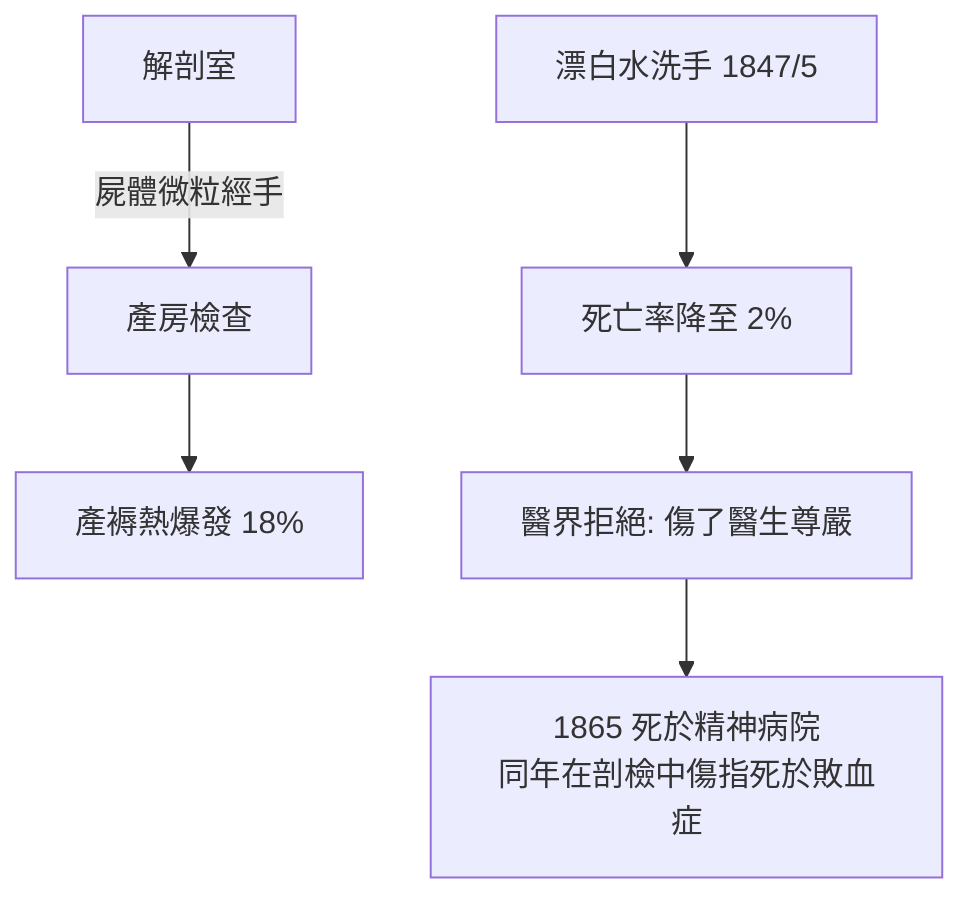

## 1847 - 塞麥爾維斯產褥熱（洗手救得了產婦，救不了偏見）

## 案件摘要

**本案的兇手一直住在醫院裡——牠就是醫生自己的手。**

1847 年，維也納總醫院第一產科的年輕助理醫師 Ignaz Semmelweis 發現一個駭人的數字對比：由醫生與醫學生接生的產科病房，產婦死於產褥熱的比例（約 10%–18%，某些月份高達 20% 以上）是助產士接生病房（約 2%–3%）的數倍。他推論：醫生們從解剖室直接走進產房，手上帶著「屍體的微粒」；他下令全科在接生前用含氯石灰水（漂白水）洗手。**一個月內死亡率從 18.3% 降到 2.2%；四個月內降到 1.3% 以下。** 但這個救命的措施換來的不是擁抱，而是排擠與解職——Semmelweis 的悲劇，是醫學史上「數據打不贏理論」的第一號判例，也是手部衛生成為現代感控基石的起點。

## 前因 -- 為什麼會有這個案子

- **維也納總醫院的雙病房結構**：第一產科由醫生與醫學生接生（免費服務換取教學解剖權），第二產科由助產士接生（不做屍體解剖）。產婦們都知道這個差別——有人跪求被分到第二產科，有人在產房門口分娩（跳過病房）以避開第一產科。
- **1847 年 3 月的觸發點**：Semmelweis 的好友 Kolletschka 教授在解剖屍體時被學生手術刀劃傷，死於敗血症，其屍檢病理與產褥熱死者幾乎相同。Semmelweis 頓悟：**「屍體的微粒」經由醫生的手傳染給產婦**——Kolletschka 是被「死人的物質」殺死的，產婦也是。
- **產褥熱的時代背景**：19 世紀初，歐洲都市化讓教學醫院急速擴張，醫院分娩取代居家分娩；諷刺的是，醫院的產褥熱死亡率反而高於在家生產——「醫院病」（hospitalism）成為當代醫學的公開醜聞。
- **沒有微生物學的時代**：巴斯德的自然發生說反駁要到 1862 年（`1862-巴斯德天鵝頸瓶.md`），Koch 法則要到 1876 年。Semmelweis 只有數據與邏輯，沒有「細菌」這個可以指名道姓的兇手。

## 線索與推理 -- 數學式、程式、理論

Semmelweis 的方法是**純粹的對照組推理**——現代流行病學的原始形態。他的關鍵數據：

| 接生者 | 屍體解剖 | 產褥熱死亡率 | 
|---|---|---|
| 第一產科：醫生/醫學生 | 大量 | 約 10%–18% |
| 第二產科：助產士 | 無 | 約 2%–3% |
| 街頭分娩（未進病房） | 無 | 反而更低 |

**排除法的偵查過程**：

```python
hypotheses = [
    "擁擠程度",        # ✗ 兩病房擁擠度相同甚至第二產科更擠
    "氣候/季節",        # ✗ 死亡率有季節差異但兩病房同步
    "患者身分/營養",    # ✗ 兩病房收容對象相同
    "姿勢（仰臥vs側臥）", # ✗ 改姿勢無效
    "牧師鐘聲的恐懼",    # ✗ 調整後無效
    "醫生的手帶屍體微粒", # ✓ 唯一與死亡率差異平行的變項
]
# 洗手干預 = 主動實驗：改掉最後一項，死亡率斷崖
```

**決定性的主動實驗**：1847 年 5 月起，全科接生前以含氯石灰水洗手（含氯石灰既除臭又能分解有機質）。死亡率：

$$ \text{第一產科死亡率：} 18.3\% \; \xrightarrow{\;1847/5\; \text{洗手}\;} \; 2.2\% \; \xrightarrow{\;1848\;} \; 1.3\% $$

這是醫學史上第一個**「干預—取消—再干預」式的自然實驗**：1848 年革命期間洗手紀律鬆弛，死亡率回升；恢復洗手又下降——因果性的證據強度，相當於現代的 interrupted time series。



他的理論用語是「腐敗動物性物質」（putrefying animal matter）——錯的分子機制、對的傳播鏈。這正是瘴氣論與病菌說之間的過渡形態：**操作正確，解釋錯位**。七年後 John Snow 用同樣的對照邏輯破了霍亂案（`1854-斯諾霍亂地圖.md`），運氣比他好——Snow 有更清晰的量測（水公司界線）與更中立的讀者。

## 結案 -- 後果與影響

- **個人的悲劇結局**：Semmelweis 被排擠出維也納（1849 年任期不續），赴布達佩斯繼續推行（1861 年出版《產褥熱的病因、概念與預防》，並廣發公開信痛斥「產婦殺手」同行），被視為瘋子；1865 年被送入精神病院，兩週後死於傷口感染——**可能正是敗血症，死於他所診斷的那種疾病的經典傳播途徑（手上的傷口接觸腐敗物）**。
- **遲來的平反**：巴斯德在 1860–70 年代確立微生物致病說後，Semmelweis 被追認為先知；今天維也納、布達佩斯有以他命名的醫科大學與廣場。**手部衛生成為全球感控第一條軍規**——WHO 的「手衛生五時刻」是他的直接後裔。
- **方法論遺產**：本案確立了「醫院自身可以是傳染源」的意識；現代院內感染控制（ICU 感控、手術無菌術、抗生素管理）的哲學起點在此。Lister 1867 年的消毒外科術、Halsted 的橡膠手套（1890）都是本案的續集。
- **制度性教訓**：本案成為「醫療品質改善為何如此困難」的教科書案例——**當干預措施隱含「醫生是傳染源」的指控時，證據的效力會被身分政治吞噬**。這個教訓在 2020 年 COVID 疫情中的「醫護防護與院內傳播」爭議中原樣重演。
- **一句話結案**：兇手是救人的手，偵探也是救人的手——而他最終死於自己破的案子。

## 關鍵人物與文獻

- **Ignaz Semmelweis（1818–1865）**——布達佩斯人，維也納總醫院第一產科助理醫師；主要著作《產褥熱的病因、概念與預防》（1861）。
- **Kolletschka 教授**——死於解剖刀傷感染的好友，本案的關鍵「自然對照組」。
- **Carl Mayrhofer**——1860 年代在產房分離出「腐敗性弧菌」（實為鏈球菌樣菌），為 Semmelweis 理論補上微生物學證據。
- Sherwin B. Nuland, *The Doctors' Plague*（2003）。
- István Benedek 的傳記 *Ignác Semmelweis*；C. Semmelweis 的 1861 年原著（K. Codell Carter 英譯，1983）。
