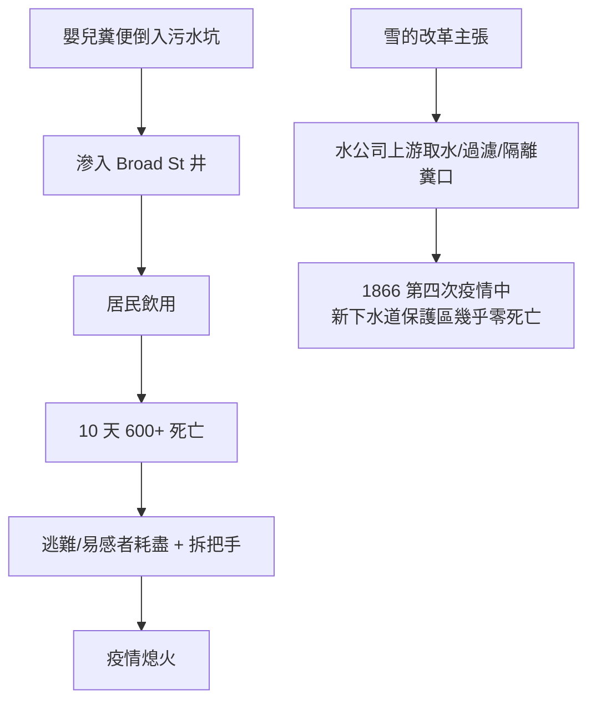

## 1854 - 斯諾霍亂地圖（現代流行病學的出生證明）

## 案件摘要

**本案的偵查者沒有顯微鏡、沒有細菌學、沒有任何化學證據——他只有一張地圖、一份水費單名冊和一個死點。**

1854 年夏末，倫敦 Soho 區爆發霍亂，十天內在半徑 250 公尺的街區裡死了 600 多人，逃難的居民把街區變成空城。麻醉科醫師 John Snow 走訪街頭，把每個死者的住址畫在同一張地圖上——所有的死亡點圍繞著同一口井：**Broad Street（寬街）水泵**。他說服教區當局拆掉水泵把手，疫情隨即衰退。這是流行病學史上被引用最多的一張圖：**在病原體被看見的 29 年前，在沒有「細菌」概念的情況下，用空間統計鎖定了水傳播鏈**。本案同時是瘴氣論（miasma）被數據擊穿的第一案。

## 前因 -- 為什麼會有這個案子

- **19 世紀的霍亂恐懼**：1817 年起霍亂從孟加拉三次全球擴散（第一次至第六次大流行），1831–32 年首次殺進英國（死亡逾 3 萬人）、1848–49 年第二次（倫敦 1.4 萬人）。患者在 24 小時內從發病到脫水死亡，「藍色的屍體」成為都市噩夢。
- **瘴氣論的官方地位**：Edwin Chadwick 的《勞動階級衛生狀況報告》（1842）與總局醫官 John Simon 的體系都以「腐敗空氣」為病因論——他們推動下水道工程（動機是除臭），卻把街道污水直接排入泰晤士河，**反而把霍亂的傳播途徑修得更通暢**。1858 年「大惡臭」逼使議會重修下水道，又是一場動機錯誤、效果正確的工程。
- **Snow 的個人軌跡**：他早在 1848–49 年疫情時就發表論文指出霍亂經水傳播、病變在腸道而非肺部（與瘴氣論預期不符）；1853 年他注意到倫敦兩家自來水公司——Southwark and Vauxhall（取下游污水水）與 Lambeth（改取上游淨水）——供應區交錯混雜，是天然的對照實驗場。1854 年他正在等下一次疫情來驗證。
- **Broad Street 的地緣線索**：Soho 區是貧民與移民的擁擠街區，沒有自來水管線，公共泵井是日常水源；疫情爆發前數日，寬街 40 號一名嬰兒的糞便（霍亂弧菌的源頭）被傾倒在泵井旁的污水坑，污水坑滲入井水。

## 線索與推理 -- 數學式、程式、理論

**第一重證據：空間聚集。** Snow 的點地圖（dot map）顯示死亡幾乎全集中在水泵周邊；更有說服力的是反例——**離泵井遠卻仍有人死的地方，死者多是「喝過寬街水」的人**：Broad Street 酒吧的調酒師（客戶死光、他自己沒死，因為他喝啤酒不喝水）、一家彈藥廠的工人（自己有私人井，幾乎無人死亡）、而泵井旁的濟貧院（500 人）僅 5 人死亡——因為院內有自己的井。

```python
# Snow 的偵查邏輯：以「是否喝過該井水」重新分組，而非以「住址」
def attack_rate(group):
    return group.deaths / group.population

print(attack_rate(drank_broad_st_water))   # 高
print(attack_rate(did_not_but_lived_near)) # 低 ← 空間近不等於接觸
# 這是病例定義從「地理」升級為「暴露」的關鍵一步——
# 現代病例對照研究的核心動作
```

**第二重證據：兩家水公司的天然對照實驗。** Snow 挨戶查訪 Southwark 區數千戶死者家庭，確認其水公司：

| 水公司 | 水源 | 每萬戶霍亂死亡 |
|---|---|---|
| Southwark & Vauxhall | 下游（污水混合） | 315 |
| Lambeth | 上游（清潔） | 37 |

$$ \text{暴露組死亡率} \; / \; \text{對照組死亡率} = 315/37 \approx 8.5 \; (\text{相對風險}) $$

——兩區住戶社經狀況幾乎相同、混居交錯，唯一系統性差異是水。**這是史上第一個大規模病例對照/佇列式調查，並給出了現代意義上的相對風險。** Snow 的 1855 年專著《論霍亂的傳播模式》（*On the Mode of Communication of Cholera*, 2nd ed.）收錄了全部數據。

**第三重證據：拆除把手。** 9 月 7 日 Snow 说服教區總務委員會拆除水泵把手（工程上只是鎖住即可）。疫情數日內衰退——雖然事後分析顯示疫情本已越過峰值，但這個行動的政治符號意義無可取代：**流行病學調查第一次直接轉化為公共衛生行動。**

Snow 的病因論模型：霍亂是一種「毒卵」（morbid poison）經口進入、在腸道增殖、隨糞便排出再污染水源的自我放大環——這已經是完整的糞口傳播鏈模型，只差一個顯微鏡下的兇手照（1883 年 Koch 在埃及與印度分離霍亂弧菌 *Vibrio cholerae*，最後一塊拼圖到位）。



## 結案 -- 後果與影響

- **當時的結局並不輝煌**：瘴氣論當權派（Simon 後來承認錯誤、Chadwick 始終不服）承認「寬街井有問題」，卻不承認水傳播理論；Snow 1858 年死於中風，54 歲，來不及看到自己被平反。
- **技術上的直接遺產**：1866 年第四次霍亂疫情中，倫敦東區雖仍死 5,000 餘人，但 Snow 的追隨者 William Farr 與 John Simon 以 Snow 的方法確認是 East London Water Company 違規取水所致——**方法被採用了，即使名字沒被提起**。此後「上游取水 + 砂濾」成為英國水務的標準，霍亂在英國基本絕跡。
- **流行病學的奠基**：本案確立了現代流行病學的三件套——**病例定義、暴露分組、比較死亡率**；Snow 被尊為「流行病學之父」。今天的疫調（contact tracing、case-control、GIS 疫情地圖）全是本案的方法學後代——2020 年 COVID 的疫區地圖，語法與 1854 年一模一樣。
- **數據視覺化的典範**：與 Florence Nightingale 的極區圖（1858）、John Graunt 的死亡表一脈相承，證明**統計圖表本身就是武器**。
- **一句話結案**：他不是找到兇手的人，他是第一個畫出兇手作案路線圖的人——而那張圖教會了所有後來的偵探怎麼畫圖。

## 關鍵人物與文獻

- **John Snow（1813–1858）**——約克郡人，倫敦麻醉科醫師（氯仿麻醉先驅，曾為維多利亞女王接生時施麻醉）；《論霍亂的傳播模式》1855 年第二版是本案的判例集。
- **William Farr**——總註冊署統計官，生命統計學之父；前期屬瘴氣派，後被數據說服。
- **John Simon**——總局醫官，1866 年正式採用 Snow 的結論。
- **Henry Whitehead**——聖路加教堂助理牧師，起初懷疑 Snow，後以更細的調查找到「零號源頭」（40 號嬰兒），成為本案的最佳合作者。
- Sandra Hempel, *The Strange Case of the Broad Street Pump*（2007）；Steven Johnson, *The Ghost Map*（2006）；Snow 原著數位化：johnsnow.matrix.msu.edu。
